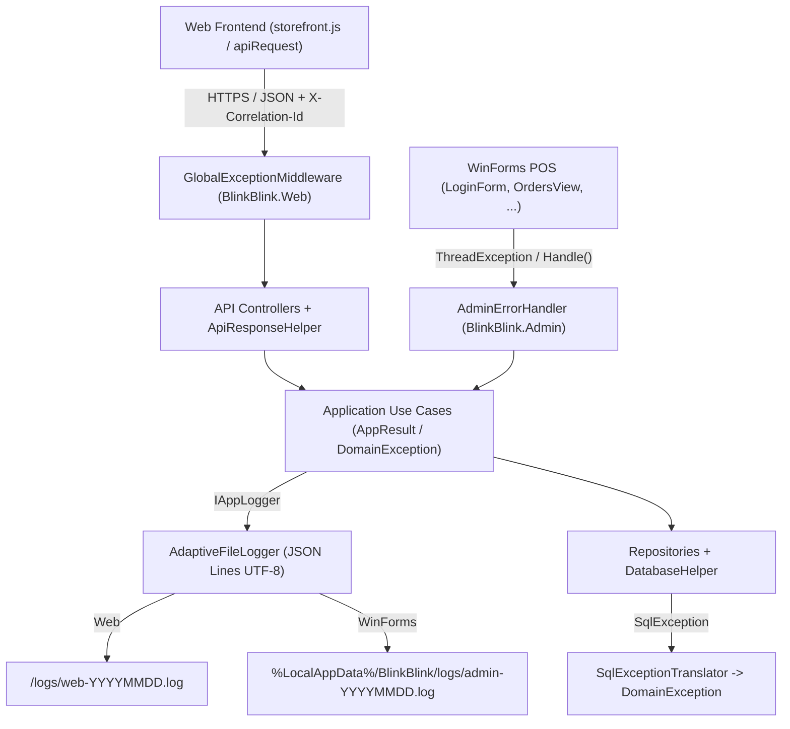

# THIẾT KẾ THÍCH ỨNG LOG & ERROR — BLINK BLINK JEWELRY

Tài liệu này đặc tả toàn bộ kiến trúc xử lý lỗi và ghi nhật ký thích ứng đã được triển khai cho solution `BlinkBlinkJewelry.slnx` (.NET 8 LTS), bao gồm hệ thống mã lỗi chuẩn hóa, bảng ánh xạ ngoại lệ, cấu trúc bản tin JSON và cấu trúc tệp nhật ký.

---

## 1. Kiến trúc Tổng thể (Clean Architecture Adaptive Log & Error)

Thiết kế tuân thủ nguyên tắc tách biệt phụ thuộc của **Clean Architecture**: tầng lõi (`Domain`, `Application`) chỉ phát sinh mã lỗi và gọi cổng trừu tượng `IAppLogger`, hoàn toàn không phụ thuộc vào ASP.NET Core hay Windows Forms. Việc hiển thị lỗi và nơi ghi nhật ký tự động thích ứng ở hai đầu `BlinkBlink.Web` và `BlinkBlink.Admin`.



### Danh sách các thành phần đã triển khai

| Tầng | Tệp mã nguồn | Vai trò chính |
| :--- | :--- | :--- |
| **Domain** | `src/BlinkBlink.Domain/Exceptions/ErrorCodes.cs` | Tập hằng số mã lỗi chuẩn hóa dùng chung toàn hệ thống |
| **Domain** | `src/BlinkBlink.Domain/Exceptions/DomainException.cs` | Cây ngoại lệ nghiệp vụ và ngoại lệ truy xuất dữ liệu (`DataAccessException`) |
| **Application** | `src/BlinkBlink.Application/Common/AppResult.cs` | Lớp `AppResult` và `AppResult<T>` trả về kết quả kèm `ErrorCode` và `Message` |
| **Application** | `src/BlinkBlink.Application/Common/Logging/IAppLogger.cs` | Giao diện `IAppLogger`, `AppLogLevel`, `AppLogContext`, `NullAppLogger` |
| **Infrastructure** | `src/BlinkBlink.Infrastructure/Logging/AdaptiveFileLogger.cs` | Ghi log xoay vòng theo ngày định dạng JSON Lines UTF-8, che mật khẩu chuỗi kết nối |
| **Infrastructure** | `src/BlinkBlink.Infrastructure/Data/SqlExceptionTranslator.cs` | Chuyển đổi `SqlException.Number` sang `DomainException` chuẩn hóa |
| **Infrastructure** | `src/BlinkBlink.Infrastructure/Data/DatabaseHelper.cs` | Thay thế khối `catch` rỗng bằng nhật ký chẩn đoán qua `IAppLogger` |
| **Web** | `src/BlinkBlink.Web/Middleware/GlobalExceptionMiddleware.cs` | Bắt ngoại lệ toàn cục, gắn `X-Correlation-Id`, phân nhánh API JSON / MVC View |
| **Web** | `src/BlinkBlink.Web/Controllers/ApiResponseHelper.cs` | Chuẩn hóa phản hồi lỗi `{ Success, Code, Message, TraceId }` cho Controller |
| **Web Client** | `src/BlinkBlink.Web/wwwroot/js/storefront.js` | Hàm `apiRequest()` tự động bắt `403`, log `TraceId` và thông báo thân thiện |
| **WinForms** | `src/BlinkBlink.Admin/Services/AdminErrorHandler.cs` | Đăng ký `ThreadException`/`UnhandledException` và hiển thị hộp thoại thích ứng |
| **WinForms** | `src/BlinkBlink.Admin/Services/AdminServiceScope.cs` | Khởi tạo `AdaptiveFileLogger`, ghi log quá trình dò SQL và fallback `InMemory` |

---

## 2. Ma trận Thích ứng Theo Ngữ cảnh

Hệ thống tự động điều chỉnh hành vi ghi nhật ký và phản hồi lỗi theo 3 chiều:

| Trục thích ứng | Chế độ A | Chế độ B |
| :--- | :--- | :--- |
| **Môi trường (`EnvironmentName`)** | **`Development`**: Ghi từ mức `Debug` trở lên; luôn đính kèm `stackTrace` trong file log; API JSON có thêm trường `detail`; WinForms hiển thị thêm `[Chẩn đoán Dev]` với lỗi `Error`/`Critical`. | **`Production`**: Ghi từ mức `Information` trở lên (bỏ qua `Debug`); chỉ đính kèm `stackTrace` khi lỗi `>= Error`; **ẩn toàn bộ chi tiết kỹ thuật** khỏi phản hồi API/WinForms, chỉ trả thông điệp an toàn kèm `TraceId`. |
| **Kênh chạy (`Channel`)** | **`Web`**: Phản hồi JSON chuẩn cho `/api/*` hoặc chuyển hướng `/Home/Error?traceId=...` cho MVC View; đính kèm header `X-Correlation-Id`. | **`WinForms`**: Bắt lỗi toàn cục trên UI Thread và Background Task giúp không sập phiên thu ngân POS; lỗi nghiệp vụ hiện `Warning`, lỗi hệ thống hiện `Error` kèm `Mã tra cứu` 8 ký tự. |
| **Chế độ dữ liệu (`DataMode`)** | **`SqlServer`**: Ghi nhận và ánh xạ mã lỗi `SqlException` qua `SqlExceptionTranslator`. | **`InMemory` / `SqlServerUnavailable`**: Ghi log mức `Warning` tại `AdminServiceScope` hoặc `Error` tại `WebStartup`, gắn nhãn `dataMode` tương ứng trong mọi bản ghi log. |

---

## 3. Bảng Danh mục Mã lỗi Chuẩn hóa (`ErrorCodes`)

Toàn bộ mã lỗi được định nghĩa tập trung trong `BlinkBlink.Domain.Exceptions.ErrorCodes`.

### 3.1. Nhóm lỗi Dữ liệu đầu vào & Xác thực (`VAL_*`, `AUTH_*`)

| Mã lỗi (`ErrorCode`) | Lớp Exception tương ứng | HTTP Status | Mức Log | Hộp thoại WinForms | Ý nghĩa & Nguyên nhân |
| :--- | :--- | :---: | :---: | :---: | :--- |
| `VAL_INVALID_INPUT` | `ValidationDomainException` / `ArgumentException` | `400 Bad Request` | `Warning` | `Warning` | Thiếu tham số bắt buộc, payload rỗng hoặc mã định danh không hợp lệ |
| `VAL_INVALID_PRICE` | `ValidationDomainException` | `400 Bad Request` | `Warning` | `Warning` | Giá bán, giá nhập hoặc số lượng không hợp lệ (`<= 0`) |
| `AUTH_INVALID_CREDENTIALS` | `UnauthorizedDomainException` | `401 Unauthorized` | `Warning` | `Warning` | Sai tên đăng nhập, sai mật khẩu hoặc tài khoản không hợp lệ |
| `AUTH_ACCOUNT_LOCKED` | `ForbiddenDomainException` | `403 Forbidden` | `Warning` | `Stop` | Tài khoản khách hàng/nhân viên bị khóa (`TrangThai == false`) hoặc không đủ quyền |

### 3.2. Nhóm lỗi Quy tắc Nghiệp vụ (`BUS_*`)

| Mã lỗi (`ErrorCode`) | Lớp Exception tương ứng | HTTP Status | Mức Log | Hộp thoại WinForms | Ý nghĩa & Nguyên nhân |
| :--- | :--- | :---: | :---: | :---: | :--- |
| `BUS_CART_EMPTY` | `BusinessRuleException` | `400 Bad Request` | `Warning` | `Warning` | Khách thực hiện đặt hàng khi giỏ hàng không có sản phẩm |
| `BUS_OUT_OF_STOCK` | `BusinessRuleException` | `400 Bad Request` | `Warning` | `Warning` | Sản phẩm đã bán, ngừng kinh doanh hoặc không đủ số lượng tồn |
| `BUS_INVALID_STATE_TRANSITION` | `BusinessRuleException` | `400 Bad Request` | `Warning` | `Warning` | Chuyển trạng thái đơn hàng, phiếu bảo hành hoặc hủy đơn không hợp lệ |
| `BUS_NEGATIVE_STOCK_NOT_ALLOWED` | `BusinessRuleException` | `400 Bad Request` | `Warning` | `Warning` | Hủy phiếu nhập kho khiến tồn kho sản phẩm bị âm (`< 0`) |
| `BUS_FOREIGN_KEY_CONSTRAINT` | `BusinessRuleException` | `400 Bad Request` | `Warning` | `Warning` | Bản ghi đang liên kết khóa ngoại với chứng từ/hóa đơn khác, không thể xóa |

### 3.3. Nhóm lỗi Không tìm thấy & Xung đột (`NOT_FOUND_*`, `CONF_*`)

| Mã lỗi (`ErrorCode`) | Lớp Exception tương ứng | HTTP Status | Mức Log | Hộp thoại WinForms | Ý nghĩa & Nguyên nhân |
| :--- | :--- | :---: | :---: | :---: | :--- |
| `NOT_FOUND_RESOURCE` | `NotFoundDomainException` | `404 Not Found` | `Warning` | `Warning` | Không tìm thấy tài nguyên yêu cầu (mặc định) |
| `NOT_FOUND_PRODUCT` | `NotFoundDomainException` | `404 Not Found` | `Warning` | `Warning` | Không tìm thấy mã sản phẩm trang sức trong hệ thống |
| `NOT_FOUND_CUSTOMER` | `NotFoundDomainException` | `404 Not Found` | `Warning` | `Warning` | Không tìm thấy hồ sơ khách hàng |
| `NOT_FOUND_ORDER` | `NotFoundDomainException` | `404 Not Found` | `Warning` | `Warning` | Không tìm thấy hóa đơn / đơn đặt hàng |
| `NOT_FOUND_WARRANTY` | `NotFoundDomainException` | `404 Not Found` | `Warning` | `Warning` | Không tìm thấy số phiếu bảo hành |
| `CONF_DUPLICATE_KEY` | `ConflictDomainException` | `409 Conflict` | `Warning` | `Warning` | Trùng khóa chính hoặc mã định danh duy nhất |
| `CONF_DUPLICATE_USERNAME` | `ConflictDomainException` | `409 Conflict` | `Warning` | `Warning` | Tên đăng nhập đã tồn tại khi đăng ký tài khoản mới |

### 3.4. Nhóm lỗi Cơ sở dữ liệu & Hệ thống (`DB_*`, `SYS_*`)

| Mã lỗi (`ErrorCode`) | Lớp Exception tương ứng | HTTP Status | Mức Log | Hộp thoại WinForms | Ý nghĩa & Nguyên nhân |
| :--- | :--- | :---: | :---: | :---: | :--- |
| `DB_UNAVAILABLE` | `DataAccessException` (`IsConnectionFailure = true`) | `503 Service Unavailable` | `Error` | `Error` | Không kết nối được SQL Server hoặc dịch vụ SQL chưa chạy |
| `DB_TIMEOUT` | `DataAccessException` (`IsTransient = true`) | `503 Service Unavailable` | `Error` | `Error` | Truy vấn CSDL vượt quá thời gian chờ (`CommandTimeout` / `Connect Timeout`) |
| `DB_DEADLOCK` | `DataAccessException` (`IsTransient = true`) | `503 Service Unavailable` | `Error` | `Error` | Xung đột khóa giao dịch đồng thời trên SQL Server |
| `DB_QUERY_ERROR` | `DataAccessException` | `500 Internal Server Error` | `Error` | `Error` | Lỗi cú pháp/ràng buộc SQL chưa thuộc nhóm chuyên biệt |
| `SYS_UNHANDLED_ERROR` | `Exception` bất kỳ | `500 Internal Server Error` | `Critical` / `Error` | `Error` | Lỗi hệ thống không lường trước (`NullReferenceException`, lỗi I/O, ...) |

---

## 4. Bảng Ánh xạ Lỗi SQL Server (`SqlExceptionTranslator`)

Khi phát sinh `Microsoft.Data.SqlClient.SqlException`, lớp `SqlExceptionTranslator` tự động chuyển đổi theo `SqlException.Number`:

| `SqlException.Number` | Điều kiện phụ | Exception đầu ra | Mã lỗi (`ErrorCode`) | Ghi chú |
| :---: | :--- | :--- | :--- | :--- |
| `2601`, `2627` | `Message` chứa `TenDangNhap` | `ConflictDomainException` | `CONF_DUPLICATE_USERNAME` | Trùng tên đăng nhập |
| `2601`, `2627` | Các trường hợp khác | `ConflictDomainException` | `CONF_DUPLICATE_KEY` | Trùng khóa chính / chỉ mục duy nhất |
| `547` | — | `BusinessRuleException` | `BUS_FOREIGN_KEY_CONSTRAINT` | Vi phạm toàn vẹn tham chiếu khóa ngoại |
| `-2` | — | `DataAccessException` | `DB_TIMEOUT` | `IsTransient = true` |
| `2`, `53`, `4060`, `18456`, `40613`, `10060`, `10061` | — | `DataAccessException` | `DB_UNAVAILABLE` | `IsConnectionFailure = true`, `IsTransient = true` |
| `1205` | — | `DataAccessException` | `DB_DEADLOCK` | `IsTransient = true` |
| Khác | — | `DataAccessException` | `DB_QUERY_ERROR` | Ẩn câu T-SQL khỏi người dùng cuối |

---

## 5. Cấu trúc Bản tin Lỗi & Tệp Nhật ký

### 5.1. Phản hồi JSON Lỗi từ RESTful API (`BlinkBlink.Web`)

Mọi phản hồi lỗi qua API đều đính kèm header `X-Correlation-Id` và tuân thủ cấu trúc JSON thống nhất:

**Ở môi trường Production:**
```json
{
  "success": false,
  "code": "DB_UNAVAILABLE",
  "message": "Không thể kết nối tới máy chủ cơ sở dữ liệu SQL Server.",
  "traceId": "0HN7Q1K2J3L4M:00000001"
}
```

**Ở môi trường Development (bổ sung trường `detail` khi đi qua `GlobalExceptionMiddleware`):**
```json
{
  "success": false,
  "code": "SYS_UNHANDLED_ERROR",
  "message": "Hệ thống đang gặp sự cố tạm thời. Vui lòng thử lại sau hoặc cung cấp mã tra cứu cho bộ phận hỗ trợ.",
  "traceId": "0HN7Q1K2J3L4M:00000002",
  "detail": "Object reference not set to an instance of an object."
}
```

- Với các route MVC trả HTML (không phải `/api/*` và không có `Accept: application/json`), `GlobalExceptionMiddleware` điều hướng về `/Home/Error?traceId=...` để hiển thị `ErrorViewModel.RequestId`.
- Phía trình duyệt (`storefront.js`), hàm `apiRequest(url, options)` tự động bắt mã `403` / `AUTH_ACCOUNT_LOCKED` để đăng xuất an toàn sau `1200ms`, đồng thời ghi `TraceId` ra Console và hiển thị `Mã tra cứu` khi gặp lỗi `5xx`.

### 5.2. Định dạng Tệp Nhật ký (`AdaptiveFileLogger`)

- **Đường dẫn lưu trữ thích ứng:**
  - **Web (`BlinkBlink.Web`):** `<ContentRoot>/logs/web-YYYYMMDD.log`
  - **WinForms (`BlinkBlink.Admin`):** `%LocalAppData%\BlinkBlink\logs\admin-YYYYMMDD.log`
  - **Dự phòng tự động (khi thiếu quyền ghi thư mục ưu tiên):** `%LocalAppData%\BlinkBlink\logs\` → `<BaseDirectory>\logs\` → `%TEMP%\BlinkBlink\logs\`.
- **Định dạng mỗi dòng (JSON Lines UTF-8 không BOM, giữ nguyên tiếng Việt có dấu):**

```json
{"timestamp":"2026-11-12T22:15:10.123+07:00","level":"WARNING","channel":"WinForms","environment":"Development","dataMode":"InMemory","correlationId":"A1B2C3D4","userId":"USER_ADMIN01","userRole":"ADMIN","errorCode":"BUS_OUT_OF_STOCK","source":"OrdersView.DuyetDonHang(HD001)","message":"Sản phẩm SP001 hiện không đủ tồn kho","exceptionType":"BlinkBlink.Domain.Exceptions.BusinessRuleException","exceptionMessage":"Sản phẩm SP001 hiện không đủ tồn kho","stackTrace":"...","metadata":{"isTerminating":false}}
```

- **Quy tắc bảo mật dữ liệu trong log:**
  - `AdaptiveFileLogger.MaskConnectionString()` tự động thay thế `Password=...` / `Pwd=...` thành `Password=***` trước khi ghi log khởi động CSDL.
  - Không ghi mật khẩu người dùng vào thông điệp log ở `XacThucController` và `LoginForm`.

---

## 6. Cách Sử dụng & Mở rộng cho Nhóm Phát triển

1. **Khi thêm Use Case mới trong `BlinkBlink.Application`:**
   - Trả về `AppResult` hoặc `AppResult<T>` kèm mã lỗi từ `ErrorCodes` (hoặc ném `BusinessRuleException`, `NotFoundDomainException`, `ValidationDomainException`).
2. **Khi thêm Controller mới trong `BlinkBlink.Web`:**
   - Không cần bọc `try/catch` tràn lan cho lỗi `500` hoặc `SqlException` vì `GlobalExceptionMiddleware` đã xử lý tập trung.
   - Với lỗi kiểm tra đầu vào/trạng thái rõ ràng trong action, dùng `ApiResponseHelper.Fail(this, statusCode, ErrorCodes.Xxx, message, _logger)`.
3. **Khi thêm màn hình `UserControl` mới trong `BlinkBlink.Admin`:**
   - Mọi lỗi không bắt trong UI sẽ tự đi qua `AdminErrorHandler.RegisterGlobalHandlers()`.
   - Với các khối `try/catch` chủ động tại nút bấm, gọi `AdminErrorHandler.Handle(ex, $"{nameof(MyView)}.TenTacVu")` thay vì `MessageBox.Show(ex.Message)` trực tiếp.
4. **Cách tra cứu sự cố khi người dùng báo lỗi:**
   - Lấy `traceId` / `Mã tra cứu` trên màn hình khách hàng (Web Toast/Console) hoặc hộp thoại WinForms, sau đó tìm kiếm chuỗi đó trong tệp `web-YYYYMMDD.log` hoặc `admin-YYYYMMDD.log` để xem đúng người dùng, chế độ dữ liệu, mã lỗi và stack trace tương ứng.

