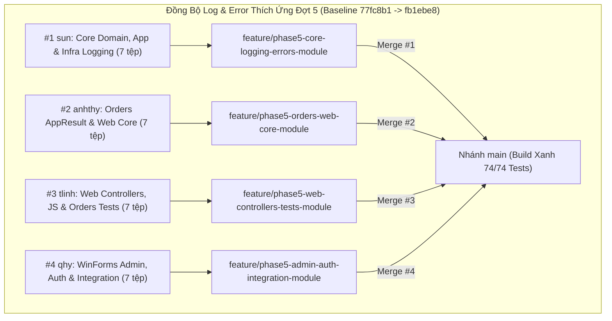
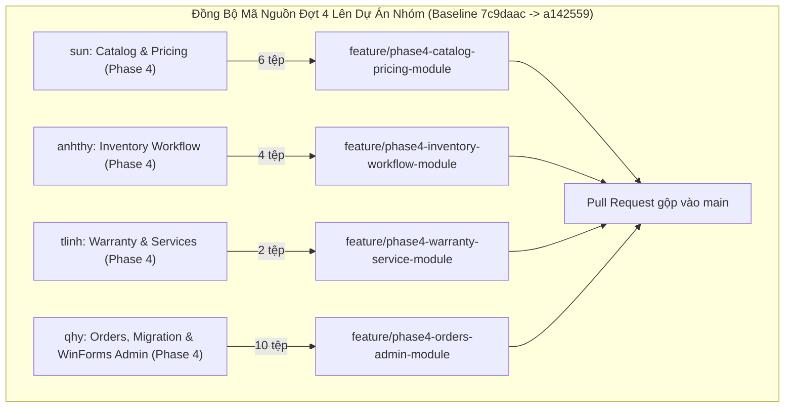

# KẾ HOẠCH COMMIT MÃ NGUỒN DỰ ÁN BLINK BLINK JEWELRY
**Dành cho nhóm 4 thành viên:** `qhy`, `sun`, `anhthy`, `tlinh`  
**Phạm vi các thư mục hệ thống Đợt 5:**  
- `src/BlinkBlink.Domain` (Clean Architecture - Domain Layer)
- `src/BlinkBlink.Application` (Clean Architecture - Application Layer)
- `src/BlinkBlink.Infrastructure` (Clean Architecture - Infrastructure Layer)
- `src/BlinkBlink.Web` (ASP.NET Core RESTful API & Giao diện Web Khách hàng)
- `src/BlinkBlink.Admin` (WinForms Desktop Admin / POS UI - phân công chuyên biệt cho `qhy`)
- `tests/` (`BlinkBlink.UnitTests` & `BlinkBlink.IntegrationTests`)

---
## LƯU Ý TIẾN ĐỘ THỰC HIỆN:
## Khi thực hiện xong lần 5 hãy đánh dấu thay đổi chữ [chưa thực hiện] thành [đã hoàn thành] khi mà mọi thành viên đều đã thực hiện xong. Nhớ là khi thành viên nhóm thực hiện xong và AI agent đã chỉnh sửa nội dung file theo hướng dẫn hãy up file này lên github.
## Chỉ thực hiện việc commit và sửa thông tin thành viên hoàn thành theo hướng dẫn, không cần tự tạo ra schedule cho lần tiếp theo, việc này sẽ do nhóm trưởng làm khi mọi thành viên thực hiện xong.

## Lần 1 [đã hoàn thành]: dùng git checkout 7993495 commit này cho lần thực thi này.
## thành viên đã thực hiện:
- qhy
- anhthy
- sun
- tlinh

## Lần 2 [đã hoàn thành]: dùng git checkout 4ea7311 commit này cho lần thực thi này.
## thành viên đã thực hiện:
- qhy
- sun
- tlinh
- anhthy

## Lần 3 [đã hoàn thành]: dùng git checkout 7c9daac commit này cho lần thực thi này.
## thành viên đã thực hiện:
- qhy
- sun
- anhthy
- tlinh

## Lần 4 [đã hoàn thành]: dùng git checkout a142559 commit này cho lần thực thi này.
## thành viên đã thực hiện:
- qhy
- anhthy
- tlinh
- sun

## thành viên chưa thực hiện:

## Lần 5 [chưa thực hiện]: dùng git checkout fb1ebe8 commit này cho lần thực thi này.
## thành viên đã thực hiện:

## thành viên chưa thực hiện:
- qhy
- anhthy
- tlinh
- sun

---

# ========================================================
# PHẦN A: KẾ HOẠCH COMMIT ĐỢT 5 (PHASE 5 - HIỆN TẠI ĐANG THỰC HIỆN)
# ========================================================

## 1. MỐC ĐỒNG BỘ CƠ SỞ ĐỢT 5 (PHASE 5 BASELINE SNAPSHOT)

> [!IMPORTANT]
> **MỐC CHỐT ĐỒNG BỘ ĐỢT 5 (PHASE 5 TARGET)**
> - **Mã Commit Baseline Bắt đầu:** `77fc8b1` *(Mốc kết thúc tài liệu Đợt 4, mã nguồn chốt tại `a142559`)*
> - **Mã Commit Baseline Đích (Personal HEAD):** `fb1ebe8`
> - **Thời điểm lập lịch:** Ngày **12/11/2026**
> - **Mục đích:** Triển khai đồng bộ kiến trúc **Log & Error thích ứng** trên toàn bộ hệ thống (`Domain`, `Application`, `Infrastructure`, `Web`, `Admin`) và bộ kiểm thử (`UnitTests`, `IntegrationTests`), bao gồm: chuẩn hóa mã lỗi `ErrorCodes` & phân cấp `DomainException`, mẫu kết quả nghiệp vụ `AppResult`, giao diện nhật ký `IAppLogger` & bộ ghi tệp thích ứng `AdaptiveFileLogger`, bộ phiên dịch lỗi SQL `SqlExceptionTranslator`, đồng nhất vỏ bọc phản hồi API + `GlobalExceptionMiddleware` cho Web (`ApiResponseHelper`, `storefront.js`), cơ chế xử lý lỗi tập trung cho WinForms (`AdminErrorHandler`, `AdminServiceScope`) và bộ kiểm thử tự động 74/74 bài test.

> [!NOTE]
> **Ghi chú về tệp tài liệu tại thư mục gốc:** Các tệp đặc tả `loganderror.md`, `temp.md` và `TODO.md` là tài liệu thiết kế và theo dõi tiến độ trên kho Personal, do trưởng nhóm quản lý đồng bộ riêng, không đưa vào bảng phân công mã nguồn của 4 thành viên.

### Cơ Chế Lọc Tệp Đợt 5:
Toàn bộ **28 tệp mã nguồn** sạch sẽ dưới đây được rà soát từ thay đổi thực tế trên 5 thư mục `src/` và thư mục `tests/`:
- **Đã loại trừ tuyệt đối:** `bin/`, `obj/`, `.vs/`, `logs/`, `*.log`, `*.user`.
- **Phạm vi mở rộng Đợt 5:** Lần đầu tiên đồng bộ song song cả `src/BlinkBlink.Web` (API + `storefront.js`) và `tests/` cùng với 4 thư mục cốt lõi trước đó (`Domain`, `Application`, `Infrastructure`, `Admin`).

---

## 2. NGUYÊN TẮC VÀNG KHI COMMIT ĐỢT 5 & THỨ TỰ MERGE PR

> [!WARNING]
> **TUYỆT ĐỐI KHÔNG COMMIT BUILD ARTIFACTS / TỆP NHẬT KÝ TẠM**
> - **CẤM** commit các thư mục: `bin/`, `obj/`, `.vs/`, `.vscode/`, `TestResults/`, `logs/`.
> - **CẤM** commit các tệp cấu hình cá nhân hoặc tệp nhật ký sinh lúc chạy: `*.user`, `*.suo`, `*.log`, `*.cache`.
> - **CHỈ COMMIT** chính xác các tệp mã nguồn được phân công (`.cs`, `.js`), bảo đảm chuẩn mã hóa `UTF-8` để giữ nguyên thông báo tiếng Việt có dấu.
> - **Tránh tuyệt đối** việc gõ lệnh `git add .` hoặc `git add -A` một cách cẩu thả.

### Thứ Tự Merge Pull Request Khuyến Nghị (Bắt Buộc Để Giữ Build Xanh)
Do tầng trên phụ thuộc vào hợp đồng lỗi và `DatabaseHelper` ở tầng dưới, các thành viên vẫn có thể tạo nhánh và đẩy code song song từ mốc `<CHO_COMMIT_MOC_5>`, nhưng khi **Merge PR vào `main`** phải tuân thủ đúng thứ tự:
1. **Merge #1 — `sun`:** Đưa `ErrorCodes`, `DomainException`, `AppResult`, `IAppLogger`, `AdaptiveFileLogger`, `SqlExceptionTranslator`, `DatabaseHelper` lên `main`.
2. **Merge #2 — `anhthy`:** Đưa `DatHangUseCase`, `GlobalExceptionMiddleware`, `ApiResponseHelper`, `Web/Program.cs`, `BanHangController`, `GioHangController` và `AdaptiveLogAndErrorTests` lên `main`.
3. **Merge #3 — `tlinh`:** Đưa 5 Web Controllers còn lại, `storefront.js` và `DatHangUseCaseTests` lên `main`.
4. **Merge #4 — `qhy`:** Đưa `XacThucController`, 5 tệp WinForms `BlinkBlink.Admin` và `AdaptiveLoggingTests` lên `main`.

### Quy ước nhánh & Quy trình hoàn tất Đợt 5
Mỗi thành viên làm việc trên đúng **1 nhánh tính năng Đợt 5 duy nhất** (`feature/phase5-<tên_phân_hệ>-module`):
1. Kéo code mới nhất từ `main` trên kho Team:
   ```bash
   git checkout main
   git pull origin main
   ```
2. Tạo và chuyển sang nhánh làm việc Đợt 5:
   ```bash
   git checkout -b feature/phase5-<tên_phân_hệ>-module
   ```
3. Sao chép đúng **7 tệp** được phân công từ mốc `fb1ebe8` và dùng `git add <đường_dẫn_file>` theo đúng lệnh bên dưới.
4. Commit với thông điệp chuẩn Conventional Commit và đẩy nhánh lên GitHub:
   ```bash
   git push origin feature/phase5-<tên_phân_hệ>-module
   ```
5. Mở Pull Request (PR) vào `main`, chờ duyệt và ghép theo đúng thứ tự `#1 -> #2 -> #3 -> #4`, sau đó cập nhật tên mình vào mục `## thành viên đã thực hiện:` trong `scheduleCommit.md`.

---

## 3. BẢNG MA TRẬN PHÂN CHIA TRÁCH NHIỆM ĐỢT 5 (28 TỆP)

| Thứ tự Merge | Thành viên | Phân hệ phụ trách Đợt 5 | Domain | Application | Infrastructure | Web | Admin | Tests | Tổng tệp | Nhánh Làm Việc Đợt 5 |
| :---: | :--- | :--- | :---: | :---: | :---: | :---: | :---: | :---: | :---: | :--- |
| **#1** | **`sun`** | **Core Error Contract & Infrastructure Logging** (`ErrorCodes`, `DomainException`, `AppResult`, `IAppLogger`, `AdaptiveFileLogger`, `SqlExceptionTranslator`, `DatabaseHelper`) | 2 | 2 | 3 | 0 | 0 | 0 | **7 tệp** | `feature/phase5-core-logging-errors-module` |
| **#2** | **`anhthy`** | **Orders `AppResult` & Web API Core** (`DatHangUseCase`, `GlobalExceptionMiddleware`, `ApiResponseHelper`, `Web/Program`, `BanHang`, `GioHang`, Unit Test lõi) | 0 | 1 | 0 | 5 | 0 | 1 | **7 tệp** | `feature/phase5-orders-web-core-module` |
| **#3** | **`tlinh`** | **Web Controllers, Storefront JS & Orders Tests** (`BaoHanh`, `PhieuNhapKho`, `SanPham`, `Home`, `KhachHang`, `storefront.js`, `DatHangUseCaseTests`) | 0 | 0 | 0 | 6 | 0 | 1 | **7 tệp** | `feature/phase5-web-controllers-tests-module` |
| **#4** | **`qhy`** | **WinForms Admin, Web Auth & Integration Tests** (`XacThucController`, `AdminErrorHandler`, `AdminServiceScope`, `Admin/Program`, `LoginForm`, `OrdersView`, `AdaptiveLoggingTests`) | 0 | 0 | 0 | 1 | 5 | 1 | **7 tệp** | `feature/phase5-admin-auth-integration-module` |
| | **TỔNG** | | **2** | **3** | **3** | **12** | **5** | **3** | **28 tệp** | |

---

## 4. KẾ HOẠCH COMMIT CHI TIẾT THEO 4 THÀNH VIÊN ĐỢT 5



---

### 1. Thành viên `sun` (Đợt 5 — Merge #1)
- **Phân hệ phụ trách:** **Lõi Mã Lỗi Domain, Hợp Đồng `AppResult` & Hạ Tầng Nhật Ký / Phiên Dịch SQL**
- **Nghiệp vụ bổ sung:**
  - Chuẩn hóa toàn bộ hằng số mã lỗi nghiệp vụ và hạ tầng trong `ErrorCodes.cs`, kế thừa qua `DomainException` (`ValidationException`, `BusinessRuleException`, `NotFoundException`, `UnauthorizedException`, `ConflictException`, `InfrastructureException`).
  - Thiết kế mẫu trả kết quả không ném ngoại lệ `AppResult` / `AppResult<T>` cùng giao diện ghi nhật ký `IAppLogger` (`AppLogContext`, `AppLogLevel`).
  - Triển khai `AdaptiveFileLogger` tự lọc cấp độ theo môi trường, che mật khẩu trong chuỗi kết nối, đồng bộ ghi tệp UTF-8; triển khai `SqlExceptionTranslator` ánh xạ mã lỗi SQL Server (`2627`, `2601`, `547`, `-2`, `4060`, `18456`, ...) và cập nhật `DatabaseHelper` truyền `IAppLogger` an toàn.
- **Nhánh làm việc duy nhất:** `feature/phase5-core-logging-errors-module`
- **Số lượng:** 7 tệp (`Domain`: 2, `Application`: 2, `Infrastructure`: 3)
- **Danh sách tệp Đợt 5:**
  - `src/BlinkBlink.Domain/Exceptions/ErrorCodes.cs`
  - `src/BlinkBlink.Domain/Exceptions/DomainException.cs`
  - `src/BlinkBlink.Application/Common/AppResult.cs`
  - `src/BlinkBlink.Application/Common/Logging/IAppLogger.cs`
  - `src/BlinkBlink.Infrastructure/Logging/AdaptiveFileLogger.cs`
  - `src/BlinkBlink.Infrastructure/Data/SqlExceptionTranslator.cs`
  - `src/BlinkBlink.Infrastructure/Data/DatabaseHelper.cs`
- **Lệnh thực hiện 1 lần duy nhất:**
  ```bash
  git checkout -b feature/phase5-core-logging-errors-module
  git add src/BlinkBlink.Domain/Exceptions/ErrorCodes.cs src/BlinkBlink.Domain/Exceptions/DomainException.cs src/BlinkBlink.Application/Common/AppResult.cs src/BlinkBlink.Application/Common/Logging/IAppLogger.cs src/BlinkBlink.Infrastructure/Logging/AdaptiveFileLogger.cs src/BlinkBlink.Infrastructure/Data/SqlExceptionTranslator.cs src/BlinkBlink.Infrastructure/Data/DatabaseHelper.cs
  git commit -m "feat(core-logging): chuan hoa ErrorCodes, AppResult, AdaptiveFileLogger va SqlExceptionTranslator"
  git push origin feature/phase5-core-logging-errors-module
  ```

---

### 2. Thành viên `anhthy` (Đợt 5 — Merge #2)
- **Phân hệ phụ trách:** **Đặt Hàng `AppResult`, Khung Xử Lý Ngoại Lệ Web & Kiểm Thử Đơn Vị Lõi**
- **Nghiệp vụ bổ sung:**
  - Bổ sung `ExecuteWithResultAsync` trong `DatHangUseCase` trả về `AppResult<HoaDon>` kèm mã lỗi chuẩn (`CART_EMPTY`, `OUT_OF_STOCK`, `CUSTOMER_NOT_FOUND`, ...).
  - Xây dựng `GlobalExceptionMiddleware` bắt mọi ngoại lệ tập trung trên ASP.NET Core, sinh `CorrelationId` qua header `X-Correlation-Id`, ẩn chi tiết kỹ thuật khi chạy ở môi trường `Production`.
  - Đồng bộ `ApiResponseHelper`, cấu hình DI cho `IAppLogger` và fallback khởi tạo CSDL trong `src/BlinkBlink.Web/Program.cs`, cập nhật `BanHangController` & `GioHangController` cùng bộ kiểm thử `AdaptiveLogAndErrorTests.cs`.
- **Nhánh làm việc duy nhất:** `feature/phase5-orders-web-core-module`
- **Số lượng:** 7 tệp (`Application`: 1, `Web`: 5, `Tests`: 1)
- **Danh sách tệp Đợt 5:**
  - `src/BlinkBlink.Application/Services/Orders/DatHangUseCase.cs`
  - `src/BlinkBlink.Web/Middleware/GlobalExceptionMiddleware.cs`
  - `src/BlinkBlink.Web/Controllers/ApiResponseHelper.cs`
  - `src/BlinkBlink.Web/Program.cs`
  - `src/BlinkBlink.Web/Controllers/BanHangController.cs`
  - `src/BlinkBlink.Web/Controllers/GioHangController.cs`
  - `tests/BlinkBlink.UnitTests/Common/AdaptiveLogAndErrorTests.cs`
- **Lệnh thực hiện 1 lần duy nhất:**
  ```bash
  git checkout -b feature/phase5-orders-web-core-module
  git add src/BlinkBlink.Application/Services/Orders/DatHangUseCase.cs src/BlinkBlink.Web/Middleware/GlobalExceptionMiddleware.cs src/BlinkBlink.Web/Controllers/ApiResponseHelper.cs src/BlinkBlink.Web/Program.cs src/BlinkBlink.Web/Controllers/BanHangController.cs src/BlinkBlink.Web/Controllers/GioHangController.cs tests/BlinkBlink.UnitTests/Common/AdaptiveLogAndErrorTests.cs
  git commit -m "feat(web-core): tich hop GlobalExceptionMiddleware, ApiResponseHelper, AppResult DatHang va UnitTests loi"
  git push origin feature/phase5-orders-web-core-module
  ```

---

### 3. Thành viên `tlinh` (Đợt 5 — Merge #3)
- **Phân hệ phụ trách:** **Hệ Thống Web Controllers, Giao Diện `storefront.js` & Kiểm Thử Đặt Hàng**
- **Nghiệp vụ bổ sung:**
  - Chuẩn hóa phản hồi lỗi và vỏ bọc JSON thống nhất (`errorCode`, `correlationId`, `message`) trên các controller: `BaoHanhController`, `PhieuNhapKhoController`, `SanPhamController`, `HomeController`, `KhachHangController`.
  - Cập nhật `storefront.js` phân tích vỏ bọc phản hồi API, hiển thị thông báo tiếng Việt thân thiện kèm mã đối soát khi gặp lỗi thay vì bật thông báo kỹ thuật thô.
  - Cập nhật bộ kiểm thử `DatHangUseCaseTests.cs` xác minh cả luồng đặt hàng thành công và luồng trả `AppResult` thất bại.
- **Nhánh làm việc duy nhất:** `feature/phase5-web-controllers-tests-module`
- **Số lượng:** 7 tệp (`Web`: 6, `Tests`: 1)
- **Danh sách tệp Đợt 5:**
  - `src/BlinkBlink.Web/Controllers/BaoHanhController.cs`
  - `src/BlinkBlink.Web/Controllers/PhieuNhapKhoController.cs`
  - `src/BlinkBlink.Web/Controllers/SanPhamController.cs`
  - `src/BlinkBlink.Web/Controllers/HomeController.cs`
  - `src/BlinkBlink.Web/Controllers/KhachHangController.cs`
  - `src/BlinkBlink.Web/wwwroot/js/storefront.js`
  - `tests/BlinkBlink.UnitTests/Services/Orders/DatHangUseCaseTests.cs`
- **Lệnh thực hiện 1 lần duy nhất:**
  ```bash
  git checkout -b feature/phase5-web-controllers-tests-module
  git add src/BlinkBlink.Web/Controllers/BaoHanhController.cs src/BlinkBlink.Web/Controllers/PhieuNhapKhoController.cs src/BlinkBlink.Web/Controllers/SanPhamController.cs src/BlinkBlink.Web/Controllers/HomeController.cs src/BlinkBlink.Web/Controllers/KhachHangController.cs src/BlinkBlink.Web/wwwroot/js/storefront.js tests/BlinkBlink.UnitTests/Services/Orders/DatHangUseCaseTests.cs
  git commit -m "feat(web-controllers): dong bo ma loi JSON tren controllers, storefront.js va DatHangUseCaseTests"
  git push origin feature/phase5-web-controllers-tests-module
  ```

---

### 4. Thành viên `qhy` (Đợt 5 — Merge #4)
- **Phân hệ phụ trách:** **WinForms Admin Error Handling, Xác Thực Web & Kiểm Thử Tích Hợp**
- **Nghiệp vụ bổ sung:**
  - Xây dựng `AdminErrorHandler` tập trung xử lý ngoại lệ cho WinForms: tự ghi tệp nhật ký theo phiên, sinh mã truy vết `traceId` 8 ký tự, ẩn chi tiết kỹ thuật khi chạy ở chế độ `Production` và hiển thị thông báo thân thiện cho nhân viên POS/Admin.
  - Cập nhật `AdminServiceScope`, `src/BlinkBlink.Admin/Program.cs` (gắn `Application.ThreadException`, `AppDomain.CurrentDomain.UnhandledException`), `LoginForm.cs` và `OrdersView.cs`.
  - Đồng bộ `XacThucController.cs` cho API xác thực Web và bổ sung bộ kiểm thử tích hợp `AdaptiveLoggingTests.cs`.
- **Nhánh làm việc duy nhất:** `feature/phase5-admin-auth-integration-module`
- **Số lượng:** 7 tệp (`Web`: 1, `Admin`: 5, `Tests`: 1)
- **Danh sách tệp Đợt 5:**
  - `src/BlinkBlink.Web/Controllers/XacThucController.cs`
  - `src/BlinkBlink.Admin/Services/AdminErrorHandler.cs`
  - `src/BlinkBlink.Admin/Services/AdminServiceScope.cs`
  - `src/BlinkBlink.Admin/Program.cs`
  - `src/BlinkBlink.Admin/Forms/LoginForm.cs`
  - `src/BlinkBlink.Admin/Views/UserControls/Orders/OrdersView.cs`
  - `tests/BlinkBlink.IntegrationTests/AdaptiveLoggingTests.cs`
- **Lệnh thực hiện 1 lần duy nhất:**
  ```bash
  git checkout -b feature/phase5-admin-auth-integration-module
  git add src/BlinkBlink.Web/Controllers/XacThucController.cs src/BlinkBlink.Admin/Services/AdminErrorHandler.cs src/BlinkBlink.Admin/Services/AdminServiceScope.cs src/BlinkBlink.Admin/Program.cs src/BlinkBlink.Admin/Forms/LoginForm.cs src/BlinkBlink.Admin/Views/UserControls/Orders/OrdersView.cs tests/BlinkBlink.IntegrationTests/AdaptiveLoggingTests.cs
  git commit -m "feat(admin-auth): tich hop AdminErrorHandler, XacThucController va AdaptiveLoggingTests"
  git push origin feature/phase5-admin-auth-integration-module
  ```

---

## 5. BẢNG TRA CỨU TOÀN BỘ 28 TỆP ĐỢT 5 (AUDIT TRAIL PHASE 5)

| STT | Tệp Mã Nguồn | Thư Mục | Thứ Tự Merge | Thành Viên Phụ Trách |
| :---: | :--- | :--- | :---: | :---: |
| 1 | `Exceptions/ErrorCodes.cs` | Domain | #1 | `sun` |
| 2 | `Exceptions/DomainException.cs` | Domain | #1 | `sun` |
| 3 | `Common/AppResult.cs` | Application | #1 | `sun` |
| 4 | `Common/Logging/IAppLogger.cs` | Application | #1 | `sun` |
| 5 | `Logging/AdaptiveFileLogger.cs` | Infrastructure | #1 | `sun` |
| 6 | `Data/SqlExceptionTranslator.cs` | Infrastructure | #1 | `sun` |
| 7 | `Data/DatabaseHelper.cs` | Infrastructure | #1 | `sun` |
| 8 | `Services/Orders/DatHangUseCase.cs` | Application | #2 | `anhthy` |
| 9 | `Middleware/GlobalExceptionMiddleware.cs` | Web | #2 | `anhthy` |
| 10 | `Controllers/ApiResponseHelper.cs` | Web | #2 | `anhthy` |
| 11 | `Program.cs` | Web | #2 | `anhthy` |
| 12 | `Controllers/BanHangController.cs` | Web | #2 | `anhthy` |
| 13 | `Controllers/GioHangController.cs` | Web | #2 | `anhthy` |
| 14 | `Common/AdaptiveLogAndErrorTests.cs` | UnitTests | #2 | `anhthy` |
| 15 | `Controllers/BaoHanhController.cs` | Web | #3 | `tlinh` |
| 16 | `Controllers/PhieuNhapKhoController.cs` | Web | #3 | `tlinh` |
| 17 | `Controllers/SanPhamController.cs` | Web | #3 | `tlinh` |
| 18 | `Controllers/HomeController.cs` | Web | #3 | `tlinh` |
| 19 | `Controllers/KhachHangController.cs` | Web | #3 | `tlinh` |
| 20 | `wwwroot/js/storefront.js` | Web | #3 | `tlinh` |
| 21 | `Services/Orders/DatHangUseCaseTests.cs` | UnitTests | #3 | `tlinh` |
| 22 | `Controllers/XacThucController.cs` | Web | #4 | `qhy` |
| 23 | `Services/AdminErrorHandler.cs` | Admin | #4 | `qhy` |
| 24 | `Services/AdminServiceScope.cs` | Admin | #4 | `qhy` |
| 25 | `Program.cs` | Admin | #4 | `qhy` |
| 26 | `Forms/LoginForm.cs` | Admin | #4 | `qhy` |
| 27 | `Views/UserControls/Orders/OrdersView.cs` | Admin | #4 | `qhy` |
| 28 | `AdaptiveLoggingTests.cs` | IntegrationTests | #4 | `qhy` |

---

## 6. CHECKLIST NGHIỆM THU ĐỢT 5

Sau khi cả 4 thành viên hoàn thành commit Đợt 5 và merge nhánh của mình vào `main` theo đúng thứ tự `#1 -> #2 -> #3 -> #4`:
- [ ] **100% Cả 4 thành viên đều xuất hiện trong Git Log Đợt 5**.
- [ ] **Không có bất kỳ tệp `bin/`, `obj/`, `.vs/`, `logs/`, `*.log` nào** lọt vào lịch sử commit trên GitHub.
- [ ] Chạy lệnh `dotnet build BlinkBlinkJewelry.slnx` thành công `0 Error(s), 0 Warning(s)` với Target Framework duy nhất `.NET 8 LTS`.
- [ ] Chạy `dotnet test` đạt **74/74 tests Pass** (`64/64` ở `BlinkBlink.UnitTests` và `10/10` ở `BlinkBlink.IntegrationTests`).

---

# ========================================================
# PHẦN B: LỊCH SỬ ĐỒNG BỘ ĐỢT 4 (PHASE 4 ARCHIVE & AUDIT TRAIL)
# ========================================================
> [!NOTE]
> Khu vực này lưu trữ nguyên vẹn dữ liệu kế hoạch và bảng tra cứu của **Đợt 4 (Mốc snapshot `a142559`)** đã hoàn tất thành công để phục vụ đối chiếu và truy xuất nguồn gốc khi xảy ra lỗi.

### Mốc Đồng Bộ Đợt 4 (Phase 4 Baseline Snapshot)
- **Mã Commit Baseline Bắt đầu:** `7c9daac` *(Mốc kết thúc Đợt 3)*
- **Mã Commit Baseline Đích (Personal):** `a142559` *(Tài liệu hoàn tất tại `77fc8b1`)*
- **Thời điểm chốt mốc:** Ngày **09/11/2026**
- **Trạng thái:** ĐÃ HOÀN THÀNH 100% (Cả 4 thành viên: `qhy`, `anhthy`, `sun`, `tlinh`).

### Bảng Ma Trận Phân Chia Trách Nhiệm Đợt 4 (22 Tệp)
| Thành viên | Phân hệ nghiệp vụ cập nhật Đợt 4 | Domain | Application | Infrastructure | Admin | Tổng số tệp | Nhánh Làm Việc Đợt 4 |
| :--- | :--- | :---: | :---: | :---: | :---: | :---: | :--- |
| **`sun`** | **Catalog & Pricing** (Định giá bán tự động theo % lợi nhuận & Nhóm sản phẩm độc lập) | 1 tệp | 4 tệp | 1 tệp | 0 tệp | **6 tệp** | `feature/phase4-catalog-pricing-module` |
| **`anhthy`** | **Inventory Workflow** (Quy trình Duyệt/Hủy/Xóa phiếu nhập kho, kiểm tra tồn kho âm) | 2 tệp | 1 tệp | 1 tệp | 0 tệp | **4 tệp** | `feature/phase4-inventory-workflow-module` |
| **`tlinh`** | **Warranty & Services** (Hoàn thiện tiếp nhận bảo hành trang sức theo nhóm và khách hàng) | 0 tệp | 1 tệp | 1 tệp | 0 tệp | **2 tệp** | `feature/phase4-warranty-service-module` |
| **`qhy`** | **Orders, POS, Migration & WinForms Admin** (Giảm giá hóa đơn, Migration & UI Admin) | 1 tệp | 1 tệp | 1 tệp | 7 tệp | **10 tệp** | `feature/phase4-orders-admin-module` |
| **TỔNG** | | **4 tệp** | **7 tệp** | **4 tệp** | **7 tệp** | **22 tệp** | |

---

### Lệnh Thực Hiện Đợt 4 Đã Dùng & Chi Tiết Phân Công:



---

### 1. Thành viên `sun` (Đợt 4)
- **Phân hệ phụ trách:** **Catalog & Pricing**
- **Nghiệp vụ bổ sung:** 
  - Bổ sung thuộc tính tỷ lệ lợi nhuận `TyLeLoiNhuan` vào `SanPhamTrangSuc`.
  - Tự động tính giá bán theo công thức: $\text{Giá bán} = \text{Giá nhập bình quân} \times (1 + \frac{\text{Tỷ lệ lợi nhuận}}{100})$.
  - Cho phép tùy chỉnh tên nhóm sản phẩm độc lập, không ghi đè tên riêng của các sản phẩm con trong nhóm.
- **Nhánh làm việc duy nhất:** `feature/phase4-catalog-pricing-module`
- **Số lượng:** 6 tệp (Domain: 1, Application: 4, Infrastructure: 1)
- **Danh sách tệp kèm ngày commit gốc tại Personal:**
  - `src/BlinkBlink.Domain/Entities/Catalog/SanPhamTrangSuc.cs` *(Gốc: 2026-11-08 | `8772b20`)*
  - `src/BlinkBlink.Application/DTOs/Catalog/CapNhatSanPhamDTO.cs` *(Gốc: 2026-11-08 | `8772b20`)*
  - `src/BlinkBlink.Application/DTOs/Catalog/SanPhamDTO.cs` *(Gốc: 2026-11-08 | `8772b20`)*
  - `src/BlinkBlink.Application/Services/Catalog/QuanLyNhomSanPhamUseCase.cs` *(Gốc: 2026-11-07 | `453c167`)*
  - `src/BlinkBlink.Application/Services/Catalog/QuanLySanPhamUseCase.cs` *(Gốc: 2026-11-08 | `8772b20`)*
  - `src/BlinkBlink.Infrastructure/Repositories/SanPhamRepository.cs` *(Gốc: 2026-11-07 | `453c167`)*
- **Lệnh thực hiện 1 lần duy nhất:**
  ```bash
  git checkout -b feature/phase4-catalog-pricing-module
  git add src/BlinkBlink.Domain/Entities/Catalog/SanPhamTrangSuc.cs src/BlinkBlink.Application/DTOs/Catalog/CapNhatSanPhamDTO.cs src/BlinkBlink.Application/DTOs/Catalog/SanPhamDTO.cs src/BlinkBlink.Application/Services/Catalog/QuanLyNhomSanPhamUseCase.cs src/BlinkBlink.Application/Services/Catalog/QuanLySanPhamUseCase.cs src/BlinkBlink.Infrastructure/Repositories/SanPhamRepository.cs
  git commit -m "feat(catalog): dinh gia ban tu dong theo loi nhuan va tuy chinh nhom san pham doc lap"
  git push origin feature/phase4-catalog-pricing-module
  ```

---

### 2. Thành viên `anhthy` (Đợt 4)
- **Phân hệ phụ trách:** **Kho hàng & Quy trình Nhập kho**
- **Nghiệp vụ bổ sung:** 
  - Nâng cấp quy trình duyệt phiếu nhập: Nhân viên kho lập phiếu ở trạng thái `ChoDuyet`; Quản trị viên duyệt (`DaDuyet`) mới cộng vào tồn kho và tính lại giá nhập bình quân gia quyền.
  - Hủy/vô hiệu hóa phiếu nhập đã duyệt (`DaHuy`): Bắt buộc kiểm tra điều kiện tồn kho của bất kỳ sản phẩm nào trong phiếu sau khi trừ số lượng không được âm ($< 0$).
  - Bổ sung chức năng xóa phiếu nhập kho ở trạng thái chờ duyệt.
- **Nhánh làm việc duy nhất:** `feature/phase4-inventory-workflow-module`
- **Số lượng:** 4 tệp (Domain: 2, Application: 1, Infrastructure: 1)
- **Danh sách tệp kèm ngày commit gốc tại Personal:**
  - `src/BlinkBlink.Domain/Entities/Inventory/PhieuNhapKho.cs` *(Gốc: 2026-11-08 | `8772b20`)*
  - `src/BlinkBlink.Domain/Interfaces/IPhieuNhapKhoRepository.cs` *(Gốc: 2026-11-08 | `8772b20`)*
  - `src/BlinkBlink.Application/Services/Inventory/XacNhanNhapKhoUseCase.cs` *(Gốc: 2026-11-08 | `8772b20`)*
  - `src/BlinkBlink.Infrastructure/Repositories/PhieuNhapKhoRepositoryImpl.cs` *(Gốc: 2026-11-08 | `8772b20`)*
- **Lệnh thực hiện 1 lần duy nhất:**
  ```bash
  git checkout -b feature/phase4-inventory-workflow-module
  git add src/BlinkBlink.Domain/Entities/Inventory/PhieuNhapKho.cs src/BlinkBlink.Domain/Interfaces/IPhieuNhapKhoRepository.cs src/BlinkBlink.Application/Services/Inventory/XacNhanNhapKhoUseCase.cs src/BlinkBlink.Infrastructure/Repositories/PhieuNhapKhoRepositoryImpl.cs
  git commit -m "feat(inventory): quy trinh duyet huy phieu nhap kho va tinh lai gia von ton kho"
  git push origin feature/phase4-inventory-workflow-module
  ```

---

### 3. Thành viên `tlinh` (Đợt 4)
- **Phân hệ phụ trách:** **Dịch vụ & Tiếp nhận Bảo hành**
- **Nghiệp vụ bổ sung:** Hoàn thiện tiếp nhận bảo hành trang sức, đồng bộ truy vấn dữ liệu theo cấu trúc nhóm sản phẩm và khách hàng, tối ưu hóa repository xử lý bảo hành.
- **Nhánh làm việc duy nhất:** `feature/phase4-warranty-service-module`
- **Số lượng:** 2 tệp (Domain: 0, Application: 1, Infrastructure: 1)
- **Danh sách tệp kèm ngày commit gốc tại Personal:**
  - `src/BlinkBlink.Application/Services/Warranty/TiepNhanBaoHanhUseCase.cs` *(Gốc: 2026-11-07 | `453c167`)*
  - `src/BlinkBlink.Infrastructure/Repositories/BaoHanhRepository.cs` *(Gốc: 2026-11-07 | `453c167`)*
- **Lệnh thực hiện 1 lần duy nhất:**
  ```bash
  git checkout -b feature/phase4-warranty-service-module
  git add src/BlinkBlink.Application/Services/Warranty/TiepNhanBaoHanhUseCase.cs src/BlinkBlink.Infrastructure/Repositories/BaoHanhRepository.cs
  git commit -m "feat(warranty): hoan thien tiep nhan bao hanh va toi uu truy van repository"
  git push origin feature/phase4-warranty-service-module
  ```

---

### 4. Thành viên `qhy` (Đợt 4)
- **Phân hệ phụ trách:** **Orders, POS, Migration CSDL & Giao diện WinForms Admin**
- **Nghiệp vụ bổ sung:** 
  - Cơ chế giảm giá theo từng sản phẩm trong hóa đơn (`PhanTramGiamGia`), chuẩn hóa công thức tính `TongTienHang` (giá gốc), `TienGiamGia` (giảm giá lũy kế) và `TongThanhToan` (thực thu).
  - Tự động migration CSDL qua `DatabaseHelper` (cột `TyLeLoiNhuan`, `PhanTramGiamGia`, `TrangThai` nvarchar của `PhieuNhapKho`).
  - **Đồng bộ giao diện WinForms Admin (`src/BlinkBlink.Admin`):** Khóa sửa đơn giá bán, điều chỉnh `% Lợi Nhuận` trên `ProductEditDialog`; hiển thị cột `% LỢI NHUẬN` trên `ProductsView`; nút duyệt/hủy/xóa phiếu nhập trên `InventoryInwardView`; khóa sửa phiếu kiểm kê trên `InventoryAuditView`; cập nhật `ProductGroupsView`, `WarrantyView` và `InMemoryDataContext`.
- **Nhánh làm việc duy nhất:** `feature/phase4-orders-admin-module`
- **Số lượng:** 10 tệp (Domain: 1, Application: 1, Infrastructure: 1, Admin: 7)
- **Danh sách tệp kèm ngày commit gốc tại Personal:**
  - `src/BlinkBlink.Domain/Entities/Orders/HoaDon.cs` *(Gốc: 2026-11-08 | `8772b20`)*
  - `src/BlinkBlink.Application/Services/Orders/BanHangOfflineUseCase.cs` *(Gốc: 2026-11-08 | `8772b20`)*
  - `src/BlinkBlink.Infrastructure/Data/DatabaseHelper.cs` *(Gốc: 2026-11-08 | `8772b20`)*
  - `src/BlinkBlink.Admin/Services/InMemoryDataContext.cs` *(Gốc: 2026-11-08 | `8772b20`)*
  - `src/BlinkBlink.Admin/Views/UserControls/Catalog/ProductEditDialog.cs` *(Gốc: 2026-11-08 | `8772b20`)*
  - `src/BlinkBlink.Admin/Views/UserControls/Catalog/ProductGroupsView.cs` *(Gốc: 2026-11-08 | `8772b20`)*
  - `src/BlinkBlink.Admin/Views/UserControls/Catalog/ProductsView.cs` *(Gốc: 2026-11-08 | `8772b20`)*
  - `src/BlinkBlink.Admin/Views/UserControls/Inventory/InventoryAuditView.cs` *(Gốc: 2026-11-08 | `8772b20`)*
  - `src/BlinkBlink.Admin/Views/UserControls/Inventory/InventoryInwardView.cs` *(Gốc: 2026-11-08 | `8772b20`)*
  - `src/BlinkBlink.Admin/Views/UserControls/Warranty/WarrantyView.cs` *(Gốc: 2026-11-07 | `453c167`)*
- **Lệnh thực hiện 1 lần duy nhất:**
  ```bash
  git checkout -b feature/phase4-orders-admin-module
  git add src/BlinkBlink.Domain/Entities/Orders/HoaDon.cs src/BlinkBlink.Application/Services/Orders/BanHangOfflineUseCase.cs src/BlinkBlink.Infrastructure/Data/DatabaseHelper.cs src/BlinkBlink.Admin/Services/InMemoryDataContext.cs src/BlinkBlink.Admin/Views/UserControls/Catalog/ProductEditDialog.cs src/BlinkBlink.Admin/Views/UserControls/Catalog/ProductGroupsView.cs src/BlinkBlink.Admin/Views/UserControls/Catalog/ProductsView.cs src/BlinkBlink.Admin/Views/UserControls/Inventory/InventoryAuditView.cs src/BlinkBlink.Admin/Views/UserControls/Inventory/InventoryInwardView.cs src/BlinkBlink.Admin/Views/UserControls/Warranty/WarrantyView.cs
  git commit -m "feat(orders-admin): giam gia tung san pham hoa don, tu dong migration CSDL va dong bo winforms admin"
  git push origin feature/phase4-orders-admin-module
  ```

---

### Bảng Tra Cứu Mốc Commit Gốc Đợt 4 (Audit Trail 22 Tệp)

| STT | Tệp Mã Nguồn | Thư Mục | Ngày Commit Gốc | Mã Hash Gốc | Thành Viên Phụ Trách |
| :---: | :--- | :--- | :---: | :---: | :---: |
| 1 | `Entities/Catalog/SanPhamTrangSuc.cs` | Domain | 2026-11-08 | `8772b20` | `sun` |
| 2 | `Entities/Inventory/PhieuNhapKho.cs` | Domain | 2026-11-08 | `8772b20` | `anhthy` |
| 3 | `Interfaces/IPhieuNhapKhoRepository.cs` | Domain | 2026-11-08 | `8772b20` | `anhthy` |
| 4 | `Entities/Orders/HoaDon.cs` | Domain | 2026-11-08 | `8772b20` | `qhy` |
| 5 | `DTOs/Catalog/CapNhatSanPhamDTO.cs` | Application | 2026-11-08 | `8772b20` | `sun` |
| 6 | `DTOs/Catalog/SanPhamDTO.cs` | Application | 2026-11-08 | `8772b20` | `sun` |
| 7 | `Services/Catalog/QuanLyNhomSanPhamUseCase.cs` | Application | 2026-11-07 | `453c167` | `sun` |
| 8 | `Services/Catalog/QuanLySanPhamUseCase.cs` | Application | 2026-11-08 | `8772b20` | `sun` |
| 9 | `Services/Inventory/XacNhanNhapKhoUseCase.cs` | Application | 2026-11-08 | `8772b20` | `anhthy` |
| 10 | `Services/Orders/BanHangOfflineUseCase.cs` | Application | 2026-11-08 | `8772b20` | `qhy` |
| 11 | `Services/Warranty/TiepNhanBaoHanhUseCase.cs` | Application | 2026-11-07 | `453c167` | `tlinh` |
| 12 | `Data/DatabaseHelper.cs` | Infrastructure | 2026-11-08 | `8772b20` | `qhy` |
| 13 | `Repositories/BaoHanhRepository.cs` | Infrastructure | 2026-11-07 | `453c167` | `tlinh` |
| 14 | `Repositories/PhieuNhapKhoRepositoryImpl.cs` | Infrastructure | 2026-11-08 | `8772b20` | `anhthy` |
| 15 | `Repositories/SanPhamRepository.cs` | Infrastructure | 2026-11-07 | `453c167` | `sun` |
| 16 | `Services/InMemoryDataContext.cs` | Admin | 2026-11-08 | `8772b20` | `qhy` |
| 17 | `Views/UserControls/Catalog/ProductEditDialog.cs` | Admin | 2026-11-08 | `8772b20` | `qhy` |
| 18 | `Views/UserControls/Catalog/ProductGroupsView.cs` | Admin | 2026-11-08 | `8772b20` | `qhy` |
| 19 | `Views/UserControls/Catalog/ProductsView.cs` | Admin | 2026-11-08 | `8772b20` | `qhy` |
| 20 | `Views/UserControls/Inventory/InventoryAuditView.cs` | Admin | 2026-11-08 | `8772b20` | `qhy` |
| 21 | `Views/UserControls/Inventory/InventoryInwardView.cs` | Admin | 2026-11-08 | `8772b20` | `qhy` |
| 22 | `Views/UserControls/Warranty/WarrantyView.cs` | Admin | 2026-11-07 | `453c167` | `qhy` |

---

---

# ========================================================
# PHẦN C: LỊCH SỬ ĐỒNG BỘ ĐỢT 3 (PHASE 3 ARCHIVE & AUDIT TRAIL)
# ========================================================
> [!NOTE]
> Khu vực này lưu trữ nguyên vẹn dữ liệu kế hoạch và bảng tra cứu của **Đợt 3 (Mốc snapshot `7c9daac`)** đã hoàn tất thành công để phục vụ đối chiếu và truy xuất nguồn gốc khi xảy ra lỗi.

### Mốc Đồng Bộ Đợt 3 (Phase 3 Baseline Snapshot)
- **Mã Commit Baseline Bắt đầu:** `4ea7311` *(Mốc kết thúc Đợt 2)*
- **Mã Commit Baseline Đích (Personal):** `7c9daac`
- **Thời điểm chốt mốc:** Ngày **07/11/2026**
- **Trạng thái:** ĐÃ HOÀN THÀNH 100% (Cả 4 thành viên: `qhy`, `sun`, `anhthy`, `tlinh`).

### Bảng Ma Trận Phân Chia Trách Nhiệm Đợt 3 (25 Tệp)
| Thành viên | Phân hệ nghiệp vụ cập nhật Đợt 3 | Thư mục Domain | Thư mục Application | Thư mục Infrastructure | Nhánh Làm Việc Đợt 3 | Trạng Thái |
| :--- | :--- | :---: | :---: | :---: | :--- | :---: |
| **`sun`** | **Catalog & Product Groups** (Nhóm sản phẩm gộp size, lọc theo size và nhóm trang sức) | 4 tệp | 2 tệp | 2 tệp | `feature/phase3-catalog-groups-module` | **Đã xong** |
| **`anhthy`** | **Inventory & Stock Audit** (Lập biên bản kiểm kê, đối chiếu sổ sách và chênh lệch tồn thực tế) | 4 tệp | 3 tệp | 2 tệp | `feature/phase3-inventory-audit-module` | **Đã xong** |
| **`tlinh`** | **Warranty & Services** (Tiếp nhận bảo hành khách vãng lai, xử lý kỹ thuật 5 trạng thái) | 2 tệp | 3 tệp | 1 tệp | `feature/phase3-warranty-walkin-module` | **Đã xong** |
| **`qhy`** | **Identity & Migration** (Khách hàng không bắt buộc SĐT & Tự động nâng cấp CSDL) | 0 tệp | 1 tệp | 1 tệp | `feature/phase3-identity-migration-module` | **Đã xong** |

### Lệnh Thực Hiện Đợt 3 Đã Dùng:
- **`sun` (Nhánh: `feature/phase3-catalog-groups-module`):**
  ```bash
  git checkout -b feature/phase3-catalog-groups-module
  git add src/BlinkBlink.Domain/Entities/Catalog/NhomSanPham.cs src/BlinkBlink.Domain/Entities/Catalog/SanPhamTrangSuc.cs src/BlinkBlink.Domain/Interfaces/INhomSanPhamRepository.cs src/BlinkBlink.Domain/Interfaces/ISanPhamRepository.cs src/BlinkBlink.Application/DTOs/Catalog/NhomSanPhamDTO.cs src/BlinkBlink.Application/Services/Catalog/QuanLyNhomSanPhamUseCase.cs src/BlinkBlink.Infrastructure/Repositories/NhomSanPhamRepository.cs src/BlinkBlink.Infrastructure/Repositories/SanPhamRepository.cs
  git commit -m "feat(catalog): quan ly nhom san pham gom size va tich hop truy van theo size"
  git push origin feature/phase3-catalog-groups-module
  ```
- **`anhthy` (Nhánh: `feature/phase3-inventory-audit-module`):**
  ```bash
  git checkout -b feature/phase3-inventory-audit-module
  git add src/BlinkBlink.Domain/Entities/Inventory/PhieuKiemKe.cs src/BlinkBlink.Domain/Entities/Inventory/PhieuNhapKho.cs src/BlinkBlink.Domain/Interfaces/IPhieuKiemKeRepository.cs src/BlinkBlink.Domain/Interfaces/IPhieuNhapKhoRepository.cs src/BlinkBlink.Application/DTOs/Inventory/KiemKeDTO.cs src/BlinkBlink.Application/Services/Inventory/QuanLyKiemKeUseCase.cs src/BlinkBlink.Application/Services/Inventory/XacNhanNhapKhoUseCase.cs src/BlinkBlink.Infrastructure/Repositories/PhieuKiemKeRepository.cs src/BlinkBlink.Infrastructure/Repositories/PhieuNhapKhoRepositoryImpl.cs
  git commit -m "feat(inventory): tich hop quy trinh kiem ke kho va toi uu nhan vien nhap kho"
  git push origin feature/phase3-inventory-audit-module
  ```
- **`tlinh` (Nhánh: `feature/phase3-warranty-walkin-module`):**
  ```bash
  git checkout -b feature/phase3-warranty-walkin-module
  git add src/BlinkBlink.Domain/Entities/Warranty/PhieuBaoHanh.cs src/BlinkBlink.Domain/Interfaces/IBaoHanhRepository.cs src/BlinkBlink.Application/DTOs/Warranty/TaoBaoHanhDTO.cs src/BlinkBlink.Application/Services/Warranty/TiepNhanBaoHanhUseCase.cs src/BlinkBlink.Application/Services/Warranty/XuLyBaoHanhUseCase.cs src/BlinkBlink.Infrastructure/Repositories/BaoHanhRepository.cs
  git commit -m "feat(warranty): tiep nhan bao hanh vang lai khong bat buoc sdt va quy trinh xu ly 5 trang thai"
  git push origin feature/phase3-warranty-walkin-module
  ```
- **`qhy` (Nhánh: `feature/phase3-identity-migration-module`):**
  ```bash
  git checkout -b feature/phase3-identity-migration-module
  git add src/BlinkBlink.Application/Services/Identity/DangKyKhachHangUseCase.cs src/BlinkBlink.Infrastructure/Data/DatabaseHelper.cs
  git commit -m "feat(identity-migration): cho phep so dien thoai rong cho khach vang lai va tu dong migration CSDL"
  git push origin feature/phase3-identity-migration-module
  ```

### Bảng Tra Cứu Mốc Commit Gốc Đợt 3 (Audit Trail 25 Tệp)
| STT | Tệp Mã Nguồn | Thư Mục | Ngày Commit Gốc | Mã Hash Gốc | Thành Viên Phụ Trách |
| :---: | :--- | :--- | :---: | :---: | :---: |
| 1 | `Entities/Catalog/NhomSanPham.cs` | Domain | 2026-11-06 | `62e11d3` | `sun` |
| 2 | `Entities/Catalog/SanPhamTrangSuc.cs` | Domain | 2026-11-06 | `62e11d3` | `sun` |
| 3 | `Entities/Inventory/PhieuKiemKe.cs` | Domain | 2026-11-06 | `71aac07` | `anhthy` |
| 4 | `Entities/Inventory/PhieuNhapKho.cs` | Domain | 2026-11-06 | `71aac07` | `anhthy` |
| 5 | `Entities/Warranty/PhieuBaoHanh.cs` | Domain | 2026-11-06 | `71aac07` | `tlinh` |
| 6 | `Interfaces/IBaoHanhRepository.cs` | Domain | 2026-11-06 | `71aac07` | `tlinh` |
| 7 | `Interfaces/INhomSanPhamRepository.cs` | Domain | 2026-11-06 | `62e11d3` | `sun` |
| 8 | `Interfaces/IPhieuKiemKeRepository.cs` | Domain | 2026-11-06 | `71aac07` | `anhthy` |
| 9 | `Interfaces/IPhieuNhapKhoRepository.cs` | Domain | 2026-11-06 | `71aac07` | `anhthy` |
| 10 | `Interfaces/ISanPhamRepository.cs` | Domain | 2026-11-06 | `62e11d3` | `sun` |
| 11 | `DTOs/Catalog/NhomSanPhamDTO.cs` | Application | 2026-11-06 | `62e11d3` | `sun` |
| 12 | `DTOs/Inventory/KiemKeDTO.cs` | Application | 2026-11-06 | `71aac07` | `anhthy` |
| 13 | `DTOs/Warranty/TaoBaoHanhDTO.cs` | Application | 2026-11-06 | `71aac07` | `tlinh` |
| 14 | `Services/Catalog/QuanLyNhomSanPhamUseCase.cs` | Application | 2026-11-06 | `62e11d3` | `sun` |
| 15 | `Services/Identity/DangKyKhachHangUseCase.cs` | Application | 2026-11-06 | `71aac07` | `qhy` |
| 16 | `Services/Inventory/QuanLyKiemKeUseCase.cs` | Application | 2026-11-06 | `71aac07` | `anhthy` |
| 17 | `Services/Inventory/XacNhanNhapKhoUseCase.cs` | Application | 2026-11-06 | `71aac07` | `anhthy` |
| 18 | `Services/Warranty/TiepNhanBaoHanhUseCase.cs` | Application | 2026-11-06 | `71aac07` | `tlinh` |
| 19 | `Services/Warranty/XuLyBaoHanhUseCase.cs` | Application | 2026-11-06 | `b03d4b2` | `tlinh` |
| 20 | `Data/DatabaseHelper.cs` | Infrastructure | 2026-11-06 | `71aac07` | `qhy` |
| 21 | `Repositories/BaoHanhRepository.cs` | Infrastructure | 2026-11-06 | `71aac07` | `tlinh` |
| 22 | `Repositories/NhomSanPhamRepository.cs` | Infrastructure | 2026-11-06 | `62e11d3` | `sun` |
| 23 | `Repositories/PhieuKiemKeRepository.cs` | Infrastructure | 2026-11-06 | `71aac07` | `anhthy` |
| 24 | `Repositories/PhieuNhapKhoRepositoryImpl.cs` | Infrastructure | 2026-11-06 | `71aac07` | `anhthy` |
| 25 | `Repositories/SanPhamRepository.cs` | Infrastructure | 2026-11-06 | `62e11d3` | `sun` |

---

# ========================================================
# PHẦN D: LỊCH SỬ ĐỒNG BỘ ĐỢT 2 (PHASE 2 ARCHIVE & AUDIT TRAIL)
# ========================================================
> [!NOTE]
> Khu vực này lưu trữ nguyên vẹn dữ liệu kế hoạch và bảng tra cứu của **Đợt 2 (Mốc snapshot `4ea7311`)** đã hoàn tất thành công để phục vụ đối chiếu và truy xuất nguồn gốc khi xảy ra lỗi.

### Mốc Đồng Bộ Đợt 2 (Phase 2 Baseline Snapshot)
- **Mã Commit Baseline Bắt đầu:** `7993495` *(Mốc kết thúc Đợt 1)*
- **Mã Commit Baseline Đích (Personal):** `4ea7311`
- **Thời điểm chốt mốc:** Ngày **30/10/2026**
- **Trạng thái:** ĐÃ HOÀN THÀNH 100% (Cả 4 thành viên: `qhy`, `anhthy`, `sun`, `tlinh`).

### Bảng Ma Trận Phân Chia Trách Nhiệm Đợt 2 (21 Tệp)
| Thành viên | Phân hệ nghiệp vụ cập nhật Đợt 2 | Thư mục Domain | Thư mục Application | Thư mục Infrastructure | Nhánh Làm Việc Đợt 2 | Trạng Thái |
| :--- | :--- | :---: | :---: | :---: | :--- | :---: |
| **`qhy`** | **Identity & Customers** (Tìm kiếm theo SĐT & Xóa tài khoản có ràng buộc chứng từ) | 2 tệp | 3 tệp | 2 tệp | `feature/phase2-identity-module` | **Đã xong** |
| **`sun`** | **Catalog** (Bổ sung thuộc tính SoLuongTon & Quản lý tồn kho tự động thời gian thực) | 1 tệp | 0 tệp | 1 tệp | `feature/phase2-catalog-module` | **Đã xong** |
| **`anhthy`** | **Cart, Orders & Foundation** (POS Bán hàng Offline, Chiết khấu & Tự khởi tạo CSDL) | 2 tệp | 3 tệp | 3 tệp | `feature/phase2-cart-orders-foundation-module` | **Đã xong** |
| **`tlinh`** | **Warranty** (Phân định chi phí ước tính và chi phí thực tế cho quy trình bảo hành) | 1 tệp | 2 tệp | 1 tệp | `feature/phase2-warranty-module` | **Đã xong** |

### Lệnh Thực Hiện Đợt 2 Đã Dùng:
- **`qhy` (Nhánh: `feature/phase2-identity-module`):**
  ```bash
  git checkout -b feature/phase2-identity-module
  git add src/BlinkBlink.Domain/Interfaces/IKhachHangRepository.cs src/BlinkBlink.Domain/Interfaces/INhanVienRepository.cs src/BlinkBlink.Application/Services/Identity/DangKyKhachHangUseCase.cs src/BlinkBlink.Application/Services/Identity/QuanLyKhachHangUseCase.cs src/BlinkBlink.Application/Services/Identity/QuanLyNhanVienUseCase.cs src/BlinkBlink.Infrastructure/Repositories/KhachHangRepository.cs src/BlinkBlink.Infrastructure/Repositories/NhanVienRepository.cs
  git commit -m "feat(identity): cap nhat tim kiem theo sdt va xoa tai khoan kiem tra rang buoc chung tu"
  git push origin feature/phase2-identity-module
  ```
- **`sun` (Nhánh: `feature/phase2-catalog-module`):**
  ```bash
  git checkout -b feature/phase2-catalog-module
  git add src/BlinkBlink.Domain/Entities/Catalog/SanPhamTrangSuc.cs src/BlinkBlink.Infrastructure/Repositories/SanPhamRepository.cs
  git commit -m "feat(catalog): bo sung thuoc tinh SoLuongTon va truy van ton kho tu dong thoi gian thuc"
  git push origin feature/phase2-catalog-module
  ```
- **`anhthy` (Nhánh: `feature/phase2-cart-orders-foundation-module`):**
  ```bash
  git checkout -b feature/phase2-cart-orders-foundation-module
  git add src/BlinkBlink.Domain/Entities/Orders/ChiTietHoaDon.cs src/BlinkBlink.Domain/Interfaces/IHoaDonRepository.cs src/BlinkBlink.Application/DTOs/Orders/TaoHoaDonOfflineDTO.cs src/BlinkBlink.Application/Services/Orders/BanHangOfflineUseCase.cs src/BlinkBlink.Application/Services/Orders/DatHangUseCase.cs src/BlinkBlink.Infrastructure/BlinkBlink.Infrastructure.csproj src/BlinkBlink.Infrastructure/Data/DatabaseHelper.cs src/BlinkBlink.Infrastructure/Repositories/HoaDonRepository.cs
  git commit -m "feat(orders-data): tich hop UseCase ban hang POS offline va co che tu dong khoi tao CSDL"
  git push origin feature/phase2-cart-orders-foundation-module
  ```
- **`tlinh` (Nhánh: `feature/phase2-warranty-module`):**
  ```bash
  git checkout -b feature/phase2-warranty-module
  git add src/BlinkBlink.Domain/Entities/Warranty/PhieuBaoHanh.cs src/BlinkBlink.Application/Services/Warranty/TiepNhanBaoHanhUseCase.cs src/BlinkBlink.Application/Services/Warranty/XuLyBaoHanhUseCase.cs src/BlinkBlink.Infrastructure/Repositories/BaoHanhRepository.cs
  git commit -m "feat(warranty): phan dinh chi phi uoc tinh va chi phi thuc te cho quy trinh bao hanh"
  git push origin feature/phase2-warranty-module
  ```

### Bảng Tra Cứu Mốc Commit Gốc Đợt 2 (Audit Trail 21 Tệp)
| STT | Tệp Mã Nguồn | Thư Mục | Ngày Commit Gốc | Mã Hash Gốc | Thành Viên Phụ Trách |
| :---: | :--- | :--- | :---: | :---: | :---: |
| 1 | `Interfaces/IKhachHangRepository.cs` | Domain | 2026-10-25 | `2f17bed` | `qhy` |
| 2 | `Interfaces/INhanVienRepository.cs` | Domain | 2026-10-25 | `2f17bed` | `qhy` |
| 3 | `Entities/Catalog/SanPhamTrangSuc.cs` | Domain | 2026-10-25 | `2f17bed` | `sun` |
| 4 | `Entities/Orders/ChiTietHoaDon.cs` | Domain | 2026-10-25 | `2f17bed` | `anhthy` |
| 5 | `Interfaces/IHoaDonRepository.cs` | Domain | 2026-10-25 | `2f17bed` | `anhthy` |
| 6 | `Entities/Warranty/PhieuBaoHanh.cs` | Domain | 2026-10-25 | `2f17bed` | `tlinh` |
| 7 | `Services/Identity/DangKyKhachHangUseCase.cs` | Application | 2026-10-25 | `2f17bed` | `qhy` |
| 8 | `Services/Identity/QuanLyKhachHangUseCase.cs` | Application | 2026-10-25 | `2f17bed` | `qhy` |
| 9 | `Services/Identity/QuanLyNhanVienUseCase.cs` | Application | 2026-10-25 | `2f17bed` | `qhy` |
| 10 | `DTOs/Orders/TaoHoaDonOfflineDTO.cs` | Application | 2026-10-25 | `2f17bed` | `anhthy` |
| 11 | `Services/Orders/BanHangOfflineUseCase.cs` | Application | 2026-10-25 | `2f17bed` | `anhthy` |
| 12 | `Services/Orders/DatHangUseCase.cs` | Application | 2026-10-25 | `2f17bed` | `anhthy` |
| 13 | `Services/Warranty/TiepNhanBaoHanhUseCase.cs` | Application | 2026-10-25 | `2f17bed` | `tlinh` |
| 14 | `Services/Warranty/XuLyBaoHanhUseCase.cs` | Application | 2026-10-25 | `2f17bed` | `tlinh` |
| 15 | `Repositories/KhachHangRepository.cs` | Infrastructure | 2026-10-25 | `2f17bed` | `qhy` |
| 16 | `Repositories/NhanVienRepository.cs` | Infrastructure | 2026-10-25 | `2f17bed` | `qhy` |
| 17 | `Repositories/SanPhamRepository.cs` | Infrastructure | 2026-10-25 | `2f17bed` | `sun` |
| 18 | `BlinkBlink.Infrastructure.csproj` | Infrastructure | 2026-10-26 | `db07c62` | `anhthy` |
| 19 | `Data/DatabaseHelper.cs` | Infrastructure | 2026-10-26 | `db07c62` | `anhthy` |
| 20 | `Repositories/HoaDonRepository.cs` | Infrastructure | 2026-10-25 | `2f17bed` | `anhthy` |
| 21 | `Repositories/BaoHanhRepository.cs` | Infrastructure | 2026-10-25 | `2f17bed` | `tlinh` |

---

# ========================================================
# PHẦN E: LỊCH SỬ ĐỒNG BỘ ĐỢT 1 (PHASE 1 ARCHIVE & AUDIT TRAIL)
# ========================================================
> [!NOTE]
> Khu vực này lưu trữ nguyên vẹn dữ liệu kế hoạch và bảng tra cứu của **Đợt 1 (Mốc snapshot `7993495`)** đã hoàn tất thành công để phục vụ đối chiếu và truy xuất nguồn gốc khi xảy ra lỗi.

### Mốc Đồng Bộ Đợt 1 (Phase 1 Baseline Snapshot)
- **Mã Commit Baseline (Personal):** `7993495`
- **Thời điểm chốt mốc:** Ngày **23/10/2026**
- **Trạng thái:** ĐÃ HOÀN THÀNH 100% (Cả 4 thành viên: `qhy`, `anhthy`, `sun`, `tlinh`).

### Bảng Ma Trận Phân Chia Trách Nhiệm Đợt 1 (68 Tệp)
| Thành viên | Phân hệ nghiệp vụ chính phụ trách | Thư mục Domain | Thư mục Application | Thư mục Infrastructure | Nhánh Làm Việc Đợt 1 | Trạng Thái |
| :--- | :--- | :---: | :---: | :---: | :--- | :---: |
| **`qhy`** | **Identity & Customers** (Người dùng, Nhân viên, Vai trò, Khách hàng) | 9 tệp | 9 tệp | 4 tệp | `feature/identity-management-module` | **Đã xong** |
| **`sun`** | **Catalog & Reporting** (Danh mục, Sản phẩm trang sức, Thống kê) | 5 tệp | 9 tệp | 3 tệp | `feature/catalog-reporting-module` | **Đã xong** |
| **`anhthy`** | **Cart, Orders & Data Foundation** (Giỏ hàng, Đơn hàng, Hạ tầng CSDL) | 6 tệp | 4 tệp | 4 tệp | `feature/cart-orders-foundation-module` | **Đã xong** |
| **`tlinh`** | **Inventory & Warranty** (Nhập kho, Kiểm kê, Phiếu bảo hành) | 8 tệp | 7 tệp | 3 tệp | `feature/inventory-warranty-module` | **Đã xong** |

### Lệnh Thực Hiện Đợt 1 Đã Dùng:
- **`qhy` (Nhánh: `feature/identity-management-module`):**
  ```bash
  git checkout -b feature/identity-management-module
  git add src/BlinkBlink.Domain/BlinkBlink.Domain.csproj src/BlinkBlink.Domain/Entities/Identity/NguoiDung.cs src/BlinkBlink.Domain/Entities/Identity/VaiTro.cs src/BlinkBlink.Domain/Entities/Identity/NhanVien.cs src/BlinkBlink.Domain/Entities/Customers/KhachHang.cs src/BlinkBlink.Domain/Interfaces/INguoiDungRepository.cs src/BlinkBlink.Domain/Interfaces/IVaiTroRepository.cs src/BlinkBlink.Domain/Interfaces/IKhachHangRepository.cs src/BlinkBlink.Domain/Interfaces/INhanVienRepository.cs src/BlinkBlink.Application/BlinkBlink.Application.csproj src/BlinkBlink.Application/DTOs/Identity/DangNhapDTO.cs src/BlinkBlink.Application/DTOs/Identity/DangKyKhachHangDTO.cs src/BlinkBlink.Application/DTOs/Identity/TaoNhanVienDTO.cs src/BlinkBlink.Application/DTOs/Identity/CapNhatKhachHangDTO.cs src/BlinkBlink.Application/Services/Identity/DangNhapUseCase.cs src/BlinkBlink.Application/Services/Identity/DangKyKhachHangUseCase.cs src/BlinkBlink.Application/Services/Identity/QuanLyKhachHangUseCase.cs src/BlinkBlink.Application/Services/Identity/QuanLyNhanVienUseCase.cs src/BlinkBlink.Infrastructure/Repositories/KhachHangRepository.cs src/BlinkBlink.Infrastructure/Repositories/NguoiDungRepository.cs src/BlinkBlink.Infrastructure/Repositories/VaiTroRepository.cs src/BlinkBlink.Infrastructure/Repositories/NhanVienRepository.cs
  git commit -m "feat(identity): tich hop toan bo module NguoiDung, NhanVien, VaiTro va KhachHang"
  git push origin feature/identity-management-module
  ```
- **`sun` (Nhánh: `feature/catalog-reporting-module`):**
  ```bash
  git checkout -b feature/catalog-reporting-module
  git add src/BlinkBlink.Domain/Entities/Catalog/DanhMuc.cs src/BlinkBlink.Domain/Entities/Catalog/SanPhamTrangSuc.cs src/BlinkBlink.Domain/Interfaces/IDanhMucRepository.cs src/BlinkBlink.Domain/Interfaces/ISanPhamRepository.cs src/BlinkBlink.Domain/Interfaces/IThongKeRepository.cs src/BlinkBlink.Application/DTOs/Catalog/SanPhamDTO.cs src/BlinkBlink.Application/DTOs/Catalog/CapNhatSanPhamDTO.cs src/BlinkBlink.Application/DTOs/Catalog/DoiGiaDTO.cs src/BlinkBlink.Application/DTOs/Reporting/BaoCaoTonKhoDTO.cs src/BlinkBlink.Application/DTOs/Reporting/DoanhThuThongKeDTO.cs src/BlinkBlink.Application/DTOs/Reporting/TopSanPhamBanChayDTO.cs src/BlinkBlink.Application/Services/Catalog/QuanLySanPhamUseCase.cs src/BlinkBlink.Application/Services/Reporting/ThongKeDoanhThuUseCase.cs src/BlinkBlink.Application/Services/Reporting/ThongKeKhoHangUseCase.cs src/BlinkBlink.Infrastructure/Repositories/DanhMucRepository.cs src/BlinkBlink.Infrastructure/Repositories/SanPhamRepository.cs src/BlinkBlink.Infrastructure/Repositories/ThongKeRepository.cs
  git commit -m "feat(catalog-reporting): tich hop toan bo module SanPham, DanhMuc va BaoCaoThongKe"
  git push origin feature/catalog-reporting-module
  ```
- **`anhthy` (Nhánh: `feature/cart-orders-foundation-module`):**
  ```bash
  git checkout -b feature/cart-orders-foundation-module
  git add src/BlinkBlink.Domain/Entities/Cart/GioHang.cs src/BlinkBlink.Domain/Entities/Cart/ChiTietGioHang.cs src/BlinkBlink.Domain/Entities/Orders/HoaDon.cs src/BlinkBlink.Domain/Entities/Orders/ChiTietHoaDon.cs src/BlinkBlink.Domain/Interfaces/IGioHangRepository.cs src/BlinkBlink.Domain/Interfaces/IHoaDonRepository.cs src/BlinkBlink.Application/DTOs/Orders/DatHangDTO.cs src/BlinkBlink.Application/DTOs/Orders/CapNhatDonHangDTO.cs src/BlinkBlink.Application/Services/Orders/DatHangUseCase.cs src/BlinkBlink.Application/Services/Orders/XuLyDonHangUseCase.cs src/BlinkBlink.Infrastructure/BlinkBlink.Infrastructure.csproj src/BlinkBlink.Infrastructure/Data/DatabaseHelper.cs src/BlinkBlink.Infrastructure/Repositories/GioHangRepository.cs src/BlinkBlink.Infrastructure/Repositories/HoaDonRepository.cs
  git commit -m "feat(cart-orders): tich hop toan bo module GioHang, HoaDon va DatabaseHelper"
  git push origin feature/cart-orders-foundation-module
  ```
- **`tlinh` (Nhánh: `feature/inventory-warranty-module`):**
  ```bash
  git checkout -b feature/inventory-warranty-module
  git add src/BlinkBlink.Domain/Entities/Inventory/PhieuNhapKho.cs src/BlinkBlink.Domain/Entities/Inventory/ChiTietNhapKho.cs src/BlinkBlink.Domain/Entities/Inventory/PhieuKiemKe.cs src/BlinkBlink.Domain/Entities/Inventory/ChiTietKiemKe.cs src/BlinkBlink.Domain/Entities/Warranty/PhieuBaoHanh.cs src/BlinkBlink.Domain/Interfaces/IPhieuNhapKhoRepository.cs src/BlinkBlink.Domain/Interfaces/IPhieuKiemKeRepository.cs src/BlinkBlink.Domain/Interfaces/IBaoHanhRepository.cs src/BlinkBlink.Application/DTOs/Inventory/NhapKhoDTO.cs src/BlinkBlink.Application/DTOs/Inventory/ChiTietNhapKhoDTO.cs src/BlinkBlink.Application/DTOs/Warranty/TaoBaoHanhDTO.cs src/BlinkBlink.Application/DTOs/Warranty/CapNhatTrangThaiDTO.cs src/BlinkBlink.Application/Services/Inventory/XacNhanNhapKhoUseCase.cs src/BlinkBlink.Application/Services/Warranty/TiepNhanBaoHanhUseCase.cs src/BlinkBlink.Application/Services/Warranty/XuLyBaoHanhUseCase.cs src/BlinkBlink.Infrastructure/Repositories/BaoHanhRepository.cs src/BlinkBlink.Infrastructure/Repositories/PhieuNhapKhoRepositoryImpl.cs src/BlinkBlink.Infrastructure/Repositories/PhieuKiemKeRepository.cs
  git commit -m "feat(inventory-warranty): tich hop toan bo module NhapKho, KiemKe va BaoHanh"
  git push origin feature/inventory-warranty-module
  ```

### Bảng Tra Cứu Mốc Commit Gốc Đợt 1 (Audit Trail 68 Tệp)
| STT | Tệp Mã Nguồn | Thư Mục | Ngày Commit Gốc | Mã Hash Gốc | Thành Viên Phụ Trách |
| :---: | :--- | :--- | :---: | :---: | :---: |
| 1 | `BlinkBlink.Domain.csproj` | Domain | 2026-10-16 | `b70e538` | `qhy` |
| 2 | `Entities/Cart/ChiTietGioHang.cs` | Domain | 2026-10-22 | `75aab0c` | `anhthy` |
| 3 | `Entities/Cart/GioHang.cs` | Domain | 2026-10-22 | `75aab0c` | `anhthy` |
| 4 | `Entities/Catalog/DanhMuc.cs` | Domain | 2026-10-22 | `16704d9` | `sun` |
| 5 | `Entities/Catalog/SanPhamTrangSuc.cs` | Domain | 2026-10-23 | `c9028ad` | `sun` |
| 6 | `Entities/Customers/KhachHang.cs` | Domain | 2026-10-18 | `55c81ed` | `qhy` |
| 7 | `Entities/Identity/NguoiDung.cs` | Domain | 2026-10-18 | `55c81ed` | `qhy` |
| 8 | `Entities/Identity/NhanVien.cs` | Domain | 2026-10-18 | `55c81ed` | `qhy` |
| 9 | `Entities/Identity/VaiTro.cs` | Domain | 2026-10-18 | `55c81ed` | `qhy` |
| 10 | `Entities/Inventory/ChiTietKiemKe.cs` | Domain | 2026-10-22 | `16704d9` | `tlinh` |
| 11 | `Entities/Inventory/ChiTietNhapKho.cs` | Domain | 2026-10-22 | `16704d9` | `tlinh` |
| 12 | `Entities/Inventory/PhieuKiemKe.cs` | Domain | 2026-10-22 | `16704d9` | `tlinh` |
| 13 | `Entities/Inventory/PhieuNhapKho.cs` | Domain | 2026-10-22 | `16704d9` | `tlinh` |
| 14 | `Entities/Orders/ChiTietHoaDon.cs` | Domain | 2026-10-22 | `75aab0c` | `anhthy` |
| 15 | `Entities/Orders/HoaDon.cs` | Domain | 2026-10-22 | `75aab0c` | `anhthy` |
| 16 | `Entities/Warranty/PhieuBaoHanh.cs` | Domain | 2026-10-22 | `9bf5ba6` | `tlinh` |
| 17 | `Interfaces/IBaoHanhRepository.cs` | Domain | 2026-10-22 | `9bf5ba6` | `tlinh` |
| 18 | `Interfaces/IDanhMucRepository.cs` | Domain | 2026-10-22 | `68b8e9a` | `sun` |
| 19 | `Interfaces/IGioHangRepository.cs` | Domain | 2026-10-22 | `75aab0c` | `anhthy` |
| 20 | `Interfaces/IHoaDonRepository.cs` | Domain | 2026-10-22 | `75aab0c` | `anhthy` |
| 21 | `Interfaces/IKhachHangRepository.cs` | Domain | 2026-10-23 | `456e033` | `qhy` |
| 22 | `Interfaces/INguoiDungRepository.cs` | Domain | 2026-10-18 | `bb5fce4` | `qhy` |
| 23 | `Interfaces/INhanVienRepository.cs` | Domain | 2026-10-23 | `456e033` | `qhy` |
| 24 | `Interfaces/IPhieuKiemKeRepository.cs` | Domain | 2026-10-22 | `16704d9` | `tlinh` |
| 25 | `Interfaces/IPhieuNhapKhoRepository.cs` | Domain | 2026-10-22 | `68b8e9a` | `tlinh` |
| 26 | `Interfaces/ISanPhamRepository.cs` | Domain | 2026-10-22 | `68b8e9a` | `sun` |
| 27 | `Interfaces/IThongKeRepository.cs` | Domain | 2026-10-22 | `39e66a6` | `sun` |
| 28 | `Interfaces/IVaiTroRepository.cs` | Domain | 2026-10-18 | `bb5fce4` | `qhy` |
| 29 | `BlinkBlink.Application.csproj` | Application | 2026-10-16 | `b70e538` | `qhy` |
| 30 | `DTOs/Catalog/CapNhatSanPhamDTO.cs` | Application | 2026-10-23 | `c9028ad` | `sun` |
| 31 | `DTOs/Catalog/DoiGiaDTO.cs` | Application | 2026-10-22 | `16704d9` | `sun` |
| 32 | `DTOs/Catalog/SanPhamDTO.cs` | Application | 2026-10-23 | `c9028ad` | `sun` |
| 33 | `DTOs/Identity/CapNhatKhachHangDTO.cs` | Application | 2026-10-22 | `ecb94c8` | `qhy` |
| 34 | `DTOs/Identity/DangKyKhachHangDTO.cs` | Application | 2026-10-18 | `bb5fce4` | `qhy` |
| 35 | `DTOs/Identity/DangNhapDTO.cs` | Application | 2026-10-18 | `bb5fce4` | `qhy` |
| 36 | `DTOs/Identity/TaoNhanVienDTO.cs` | Application | 2026-10-18 | `bb5fce4` | `qhy` |
| 37 | `DTOs/Inventory/ChiTietNhapKhoDTO.cs` | Application | 2026-10-22 | `16704d9` | `tlinh` |
| 38 | `DTOs/Inventory/NhapKhoDTO.cs` | Application | 2026-10-22 | `16704d9` | `tlinh` |
| 39 | `DTOs/Orders/CapNhatDonHangDTO.cs` | Application | 2026-10-22 | `75aab0c` | `anhthy` |
| 40 | `DTOs/Orders/DatHangDTO.cs` | Application | 2026-10-22 | `75aab0c` | `anhthy` |
| 41 | `DTOs/Reporting/BaoCaoTonKhoDTO.cs` | Application | 2026-10-22 | `39e66a6` | `sun` |
| 42 | `DTOs/Reporting/DoanhThuThongKeDTO.cs` | Application | 2026-10-22 | `39e66a6` | `sun` |
| 43 | `DTOs/Reporting/TopSanPhamBanChayDTO.cs` | Application | 2026-10-22 | `39e66a6` | `sun` |
| 44 | `DTOs/Warranty/CapNhatTrangThaiDTO.cs` | Application | 2026-10-22 | `9bf5ba6` | `tlinh` |
| 45 | `DTOs/Warranty/TaoBaoHanhDTO.cs` | Application | 2026-10-22 | `9bf5ba6` | `tlinh` |
| 46 | `Services/Catalog/QuanLySanPhamUseCase.cs` | Application | 2026-10-23 | `c9028ad` | `sun` |
| 47 | `Services/Identity/DangKyKhachHangUseCase.cs` | Application | 2026-10-18 | `bb5fce4` | `qhy` |
| 48 | `Services/Identity/DangNhapUseCase.cs` | Application | 2026-10-18 | `bb5fce4` | `qhy` |
| 49 | `Services/Identity/QuanLyKhachHangUseCase.cs` | Application | 2026-10-23 | `456e033` | `qhy` |
| 50 | `Services/Identity/QuanLyNhanVienUseCase.cs` | Application | 2026-10-23 | `456e033` | `qhy` |
| 51 | `Services/Inventory/XacNhanNhapKhoUseCase.cs` | Application | 2026-10-22 | `16704d9` | `tlinh` |
| 52 | `Services/Orders/DatHangUseCase.cs` | Application | 2026-10-22 | `75aab0c` | `anhthy` |
| 53 | `Services/Orders/XuLyDonHangUseCase.cs` | Application | 2026-10-22 | `75aab0c` | `anhthy` |
| 54 | `Services/Reporting/ThongKeDoanhThuUseCase.cs` | Application | 2026-10-22 | `39e66a6` | `sun` |
| 55 | `Services/Reporting/ThongKeKhoHangUseCase.cs` | Application | 2026-10-22 | `39e66a6` | `sun` |
| 56 | `Services/Warranty/TiepNhanBaoHanhUseCase.cs` | Application | 2026-10-22 | `9bf5ba6` | `tlinh` |
| 57 | `Services/Warranty/XuLyBaoHanhUseCase.cs` | Application | 2026-10-22 | `9bf5ba6` | `tlinh` |
| 58 | `BlinkBlink.Infrastructure.csproj` | Infrastructure | 2026-10-22 | `224adc2` | `anhthy` |
| 59 | `Data/DatabaseHelper.cs` | Infrastructure | 2026-10-22 | `224adc2` | `anhthy` |
| 60 | `Repositories/BaoHanhRepository.cs` | Infrastructure | 2026-10-22 | `224adc2` | `tlinh` |
| 61 | `Repositories/DanhMucRepository.cs` | Infrastructure | 2026-10-22 | `68b8e9a` | `sun` |
| 62 | `Repositories/GioHangRepository.cs` | Infrastructure | 2026-10-23 | `456e033` | `anhthy` |
| 63 | `Repositories/HoaDonRepository.cs` | Infrastructure | 2026-10-23 | `456e033` | `anhthy` |
| 64 | `Repositories/KhachHangRepository.cs` | Infrastructure | 2026-10-23 | `456e033` | `qhy` |
| 65 | `Repositories/NguoiDungRepository.cs` | Infrastructure | 2026-10-22 | `224adc2` | `qhy` |
| 66 | `Repositories/NhanVienRepository.cs` | Infrastructure | 2026-10-23 | `456e033` | `qhy` |
| 67 | `Repositories/PhieuKiemKeRepository.cs` | Infrastructure | 2026-10-22 | `224adc2` | `tlinh` |
| 68 | `Repositories/PhieuNhapKhoRepositoryImpl.cs` | Infrastructure | 2026-10-23 | `c9028ad` | `tlinh` |
| 69 | `Repositories/SanPhamRepository.cs` | Infrastructure | 2026-10-23 | `c9028ad` | `sun` |
| 70 | `Repositories/ThongKeRepository.cs` | Infrastructure | 2026-10-22 | `224adc2` | `sun` |
| 71 | `Repositories/VaiTroRepository.cs` | Infrastructure | 2026-10-22 | `224adc2` | `qhy` |
