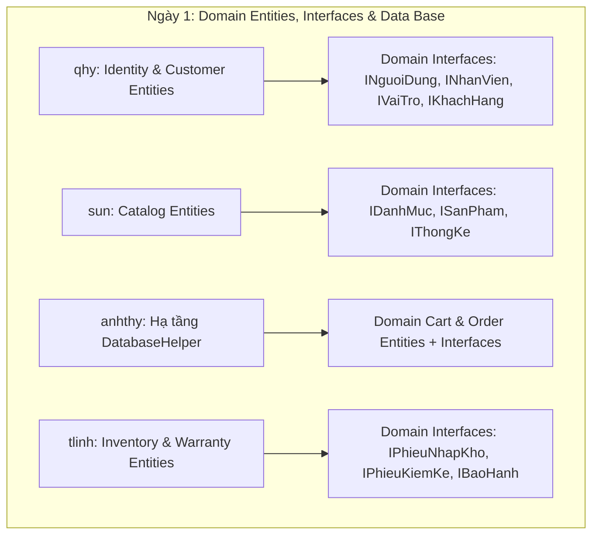
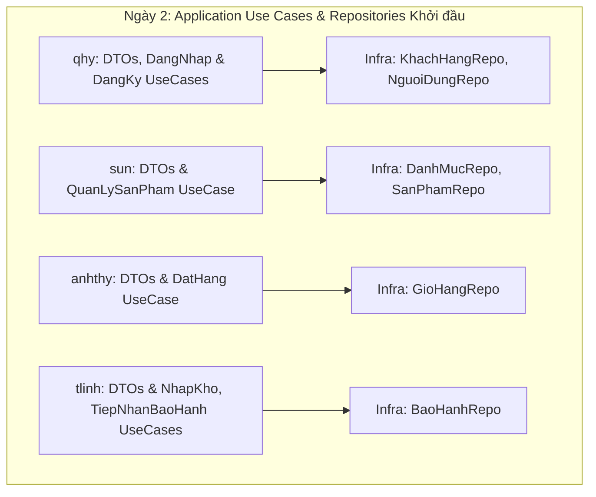
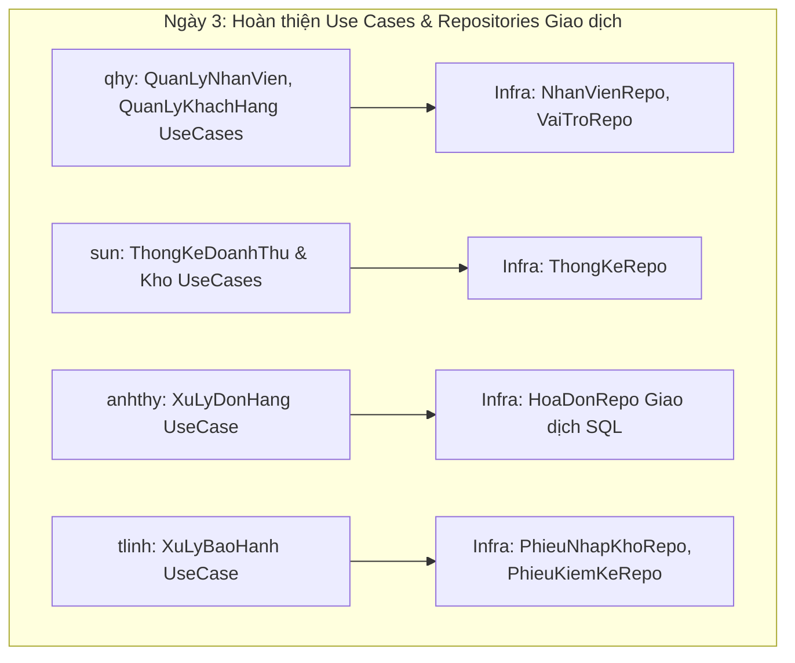

# LỘ TRÌNH COMMIT MÃ NGUỒN DỰ ÁN BLINK BLINK JEWELRY (3 NGÀY)
**Dành cho nhóm 4 thành viên:** `qhy`, `sun`, `anhthy`, `tlinh`  
**Phạm vi 3 thư mục cốt lõi Clean Architecture:**  
- `src/BlinkBlink.Domain`
- `src/BlinkBlink.Application`
- `src/BlinkBlink.Infrastructure`

---

## 1. MỐC ĐỒNG BỘ CƠ SỞ (BASELINE SNAPSHOT) & QUY TẮC ĐỢT SAU

> [!IMPORTANT]
> **MỐC CHỐT ĐỒNG BỘ ĐỢT 1 (PHASE 1 BASELINE)**
> - **Mã Commit Baseline (Personal):** `7993495`
> - **Thời điểm chốt mốc:** Ngày **23/10/2026**
> - **Mục đích:** Đánh dấu toàn bộ mã nguồn của 3 thư mục trên Personal tại thời điểm hiện tại để 4 thành viên đưa lên dự án chung của nhóm trong 3 ngày.

### Cơ Chế Lọc Tệp Tự Động Cho Các Đợt Lên Lịch Trình Sau Này:
Khi bạn tiếp tục code thêm trên `Personal` (ví dụ: sau 1 tuần nữa) và yêu cầu lập lịch trình commit mới:
1. **Tệp KHÔNG bị sửa gì (Unchanged):** Sẽ **tự động LOẠI BỎ 100%** khỏi lịch trình mới, vì chúng đã được commit lên dự án chung ở đợt này rồi.
2. **Tệp CÓ SỬA ĐỔI (`Modified`) hoặc TẠO MỚI (`Added`):** Sẽ được tự động trích xuất thông qua lệnh:
   ```bash
   git diff --name-only 7993495 HEAD -- src/BlinkBlink.Domain src/BlinkBlink.Application src/BlinkBlink.Infrastructure
   ```
3. Lịch trình đợt tiếp theo sẽ **chỉ phân bổ đúng các tệp thay đổi mới này**, không bao giờ bị trùng lặp lại mã nguồn cũ.

---

## 2. NGUYÊN TẮC VÀNG KHI COMMIT (BẮT BUỘC TUÂN THỦ)

> [!WARNING]
> **TUYỆT ĐỐI KHÔNG COMMIT BUILD ARTIFACTS / TỆP TẠM BIÊN DỊCH**
> - **CẤM** commit các thư mục: `bin/`, `obj/`, `.vs/`, `.vscode/`, `TestResults/`.
> - **CẤM** commit các tệp cấu hình cá nhân hoặc tệp sinh tự động: `*.user`, `*.suo`, `*.log`, `*.cache`.
> - **CHỈ COMMIT** các tệp mã nguồn do lập trình viên trực tiếp viết: định dạng `.cs`, định dạng `.csproj`, `.gitkeep` (nếu thư mục rỗng).
> - **Khuyến nghị thao tác an toàn:**
>   - Kiểm tra trạng thái: `git status` trước khi add.
>   - Chỉ add chính xác tệp cần commit: `git add <đường_dẫn_file.cs>`.
>   - **Tránh tuyệt đối** việc gõ lệnh `git add .` hoặc `git add -A` một cách cẩu thả.

### Quy ước nhánh (Branching Convention)
Mỗi thành viên làm việc trên một nhánh tính năng riêng biệt:
- Cú pháp: `feature/<phân_hệ>-<tên_thành_viên>`
- Quy trình:
  1. Kéo code mới nhất từ main:
     ```bash
     git checkout main
     git pull origin main
     ```
  2. Tạo và chuyển sang nhánh làm việc:
     ```bash
     git checkout -b feature/<tên_tính_năng>
     ```
  3. Thực hiện commit theo lộ trình.
  4. Đẩy nhánh lên Remote Repository:
     ```bash
     git push origin feature/<tên_tính_năng>
     ```
  5. Mở Pull Request (PR) để thành viên khác review trước khi merge vào `main`.

---

## 3. BẢNG MA TRẬN PHÂN CHIA TRÁCH NHIỆM

| Thành viên | Phân hệ nghiệp vụ chính phụ trách | Thư mục Domain | Thư mục Application | Thư mục Infrastructure |
| :--- | :--- | :---: | :---: | :---: |
| **`qhy`** | **Identity & Customers** (Người dùng, Nhân viên, Vai trò, Khách hàng) |  Ngày 1 |  Ngày 2, Ngày 3 |  Ngày 2, Ngày 3 |
| **`sun`** | **Catalog & Reporting** (Danh mục, Sản phẩm trang sức, Thống kê) |  Ngày 1 |  Ngày 2, Ngày 3 |  Ngày 2, Ngày 3 |
| **`anhthy`** | **Cart, Orders & Data Foundation** (Giỏ hàng, Đơn hàng, Hạ tầng CSDL) |  Ngày 1 |  Ngày 2, Ngày 3 |  Ngày 1, Ngày 2, Ngày 3 |
| **`tlinh`** | **Inventory & Warranty** (Nhập kho, Kiểm kê, Phiếu bảo hành) |  Ngày 1 |  Ngày 2, Ngày 3 |  Ngày 2, Ngày 3 |

---

## 4. LỘ TRÌNH COMMIT CHI TIẾT THEO TỪNG NGÀY (CÓ ĐÁNH DẤU NGÀY COMMIT GỐC)

### NGÀY 1: NỀN TẢNG CORE DOMAIN ENTITIES & HẠ TẦNG KẾT NỐI CSDL BAN ĐẦU
> **Mục tiêu Ngày 1:** Thiết lập các thực thể nghiệp vụ cốt lõi (`Entities`), các giao diện đặc tả (`Interfaces`) cho Repository và khởi tạo nền tảng kết nối cơ sở dữ liệu dùng chung (`DatabaseHelper`).



#### 1. Thành viên `qhy`
- **Nhánh làm việc:** `feature/identity-domain-entities`
- **Phiên Sáng (Commit 1):** Khởi tạo Project Domain & Thực thể Người dùng, Khách hàng, Vai trò
  - **Tệp commit kèm ngày gốc tại Personal:**
    - `src/BlinkBlink.Domain/BlinkBlink.Domain.csproj` *(Gốc: 2026-10-16 | `b70e538`)*
    - `src/BlinkBlink.Domain/Entities/Identity/NguoiDung.cs` *(Gốc: 2026-10-18 | `55c81ed`)*
    - `src/BlinkBlink.Domain/Entities/Identity/VaiTro.cs` *(Gốc: 2026-10-18 | `55c81ed`)*
    - `src/BlinkBlink.Domain/Entities/Customers/KhachHang.cs` *(Gốc: 2026-10-18 | `55c81ed`)*
  - **Lệnh thực hiện:**
    ```bash
    git add src/BlinkBlink.Domain/BlinkBlink.Domain.csproj src/BlinkBlink.Domain/Entities/Identity/NguoiDung.cs src/BlinkBlink.Domain/Entities/Identity/VaiTro.cs src/BlinkBlink.Domain/Entities/Customers/KhachHang.cs
    git commit -m "feat(domain): khoi tao entities NguoiDung, VaiTro va KhachHang"
    ```
- **Phiên Chiều (Commit 2):** Bổ sung thực thể Nhân viên & Các Repository Interfaces liên quan
  - **Tệp commit kèm ngày gốc tại Personal:**
    - `src/BlinkBlink.Domain/Entities/Identity/NhanVien.cs` *(Gốc: 2026-10-18 | `55c81ed`)*
    - `src/BlinkBlink.Domain/Interfaces/INguoiDungRepository.cs` *(Gốc: 2026-10-18 | `bb5fce4`)*
    - `src/BlinkBlink.Domain/Interfaces/IVaiTroRepository.cs` *(Gốc: 2026-10-18 | `bb5fce4`)*
    - `src/BlinkBlink.Domain/Interfaces/IKhachHangRepository.cs` *(Gốc: 2026-10-23 | `456e033`)*
    - `src/BlinkBlink.Domain/Interfaces/INhanVienRepository.cs` *(Gốc: 2026-10-23 | `456e033`)*
  - **Lệnh thực hiện:**
    ```bash
    git add src/BlinkBlink.Domain/Entities/Identity/NhanVien.cs src/BlinkBlink.Domain/Interfaces/INguoiDungRepository.cs src/BlinkBlink.Domain/Interfaces/IVaiTroRepository.cs src/BlinkBlink.Domain/Interfaces/IKhachHangRepository.cs src/BlinkBlink.Domain/Interfaces/INhanVienRepository.cs
    git commit -m "feat(domain): dinh nghia interfaces repository cho identity va khach hang"
    ```

#### 2. Thành viên `sun`
- **Nhánh làm việc:** `feature/catalog-domain-entities`
- **Phiên Sáng (Commit 1):** Khởi tạo Thực thể Danh mục & Sản phẩm trang sức
  - **Tệp commit kèm ngày gốc tại Personal:**
    - `src/BlinkBlink.Domain/Entities/Catalog/DanhMuc.cs` *(Gốc: 2026-10-22 | `16704d9`)*
    - `src/BlinkBlink.Domain/Entities/Catalog/SanPhamTrangSuc.cs` *(Gốc: 2026-10-23 | `c9028ad`)*
  - **Lệnh thực hiện:**
    ```bash
    git add src/BlinkBlink.Domain/Entities/Catalog/DanhMuc.cs src/BlinkBlink.Domain/Entities/Catalog/SanPhamTrangSuc.cs
    git commit -m "feat(domain): khoi tao entities DanhMuc va SanPhamTrangSuc"
    ```
- **Phiên Chiều (Commit 2):** Định nghĩa Interfaces Repository Sản phẩm, Danh mục & Báo cáo
  - **Tệp commit kèm ngày gốc tại Personal:**
    - `src/BlinkBlink.Domain/Interfaces/IDanhMucRepository.cs` *(Gốc: 2026-10-22 | `68b8e9a`)*
    - `src/BlinkBlink.Domain/Interfaces/ISanPhamRepository.cs` *(Gốc: 2026-10-22 | `68b8e9a`)*
    - `src/BlinkBlink.Domain/Interfaces/IThongKeRepository.cs` *(Gốc: 2026-10-22 | `39e66a6`)*
  - **Lệnh thực hiện:**
    ```bash
    git add src/BlinkBlink.Domain/Interfaces/IDanhMucRepository.cs src/BlinkBlink.Domain/Interfaces/ISanPhamRepository.cs src/BlinkBlink.Domain/Interfaces/IThongKeRepository.cs
    git commit -m "feat(domain): dinh nghia interfaces repository cho catalog va thong ke"
    ```

#### 3. Thành viên `anhthy`
- **Nhánh làm việc:** `feature/cart-orders-domain-infra-base`
- **Phiên Sáng (Commit 1):** Khởi tạo Project Infrastructure & Bộ kết nối CSDL chung (`DatabaseHelper`)
  - **Tệp commit kèm ngày gốc tại Personal:**
    - `src/BlinkBlink.Infrastructure/BlinkBlink.Infrastructure.csproj` *(Gốc: 2026-10-22 | `224adc2`)*
    - `src/BlinkBlink.Infrastructure/Data/DatabaseHelper.cs` *(Gốc: 2026-10-22 | `224adc2`)*
  - **Lệnh thực hiện:**
    ```bash
    git add src/BlinkBlink.Infrastructure/BlinkBlink.Infrastructure.csproj src/BlinkBlink.Infrastructure/Data/DatabaseHelper.cs
    git commit -m "feat(infrastructure): khoi tao du an va DatabaseHelper ket noi SQL Server"
    ```
- **Phiên Chiều (Commit 2):** Khởi tạo Thực thể & Interfaces Giỏ hàng và Đơn hàng
  - **Tệp commit kèm ngày gốc tại Personal:**
    - `src/BlinkBlink.Domain/Entities/Cart/GioHang.cs` *(Gốc: 2026-10-22 | `75aab0c`)*
    - `src/BlinkBlink.Domain/Entities/Cart/ChiTietGioHang.cs` *(Gốc: 2026-10-22 | `75aab0c`)*
    - `src/BlinkBlink.Domain/Entities/Orders/HoaDon.cs` *(Gốc: 2026-10-22 | `75aab0c`)*
    - `src/BlinkBlink.Domain/Entities/Orders/ChiTietHoaDon.cs` *(Gốc: 2026-10-22 | `75aab0c`)*
    - `src/BlinkBlink.Domain/Interfaces/IGioHangRepository.cs` *(Gốc: 2026-10-22 | `75aab0c`)*
    - `src/BlinkBlink.Domain/Interfaces/IHoaDonRepository.cs` *(Gốc: 2026-10-22 | `75aab0c`)*
  - **Lệnh thực hiện:**
    ```bash
    git add src/BlinkBlink.Domain/Entities/Cart/GioHang.cs src/BlinkBlink.Domain/Entities/Cart/ChiTietGioHang.cs src/BlinkBlink.Domain/Entities/Orders/HoaDon.cs src/BlinkBlink.Domain/Entities/Orders/ChiTietHoaDon.cs src/BlinkBlink.Domain/Interfaces/IGioHangRepository.cs src/BlinkBlink.Domain/Interfaces/IHoaDonRepository.cs
    git commit -m "feat(domain): thiet lap entities va interfaces cho gio hang va hoa don"
    ```

#### 4. Thành viên `tlinh`
- **Nhánh làm việc:** `feature/inventory-warranty-domain`
- **Phiên Sáng (Commit 1):** Khởi tạo Thực thể Nhập kho & Kiểm kê kho
  - **Tệp commit kèm ngày gốc tại Personal:**
    - `src/BlinkBlink.Domain/Entities/Inventory/PhieuNhapKho.cs` *(Gốc: 2026-10-22 | `16704d9`)*
    - `src/BlinkBlink.Domain/Entities/Inventory/ChiTietNhapKho.cs` *(Gốc: 2026-10-22 | `16704d9`)*
    - `src/BlinkBlink.Domain/Entities/Inventory/PhieuKiemKe.cs` *(Gốc: 2026-10-22 | `16704d9`)*
    - `src/BlinkBlink.Domain/Entities/Inventory/ChiTietKiemKe.cs` *(Gốc: 2026-10-22 | `16704d9`)*
  - **Lệnh thực hiện:**
    ```bash
    git add src/BlinkBlink.Domain/Entities/Inventory/PhieuNhapKho.cs src/BlinkBlink.Domain/Entities/Inventory/ChiTietNhapKho.cs src/BlinkBlink.Domain/Entities/Inventory/PhieuKiemKe.cs src/BlinkBlink.Domain/Entities/Inventory/ChiTietKiemKe.cs
    git commit -m "feat(domain): khoi tao entities quan ly nhap kho va phieu kiem ke"
    ```
- **Phiên Chiều (Commit 2):** Khởi tạo Thực thể Bảo hành & Interfaces Kho / Bảo hành
  - **Tệp commit kèm ngày gốc tại Personal:**
    - `src/BlinkBlink.Domain/Entities/Warranty/PhieuBaoHanh.cs` *(Gốc: 2026-10-22 | `9bf5ba6`)*
    - `src/BlinkBlink.Domain/Interfaces/IPhieuNhapKhoRepository.cs` *(Gốc: 2026-10-22 | `68b8e9a`)*
    - `src/BlinkBlink.Domain/Interfaces/IPhieuKiemKeRepository.cs` *(Gốc: 2026-10-22 | `16704d9`)*
    - `src/BlinkBlink.Domain/Interfaces/IBaoHanhRepository.cs` *(Gốc: 2026-10-22 | `9bf5ba6`)*
  - **Lệnh thực hiện:**
    ```bash
    git add src/BlinkBlink.Domain/Entities/Warranty/PhieuBaoHanh.cs src/BlinkBlink.Domain/Interfaces/IPhieuNhapKhoRepository.cs src/BlinkBlink.Domain/Interfaces/IPhieuKiemKeRepository.cs src/BlinkBlink.Domain/Interfaces/IBaoHanhRepository.cs
    git commit -m "feat(domain): thiet lap entities bao hanh va interfaces kho, bao hanh"
    ```

---

### NGÀY 2: TRIỂN KHAI TẦNG APPLICATION (DTOS, USE CASES) & BẮT ĐẦU REPOSITORIES CƠ SỞ
> **Mục tiêu Ngày 2:** Xây dựng tầng Application gồm các tệp chuyển giao dữ liệu (`DTOs`) và các ca sử dụng (`Use Cases`) trọng tâm, đồng thời bắt đầu cài đặt các `Repositories` cơ sở tại tầng `Infrastructure`.



#### 1. Thành viên `qhy`
- **Nhánh làm việc:** `feature/identity-application-usecase`
- **Phiên Sáng (Commit 1):** Triển khai Application Project, DTOs & Use Cases Đăng nhập, Đăng ký
  - **Tệp commit kèm ngày gốc tại Personal:**
    - `src/BlinkBlink.Application/BlinkBlink.Application.csproj` *(Gốc: 2026-10-16 | `b70e538`)*
    - `src/BlinkBlink.Application/DTOs/Identity/DangNhapDTO.cs` *(Gốc: 2026-10-18 | `bb5fce4`)*
    - `src/BlinkBlink.Application/DTOs/Identity/DangKyKhachHangDTO.cs` *(Gốc: 2026-10-18 | `bb5fce4`)*
    - `src/BlinkBlink.Application/Services/Identity/DangNhapUseCase.cs` *(Gốc: 2026-10-18 | `bb5fce4`)*
    - `src/BlinkBlink.Application/Services/Identity/DangKyKhachHangUseCase.cs` *(Gốc: 2026-10-18 | `bb5fce4`)*
  - **Lệnh thực hiện:**
    ```bash
    git add src/BlinkBlink.Application/BlinkBlink.Application.csproj src/BlinkBlink.Application/DTOs/Identity/DangNhapDTO.cs src/BlinkBlink.Application/DTOs/Identity/DangKyKhachHangDTO.cs src/BlinkBlink.Application/Services/Identity/DangNhapUseCase.cs src/BlinkBlink.Application/Services/Identity/DangKyKhachHangUseCase.cs
    git commit -m "feat(application): cai dat DangNhap va DangKyKhachHang use case"
    ```
- **Phiên Chiều (Commit 2):** Khởi tạo Repositories Khách hàng & Người dùng ở Infrastructure
  - **Tệp commit kèm ngày gốc tại Personal:**
    - `src/BlinkBlink.Infrastructure/Repositories/KhachHangRepository.cs` *(Gốc: 2026-10-23 | `456e033`)*
    - `src/BlinkBlink.Infrastructure/Repositories/NguoiDungRepository.cs` *(Gốc: 2026-10-22 | `224adc2`)*
  - **Lệnh thực hiện:**
    ```bash
    git add src/BlinkBlink.Infrastructure/Repositories/KhachHangRepository.cs src/BlinkBlink.Infrastructure/Repositories/NguoiDungRepository.cs
    git commit -m "feat(infrastructure): cai dat ADO.NET cho KhachHangRepository va NguoiDungRepository"
    ```

#### 2. Thành viên `sun`
- **Nhánh làm việc:** `feature/catalog-application-usecase`
- **Phiên Sáng (Commit 1):** Triển khai DTOs & Use Case Quản lý Sản phẩm
  - **Tệp commit kèm ngày gốc tại Personal:**
    - `src/BlinkBlink.Application/DTOs/Catalog/SanPhamDTO.cs` *(Gốc: 2026-10-23 | `c9028ad`)*
    - `src/BlinkBlink.Application/DTOs/Catalog/CapNhatSanPhamDTO.cs` *(Gốc: 2026-10-23 | `c9028ad`)*
    - `src/BlinkBlink.Application/DTOs/Catalog/DoiGiaDTO.cs` *(Gốc: 2026-10-22 | `16704d9`)*
    - `src/BlinkBlink.Application/Services/Catalog/QuanLySanPhamUseCase.cs` *(Gốc: 2026-10-23 | `c9028ad`)*
  - **Lệnh thực hiện:**
    ```bash
    git add src/BlinkBlink.Application/DTOs/Catalog/SanPhamDTO.cs src/BlinkBlink.Application/DTOs/Catalog/CapNhatSanPhamDTO.cs src/BlinkBlink.Application/DTOs/Catalog/DoiGiaDTO.cs src/BlinkBlink.Application/Services/Catalog/QuanLySanPhamUseCase.cs
    git commit -m "feat(application): cai dat QuanLySanPhamUseCase va cac DTO catalog"
    ```
- **Phiên Chiều (Commit 2):** Khởi tạo Repositories Danh mục & Sản phẩm ở Infrastructure
  - **Tệp commit kèm ngày gốc tại Personal:**
    - `src/BlinkBlink.Infrastructure/Repositories/DanhMucRepository.cs` *(Gốc: 2026-10-22 | `68b8e9a`)*
    - `src/BlinkBlink.Infrastructure/Repositories/SanPhamRepository.cs` *(Gốc: 2026-10-23 | `c9028ad`)*
  - **Lệnh thực hiện:**
    ```bash
    git add src/BlinkBlink.Infrastructure/Repositories/DanhMucRepository.cs src/BlinkBlink.Infrastructure/Repositories/SanPhamRepository.cs
    git commit -m "feat(infrastructure): cai dat DanhMucRepository va SanPhamRepository bang SQL thuan"
    ```

#### 3. Thành viên `anhthy`
- **Nhánh làm việc:** `feature/orders-application-usecase`
- **Phiên Sáng (Commit 1):** Triển khai DTOs & Use Case Đặt hàng
  - **Tệp commit kèm ngày gốc tại Personal:**
    - `src/BlinkBlink.Application/DTOs/Orders/DatHangDTO.cs` *(Gốc: 2026-10-22 | `75aab0c`)*
    - `src/BlinkBlink.Application/DTOs/Orders/CapNhatDonHangDTO.cs` *(Gốc: 2026-10-22 | `75aab0c`)*
    - `src/BlinkBlink.Application/Services/Orders/DatHangUseCase.cs` *(Gốc: 2026-10-22 | `75aab0c`)*
  - **Lệnh thực hiện:**
    ```bash
    git add src/BlinkBlink.Application/DTOs/Orders/DatHangDTO.cs src/BlinkBlink.Application/DTOs/Orders/CapNhatDonHangDTO.cs src/BlinkBlink.Application/Services/Orders/DatHangUseCase.cs
    git commit -m "feat(application): dinh nghia DatHangDTO va cai dat DatHangUseCase"
    ```
- **Phiên Chiều (Commit 2):** Khởi tạo Repositories Giỏ hàng ở Infrastructure
  - **Tệp commit kèm ngày gốc tại Personal:**
    - `src/BlinkBlink.Infrastructure/Repositories/GioHangRepository.cs` *(Gốc: 2026-10-23 | `456e033`)*
  - **Lệnh thực hiện:**
    ```bash
    git add src/BlinkBlink.Infrastructure/Repositories/GioHangRepository.cs
    git commit -m "feat(infrastructure): cai dat GioHangRepository quan ly gio hang truc tuyen"
    ```

#### 4. Thành viên `tlinh`
- **Nhánh làm việc:** `feature/inventory-warranty-application`
- **Phiên Sáng (Commit 1):** Triển khai DTOs & Use Cases Xác nhận Nhập kho, Tiếp nhận Bảo hành
  - **Tệp commit kèm ngày gốc tại Personal:**
    - `src/BlinkBlink.Application/DTOs/Inventory/NhapKhoDTO.cs` *(Gốc: 2026-10-22 | `16704d9`)*
    - `src/BlinkBlink.Application/DTOs/Inventory/ChiTietNhapKhoDTO.cs` *(Gốc: 2026-10-22 | `16704d9`)*
    - `src/BlinkBlink.Application/DTOs/Warranty/TaoBaoHanhDTO.cs` *(Gốc: 2026-10-22 | `9bf5ba6`)*
    - `src/BlinkBlink.Application/DTOs/Warranty/CapNhatTrangThaiDTO.cs` *(Gốc: 2026-10-22 | `9bf5ba6`)*
    - `src/BlinkBlink.Application/Services/Inventory/XacNhanNhapKhoUseCase.cs` *(Gốc: 2026-10-22 | `16704d9`)*
    - `src/BlinkBlink.Application/Services/Warranty/TiepNhanBaoHanhUseCase.cs` *(Gốc: 2026-10-22 | `9bf5ba6`)*
  - **Lệnh thực hiện:**
    ```bash
    git add src/BlinkBlink.Application/DTOs/Inventory/NhapKhoDTO.cs src/BlinkBlink.Application/DTOs/Inventory/ChiTietNhapKhoDTO.cs src/BlinkBlink.Application/DTOs/Warranty/TaoBaoHanhDTO.cs src/BlinkBlink.Application/DTOs/Warranty/CapNhatTrangThaiDTO.cs src/BlinkBlink.Application/Services/Inventory/XacNhanNhapKhoUseCase.cs src/BlinkBlink.Application/Services/Warranty/TiepNhanBaoHanhUseCase.cs
    git commit -m "feat(application): cai dat XacNhanNhapKhoUseCase va TiepNhanBaoHanhUseCase"
    ```
- **Phiên Chiều (Commit 2):** Khởi tạo Repository Bảo hành ở Infrastructure
  - **Tệp commit kèm ngày gốc tại Personal:**
    - `src/BlinkBlink.Infrastructure/Repositories/BaoHanhRepository.cs` *(Gốc: 2026-10-22 | `224adc2`)*
  - **Lệnh thực hiện:**
    ```bash
    git add src/BlinkBlink.Infrastructure/Repositories/BaoHanhRepository.cs
    git commit -m "feat(infrastructure): cai dat BaoHanhRepository truy xuat so bao hanh"
    ```

---

### NGÀY 3: HOÀN THIỆN INFRASTRUCTURE REPOSITORIES, USE CASES CÒN LẠI & KHỚP NỐI HỆ THỐNG
> **Mục tiêu Ngày 3:** Hoàn thành 100% các Use Cases nâng cao, các Repositories xử lý giao dịch SQL phức tạp tại `Infrastructure`, đảm bảo Clean Architecture được kết nối trơn tru giữa cả 3 tầng.



#### 1. Thành viên `qhy`
- **Nhánh làm việc:** `feature/identity-management-completion`
- **Phiên Sáng (Commit 1):** Hoàn thiện Use Cases Quản lý Nhân sự & Khách hàng
  - **Tệp commit kèm ngày gốc tại Personal:**
    - `src/BlinkBlink.Application/DTOs/Identity/TaoNhanVienDTO.cs` *(Gốc: 2026-10-18 | `bb5fce4`)*
    - `src/BlinkBlink.Application/DTOs/Identity/CapNhatKhachHangDTO.cs` *(Gốc: 2026-10-22 | `ecb94c8`)*
    - `src/BlinkBlink.Application/Services/Identity/QuanLyKhachHangUseCase.cs` *(Gốc: 2026-10-23 | `456e033`)*
    - `src/BlinkBlink.Application/Services/Identity/QuanLyNhanVienUseCase.cs` *(Gốc: 2026-10-23 | `456e033`)*
  - **Lệnh thực hiện:**
    ```bash
    git add src/BlinkBlink.Application/DTOs/Identity/TaoNhanVienDTO.cs src/BlinkBlink.Application/DTOs/Identity/CapNhatKhachHangDTO.cs src/BlinkBlink.Application/Services/Identity/QuanLyKhachHangUseCase.cs src/BlinkBlink.Application/Services/Identity/QuanLyNhanVienUseCase.cs
    git commit -m "feat(application): hoan thien QuanLyKhachHangUseCase va QuanLyNhanVienUseCase"
    ```
- **Phiên Chiều (Commit 2):** Hoàn thiện Infrastructure Vai trò & Nhân viên
  - **Tệp commit kèm ngày gốc tại Personal:**
    - `src/BlinkBlink.Infrastructure/Repositories/VaiTroRepository.cs` *(Gốc: 2026-10-22 | `224adc2`)*
    - `src/BlinkBlink.Infrastructure/Repositories/NhanVienRepository.cs` *(Gốc: 2026-10-23 | `456e033`)*
  - **Lệnh thực hiện:**
    ```bash
    git add src/BlinkBlink.Infrastructure/Repositories/VaiTroRepository.cs src/BlinkBlink.Infrastructure/Repositories/NhanVienRepository.cs
    git commit -m "feat(infrastructure): hoan thien VaiTroRepository va NhanVienRepository"
    ```

#### 2. Thành viên `sun`
- **Nhánh làm việc:** `feature/reporting-application-infra`
- **Phiên Sáng (Commit 1):** Triển khai DTOs & Use Cases Báo cáo Thống kê Doanh thu và Kho hàng
  - **Tệp commit kèm ngày gốc tại Personal:**
    - `src/BlinkBlink.Application/DTOs/Reporting/BaoCaoTonKhoDTO.cs` *(Gốc: 2026-10-22 | `39e66a6`)*
    - `src/BlinkBlink.Application/DTOs/Reporting/DoanhThuThongKeDTO.cs` *(Gốc: 2026-10-22 | `39e66a6`)*
    - `src/BlinkBlink.Application/DTOs/Reporting/TopSanPhamBanChayDTO.cs` *(Gốc: 2026-10-22 | `39e66a6`)*
    - `src/BlinkBlink.Application/Services/Reporting/ThongKeDoanhThuUseCase.cs` *(Gốc: 2026-10-22 | `39e66a6`)*
    - `src/BlinkBlink.Application/Services/Reporting/ThongKeKhoHangUseCase.cs` *(Gốc: 2026-10-22 | `39e66a6`)*
  - **Lệnh thực hiện:**
    ```bash
    git add src/BlinkBlink.Application/DTOs/Reporting/BaoCaoTonKhoDTO.cs src/BlinkBlink.Application/DTOs/Reporting/DoanhThuThongKeDTO.cs src/BlinkBlink.Application/DTOs/Reporting/TopSanPhamBanChayDTO.cs src/BlinkBlink.Application/Services/Reporting/ThongKeDoanhThuUseCase.cs src/BlinkBlink.Application/Services/Reporting/ThongKeKhoHangUseCase.cs
    git commit -m "feat(application): cai dat Use Cases va DTOs thong ke doanh thu, kho hang"
    ```
- **Phiên Chiều (Commit 2):** Hoàn thiện Infrastructure Thống kê báo cáo
  - **Tệp commit kèm ngày gốc tại Personal:**
    - `src/BlinkBlink.Infrastructure/Repositories/ThongKeRepository.cs` *(Gốc: 2026-10-22 | `224adc2`)*
  - **Lệnh thực hiện:**
    ```bash
    git add src/BlinkBlink.Infrastructure/Repositories/ThongKeRepository.cs
    git commit -m "feat(infrastructure): hoan tat ThongKeRepository thuc thi truy van tong hop"
    ```

#### 3. Thành viên `anhthy`
- **Nhánh làm việc:** `feature/orders-processing-infra-completion`
- **Phiên Sáng (Commit 1):** Triển khai Use Case Xử lý Đơn hàng (Cập nhật trạng thái, Hủy đơn)
  - **Tệp commit kèm ngày gốc tại Personal:**
    - `src/BlinkBlink.Application/Services/Orders/XuLyDonHangUseCase.cs` *(Gốc: 2026-10-22 | `75aab0c`)*
  - **Lệnh thực hiện:**
    ```bash
    git add src/BlinkBlink.Application/Services/Orders/XuLyDonHangUseCase.cs
    git commit -m "feat(application): cai dat XuLyDonHangUseCase cap nhat tien trinh don hang"
    ```
- **Phiên Chiều (Commit 2):** Hoàn thiện Infrastructure Hóa đơn (Xử lý SqlTransaction)
  - **Tệp commit kèm ngày gốc tại Personal:**
    - `src/BlinkBlink.Infrastructure/Repositories/HoaDonRepository.cs` *(Gốc: 2026-10-23 | `456e033`)*
  - **Lệnh thực hiện:**
    ```bash
    git add src/BlinkBlink.Infrastructure/Repositories/HoaDonRepository.cs
    git commit -m "feat(infrastructure): hoan tat HoaDonRepository voi giao dich SqlTransaction toan ven"
    ```

#### 4. Thành viên `tlinh`
- **Nhánh làm việc:** `feature/inventory-warranty-completion`
- **Phiên Sáng (Commit 1):** Triển khai Use Case Xử lý Bảo hành kiệt tác
  - **Tệp commit kèm ngày gốc tại Personal:**
    - `src/BlinkBlink.Application/Services/Warranty/XuLyBaoHanhUseCase.cs` *(Gốc: 2026-10-22 | `9bf5ba6`)*
  - **Lệnh thực hiện:**
    ```bash
    git add src/BlinkBlink.Application/Services/Warranty/XuLyBaoHanhUseCase.cs
    git commit -m "feat(application): cai dat XuLyBaoHanhUseCase hoan tat tien trinh bao hanh"
    ```
- **Phiên Chiều (Commit 2):** Hoàn thiện Infrastructure Nhập kho & Kiểm kê kho
  - **Tệp commit kèm ngày gốc tại Personal:**
    - `src/BlinkBlink.Infrastructure/Repositories/PhieuNhapKhoRepositoryImpl.cs` *(Gốc: 2026-10-23 | `c9028ad`)*
    - `src/BlinkBlink.Infrastructure/Repositories/PhieuKiemKeRepository.cs` *(Gốc: 2026-10-22 | `224adc2`)*
  - **Lệnh thực hiện:**
    ```bash
    git add src/BlinkBlink.Infrastructure/Repositories/PhieuNhapKhoRepositoryImpl.cs src/BlinkBlink.Infrastructure/Repositories/PhieuKiemKeRepository.cs
    git commit -m "feat(infrastructure): hoan tat PhieuNhapKhoRepositoryImpl va PhieuKiemKeRepository"
    ```

---

## 5. BẢNG TRA CỨU MỐC COMMIT GỐC CỦA TOÀN BỘ 68 TỆP (AUDIT TRAIL)

| STT | Tệp Mã Nguồn | Thư Mục | Ngày Commit Gốc | Mã Hash Gốc | Trạng Thái Đợt 1 |
| :---: | :--- | :--- | :---: | :---: | :---: |
| 1 | `BlinkBlink.Domain.csproj` | Domain | 2026-10-16 | `b70e538` | Sẵn sàng đưa lên nhóm |
| 2 | `Entities/Cart/ChiTietGioHang.cs` | Domain | 2026-10-22 | `75aab0c` | Sẵn sàng đưa lên nhóm |
| 3 | `Entities/Cart/GioHang.cs` | Domain | 2026-10-22 | `75aab0c` | Sẵn sàng đưa lên nhóm |
| 4 | `Entities/Catalog/DanhMuc.cs` | Domain | 2026-10-22 | `16704d9` | Sẵn sàng đưa lên nhóm |
| 5 | `Entities/Catalog/SanPhamTrangSuc.cs` | Domain | 2026-10-23 | `c9028ad` | Sẵn sàng đưa lên nhóm |
| 6 | `Entities/Customers/KhachHang.cs` | Domain | 2026-10-18 | `55c81ed` | Sẵn sàng đưa lên nhóm |
| 7 | `Entities/Identity/NguoiDung.cs` | Domain | 2026-10-18 | `55c81ed` | Sẵn sàng đưa lên nhóm |
| 8 | `Entities/Identity/NhanVien.cs` | Domain | 2026-10-18 | `55c81ed` | Sẵn sàng đưa lên nhóm |
| 9 | `Entities/Identity/VaiTro.cs` | Domain | 2026-10-18 | `55c81ed` | Sẵn sàng đưa lên nhóm |
| 10 | `Entities/Inventory/ChiTietKiemKe.cs` | Domain | 2026-10-22 | `16704d9` | Sẵn sàng đưa lên nhóm |
| 11 | `Entities/Inventory/ChiTietNhapKho.cs` | Domain | 2026-10-22 | `16704d9` | Sẵn sàng đưa lên nhóm |
| 12 | `Entities/Inventory/PhieuKiemKe.cs` | Domain | 2026-10-22 | `16704d9` | Sẵn sàng đưa lên nhóm |
| 13 | `Entities/Inventory/PhieuNhapKho.cs` | Domain | 2026-10-22 | `16704d9` | Sẵn sàng đưa lên nhóm |
| 14 | `Entities/Orders/ChiTietHoaDon.cs` | Domain | 2026-10-22 | `75aab0c` | Sẵn sàng đưa lên nhóm |
| 15 | `Entities/Orders/HoaDon.cs` | Domain | 2026-10-22 | `75aab0c` | Sẵn sàng đưa lên nhóm |
| 16 | `Entities/Warranty/PhieuBaoHanh.cs` | Domain | 2026-10-22 | `9bf5ba6` | Sẵn sàng đưa lên nhóm |
| 17 | `Interfaces/IBaoHanhRepository.cs` | Domain | 2026-10-22 | `9bf5ba6` | Sẵn sàng đưa lên nhóm |
| 18 | `Interfaces/IDanhMucRepository.cs` | Domain | 2026-10-22 | `68b8e9a` | Sẵn sàng đưa lên nhóm |
| 19 | `Interfaces/IGioHangRepository.cs` | Domain | 2026-10-22 | `75aab0c` | Sẵn sàng đưa lên nhóm |
| 20 | `Interfaces/IHoaDonRepository.cs` | Domain | 2026-10-22 | `75aab0c` | Sẵn sàng đưa lên nhóm |
| 21 | `Interfaces/IKhachHangRepository.cs` | Domain | 2026-10-23 | `456e033` | Sẵn sàng đưa lên nhóm |
| 22 | `Interfaces/INguoiDungRepository.cs` | Domain | 2026-10-18 | `bb5fce4` | Sẵn sàng đưa lên nhóm |
| 23 | `Interfaces/INhanVienRepository.cs` | Domain | 2026-10-23 | `456e033` | Sẵn sàng đưa lên nhóm |
| 24 | `Interfaces/IPhieuKiemKeRepository.cs` | Domain | 2026-10-22 | `16704d9` | Sẵn sàng đưa lên nhóm |
| 25 | `Interfaces/IPhieuNhapKhoRepository.cs` | Domain | 2026-10-22 | `68b8e9a` | Sẵn sàng đưa lên nhóm |
| 26 | `Interfaces/ISanPhamRepository.cs` | Domain | 2026-10-22 | `68b8e9a` | Sẵn sàng đưa lên nhóm |
| 27 | `Interfaces/IThongKeRepository.cs` | Domain | 2026-10-22 | `39e66a6` | Sẵn sàng đưa lên nhóm |
| 28 | `Interfaces/IVaiTroRepository.cs` | Domain | 2026-10-18 | `bb5fce4` | Sẵn sàng đưa lên nhóm |
| 29 | `BlinkBlink.Application.csproj` | Application | 2026-10-16 | `b70e538` | Sẵn sàng đưa lên nhóm |
| 30 | `DTOs/Catalog/CapNhatSanPhamDTO.cs` | Application | 2026-10-23 | `c9028ad` | Sẵn sàng đưa lên nhóm |
| 31 | `DTOs/Catalog/DoiGiaDTO.cs` | Application | 2026-10-22 | `16704d9` | Sẵn sàng đưa lên nhóm |
| 32 | `DTOs/Catalog/SanPhamDTO.cs` | Application | 2026-10-23 | `c9028ad` | Sẵn sàng đưa lên nhóm |
| 33 | `DTOs/Identity/CapNhatKhachHangDTO.cs` | Application | 2026-10-22 | `ecb94c8` | Sẵn sàng đưa lên nhóm |
| 34 | `DTOs/Identity/DangKyKhachHangDTO.cs` | Application | 2026-10-18 | `bb5fce4` | Sẵn sàng đưa lên nhóm |
| 35 | `DTOs/Identity/DangNhapDTO.cs` | Application | 2026-10-18 | `bb5fce4` | Sẵn sàng đưa lên nhóm |
| 36 | `DTOs/Identity/TaoNhanVienDTO.cs` | Application | 2026-10-18 | `bb5fce4` | Sẵn sàng đưa lên nhóm |
| 37 | `DTOs/Inventory/ChiTietNhapKhoDTO.cs` | Application | 2026-10-22 | `16704d9` | Sẵn sàng đưa lên nhóm |
| 38 | `DTOs/Inventory/NhapKhoDTO.cs` | Application | 2026-10-22 | `16704d9` | Sẵn sàng đưa lên nhóm |
| 39 | `DTOs/Orders/CapNhatDonHangDTO.cs` | Application | 2026-10-22 | `75aab0c` | Sẵn sàng đưa lên nhóm |
| 40 | `DTOs/Orders/DatHangDTO.cs` | Application | 2026-10-22 | `75aab0c` | Sẵn sàng đưa lên nhóm |
| 41 | `DTOs/Reporting/BaoCaoTonKhoDTO.cs` | Application | 2026-10-22 | `39e66a6` | Sẵn sàng đưa lên nhóm |
| 42 | `DTOs/Reporting/DoanhThuThongKeDTO.cs` | Application | 2026-10-22 | `39e66a6` | Sẵn sàng đưa lên nhóm |
| 43 | `DTOs/Reporting/TopSanPhamBanChayDTO.cs` | Application | 2026-10-22 | `39e66a6` | Sẵn sàng đưa lên nhóm |
| 44 | `DTOs/Warranty/CapNhatTrangThaiDTO.cs` | Application | 2026-10-22 | `9bf5ba6` | Sẵn sàng đưa lên nhóm |
| 45 | `DTOs/Warranty/TaoBaoHanhDTO.cs` | Application | 2026-10-22 | `9bf5ba6` | Sẵn sàng đưa lên nhóm |
| 46 | `Services/Catalog/QuanLySanPhamUseCase.cs` | Application | 2026-10-23 | `c9028ad` | Sẵn sàng đưa lên nhóm |
| 47 | `Services/Identity/DangKyKhachHangUseCase.cs` | Application | 2026-10-18 | `bb5fce4` | Sẵn sàng đưa lên nhóm |
| 48 | `Services/Identity/DangNhapUseCase.cs` | Application | 2026-10-18 | `bb5fce4` | Sẵn sàng đưa lên nhóm |
| 49 | `Services/Identity/QuanLyKhachHangUseCase.cs` | Application | 2026-10-23 | `456e033` | Sẵn sàng đưa lên nhóm |
| 50 | `Services/Identity/QuanLyNhanVienUseCase.cs` | Application | 2026-10-23 | `456e033` | Sẵn sàng đưa lên nhóm |
| 51 | `Services/Inventory/XacNhanNhapKhoUseCase.cs` | Application | 2026-10-22 | `16704d9` | Sẵn sàng đưa lên nhóm |
| 52 | `Services/Orders/DatHangUseCase.cs` | Application | 2026-10-22 | `75aab0c` | Sẵn sàng đưa lên nhóm |
| 53 | `Services/Orders/XuLyDonHangUseCase.cs` | Application | 2026-10-22 | `75aab0c` | Sẵn sàng đưa lên nhóm |
| 54 | `Services/Reporting/ThongKeDoanhThuUseCase.cs` | Application | 2026-10-22 | `39e66a6` | Sẵn sàng đưa lên nhóm |
| 55 | `Services/Reporting/ThongKeKhoHangUseCase.cs` | Application | 2026-10-22 | `39e66a6` | Sẵn sàng đưa lên nhóm |
| 56 | `Services/Warranty/TiepNhanBaoHanhUseCase.cs` | Application | 2026-10-22 | `9bf5ba6` | Sẵn sàng đưa lên nhóm |
| 57 | `Services/Warranty/XuLyBaoHanhUseCase.cs` | Application | 2026-10-22 | `9bf5ba6` | Sẵn sàng đưa lên nhóm |
| 58 | `BlinkBlink.Infrastructure.csproj` | Infrastructure | 2026-10-22 | `224adc2` | Sẵn sàng đưa lên nhóm |
| 59 | `Data/DatabaseHelper.cs` | Infrastructure | 2026-10-22 | `224adc2` | Sẵn sàng đưa lên nhóm |
| 60 | `Repositories/BaoHanhRepository.cs` | Infrastructure | 2026-10-22 | `224adc2` | Sẵn sàng đưa lên nhóm |
| 61 | `Repositories/DanhMucRepository.cs` | Infrastructure | 2026-10-22 | `68b8e9a` | Sẵn sàng đưa lên nhóm |
| 62 | `Repositories/GioHangRepository.cs` | Infrastructure | 2026-10-23 | `456e033` | Sẵn sàng đưa lên nhóm |
| 63 | `Repositories/HoaDonRepository.cs` | Infrastructure | 2026-10-23 | `456e033` | Sẵn sàng đưa lên nhóm |
| 64 | `Repositories/KhachHangRepository.cs` | Infrastructure | 2026-10-23 | `456e033` | Sẵn sàng đưa lên nhóm |
| 65 | `Repositories/NguoiDungRepository.cs` | Infrastructure | 2026-10-22 | `224adc2` | Sẵn sàng đưa lên nhóm |
| 66 | `Repositories/NhanVienRepository.cs` | Infrastructure | 2026-10-23 | `456e033` | Sẵn sàng đưa lên nhóm |
| 67 | `Repositories/PhieuKiemKeRepository.cs` | Infrastructure | 2026-10-22 | `224adc2` | Sẵn sàng đưa lên nhóm |
| 68 | `Repositories/PhieuNhapKhoRepositoryImpl.cs` | Infrastructure | 2026-10-23 | `c9028ad` | Sẵn sàng đưa lên nhóm |
| 69 | `Repositories/SanPhamRepository.cs` | Infrastructure | 2026-10-23 | `c9028ad` | Sẵn sàng đưa lên nhóm |
| 70 | `Repositories/ThongKeRepository.cs` | Infrastructure | 2026-10-22 | `224adc2` | Sẵn sàng đưa lên nhóm |
| 71 | `Repositories/VaiTroRepository.cs` | Infrastructure | 2026-10-22 | `224adc2` | Sẵn sàng đưa lên nhóm |

---

## 6. CHECKLIST NGHIỆM THU ĐẢM BẢO QUY CHUẨN

Sau khi cả 4 thành viên hoàn thành toàn bộ lộ trình commit trên:
- [ ] **100% Cả 4 thành viên đều xuất hiện trong Git Log** của `src/BlinkBlink.Domain`.
- [ ] **100% Cả 4 thành viên đều xuất hiện trong Git Log** của `src/BlinkBlink.Application`.
- [ ] **100% Cả 4 thành viên đều xuất hiện trong Git Log** của `src/BlinkBlink.Infrastructure`.
- [ ] **Không có bất kỳ tệp `bin/`, `obj/` nào** lọt vào lịch sử commit trên GitHub.
- [ ] Chạy lệnh `dotnet build` trên giải pháp `BlinkBlinkJewelry.slnx` thành công `0 Error(s), 0 Warning(s)` với Target Framework duy nhất `.NET 8 LTS`.
- [ ] Chạy `dotnet test` đảm bảo toàn bộ bộ kiểm thử đơn vị và tích hợp đều đạt 100% Pass.
