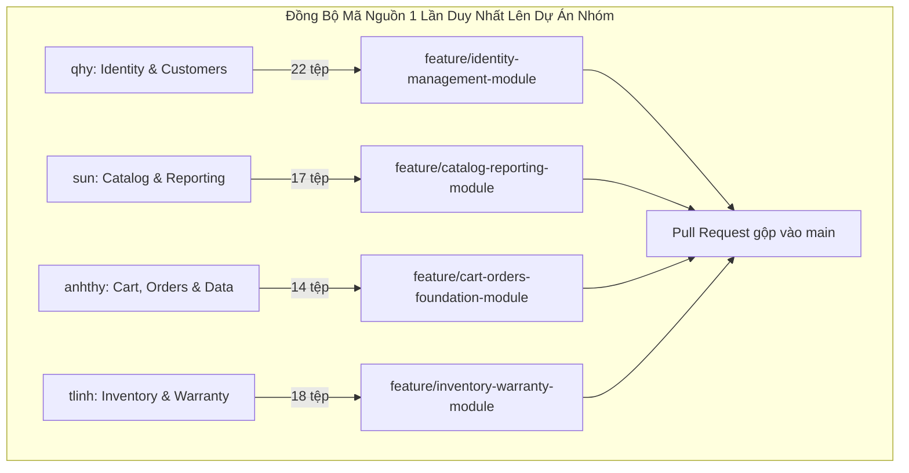

# KẾ HOẠCH COMMIT MÃ NGUỒN DỰ ÁN BLINK BLINK JEWELRY (1 LẦN HOÀN TẤT)
**Dành cho nhóm 4 thành viên:** `qhy`, `sun`, `anhthy`, `tlinh`  
**Phạm vi 3 thư mục cốt lõi Clean Architecture:**  
- `src/BlinkBlink.Domain`
- `src/BlinkBlink.Application`
- `src/BlinkBlink.Infrastructure`

---
## Lưu ý: 
## Khi thực hiện xong lần 1 hãy đánh dấu thay đổi chữ [chưa thực hiện] thành [đã hoàn thành] khi mà mọi thành viên đều đã thực hiện xong. Nhớ là khi thành viên nhóm thực hiện xong và AI agent đã chỉnh sửa nội dung file theo hướng dẫn hãy up file này lên github.
## Chỉ thực hiện việc commit và sửa thông tin thành viên hoàn thành theo hướng dẫn, không cần tự tạo ra schedule cho lần tiếp theo, việc này sẽ do nhóm trưởng làm khi mọi thành viên thực hiện xong.
## Lần 1 [chưa thực hiện]: dùng git checkout 7993495 commit này cho lần thực thi này.
## thành viên đã thực hiện:
- qhy
- anhthy
- sun

## thành viên chưa thực hiện:
- tlinh
## Lần 2: chưa thực hiện


## 1. MỐC ĐỒNG BỘ CƠ SỞ (BASELINE SNAPSHOT) & QUY TẮC ĐỢT SAU

> [!IMPORTANT]
> **MỐC CHỐT ĐỒNG BỘ ĐỢT 1 (PHASE 1 BASELINE)**
> - **Mã Commit Baseline (Personal):** `7993495`
> - **Thời điểm chốt mốc:** Ngày **23/10/2026**
> - **Mục đích:** Đánh dấu toàn bộ mã nguồn của 3 thư mục trên kho Personal tại thời điểm hiện tại để 4 thành viên đưa lên dự án chung của nhóm **trong 1 lần duy nhất**.

### Cơ Chế Lọc Tệp Tự Động Cho Các Đợt Lên Kế Hoạch Sau Này:
Khi bạn tiếp tục phát triển thêm trên kho `Personal` (ví dụ: sau 1 tuần nữa) và yêu cầu lập lịch trình commit mới:
1. **Tệp KHÔNG bị sửa gì (Unchanged):** Sẽ **tự động LOẠI BỎ 100%** khỏi kế hoạch mới, vì chúng đã được commit lên dự án chung ở đợt này rồi.
2. **Tệp CÓ SỬA ĐỔI (`Modified`) hoặc TẠO MỚI (`Added`):** Sẽ được tự động trích xuất thông qua lệnh:
   ```bash
   git diff --name-only 7993495 HEAD -- src/BlinkBlink.Domain src/BlinkBlink.Application src/BlinkBlink.Infrastructure
   ```
3. Kế hoạch đợt tiếp theo sẽ **chỉ phân bổ đúng các tệp thay đổi mới này**, không bao giờ bị trùng lặp lại mã nguồn cũ.

---

## 2. NGUYÊN TẮC VÀNG KHI COMMIT (BẮT BUỘC TUÂN THỦ)

> [!WARNING]
> **TUYỆT ĐỐI KHÔNG COMMIT BUILD ARTIFACTS / TỆP TẠM BIÊN DỊCH**
> - **CẤM** commit các thư mục: `bin/`, `obj/`, `.vs/`, `.vscode/`, `TestResults/`.
> - **CẤM** commit các tệp cấu hình cá nhân hoặc tệp sinh tự động: `*.user`, `*.suo`, `*.log`, `*.cache`.
> - **CHỈ COMMIT** các tệp mã nguồn do lập trình viên trực tiếp viết: định dạng `.cs`, định dạng `.csproj`, `.gitkeep` (nếu thư mục rỗng).
> - **Khuyến nghị thao tác an toàn:**
>   - Kiểm tra trạng thái: `git status` trước khi add.
>   - Chỉ add chính xác tệp cần commit: `git add <đường_dẫn_file>`.
>   - **Tránh tuyệt đối** việc gõ lệnh `git add .` hoặc `git add -A` một cách cẩu thả.

### Quy ước nhánh & Quy trình hoàn tất (Branching & PR Workflow)
Mỗi thành viên làm việc trên đúng **1 nhánh tính năng duy nhất** cho toàn bộ phân hệ của mình:
- **Cú pháp nhánh:** `feature/<tên_phân_hệ>-module`
- **Quy trình 5 bước thực hiện 1 lần duy nhất:**
  1. Kéo code mới nhất từ main:
     ```bash
     git checkout main
     git pull origin main
     ```
  2. Tạo và chuyển sang nhánh làm việc:
     ```bash
     git checkout -b feature/<tên_phân_hệ>-module
     ```
  3. Sao chép và add toàn bộ tệp thuộc phân hệ của mình.
  4. Thực hiện commit với thông điệp chuẩn Conventional Commit.
  5. Đẩy nhánh lên Remote Repository và mở Pull Request (PR):
     ```bash
     git push origin feature/<tên_phân_hệ>-module
     ```

---

## 3. BẢNG MA TRẬN PHÂN CHIA TRÁCH NHIỆM (1 LẦN HOÀN TẤT)

| Thành viên | Phân hệ nghiệp vụ chính phụ trách | Thư mục Domain | Thư mục Application | Thư mục Infrastructure | Nhánh Làm Việc Duy Nhất |
| :--- | :--- | :---: | :---: | :---: | :--- |
| **`qhy`** | **Identity & Customers** (Người dùng, Nhân viên, Vai trò, Khách hàng) | 9 tệp | 9 tệp | 4 tệp | `feature/identity-management-module` |
| **`sun`** | **Catalog & Reporting** (Danh mục, Sản phẩm trang sức, Thống kê) | 5 tệp | 9 tệp | 3 tệp | `feature/catalog-reporting-module` |
| **`anhthy`** | **Cart, Orders & Data Foundation** (Giỏ hàng, Đơn hàng, Hạ tầng CSDL) | 6 tệp | 4 tệp | 4 tệp | `feature/cart-orders-foundation-module` |
| **`tlinh`** | **Inventory & Warranty** (Nhập kho, Kiểm kê, Phiếu bảo hành) | 8 tệp | 7 tệp | 3 tệp | `feature/inventory-warranty-module` |

---

## 4. KẾ HOẠCH COMMIT CHI TIẾT THEO 4 THÀNH VIÊN (1 LẦN HOÀN THÀNH)



---

### 1. Thành viên `qhy`
- **Phân hệ phụ trách:** **Identity & Khách hàng**
- **Nhánh làm việc duy nhất:** `feature/identity-management-module`
- **Số lượng:** 22 tệp (Domain: 9, Application: 9, Infrastructure: 4)
- **Danh sách tệp kèm ngày commit gốc tại Personal:**
  - `src/BlinkBlink.Domain/BlinkBlink.Domain.csproj` *(Gốc: 2026-10-16 | `b70e538`)*
  - `src/BlinkBlink.Domain/Entities/Identity/NguoiDung.cs` *(Gốc: 2026-10-18 | `55c81ed`)*
  - `src/BlinkBlink.Domain/Entities/Identity/VaiTro.cs` *(Gốc: 2026-10-18 | `55c81ed`)*
  - `src/BlinkBlink.Domain/Entities/Identity/NhanVien.cs` *(Gốc: 2026-10-18 | `55c81ed`)*
  - `src/BlinkBlink.Domain/Entities/Customers/KhachHang.cs` *(Gốc: 2026-10-18 | `55c81ed`)*
  - `src/BlinkBlink.Domain/Interfaces/INguoiDungRepository.cs` *(Gốc: 2026-10-18 | `bb5fce4`)*
  - `src/BlinkBlink.Domain/Interfaces/IVaiTroRepository.cs` *(Gốc: 2026-10-18 | `bb5fce4`)*
  - `src/BlinkBlink.Domain/Interfaces/IKhachHangRepository.cs` *(Gốc: 2026-10-23 | `456e033`)*
  - `src/BlinkBlink.Domain/Interfaces/INhanVienRepository.cs` *(Gốc: 2026-10-23 | `456e033`)*
  - `src/BlinkBlink.Application/BlinkBlink.Application.csproj` *(Gốc: 2026-10-16 | `b70e538`)*
  - `src/BlinkBlink.Application/DTOs/Identity/DangNhapDTO.cs` *(Gốc: 2026-10-18 | `bb5fce4`)*
  - `src/BlinkBlink.Application/DTOs/Identity/DangKyKhachHangDTO.cs` *(Gốc: 2026-10-18 | `bb5fce4`)*
  - `src/BlinkBlink.Application/DTOs/Identity/TaoNhanVienDTO.cs` *(Gốc: 2026-10-18 | `bb5fce4`)*
  - `src/BlinkBlink.Application/DTOs/Identity/CapNhatKhachHangDTO.cs` *(Gốc: 2026-10-22 | `ecb94c8`)*
  - `src/BlinkBlink.Application/Services/Identity/DangNhapUseCase.cs` *(Gốc: 2026-10-18 | `bb5fce4`)*
  - `src/BlinkBlink.Application/Services/Identity/DangKyKhachHangUseCase.cs` *(Gốc: 2026-10-18 | `bb5fce4`)*
  - `src/BlinkBlink.Application/Services/Identity/QuanLyKhachHangUseCase.cs` *(Gốc: 2026-10-23 | `456e033`)*
  - `src/BlinkBlink.Application/Services/Identity/QuanLyNhanVienUseCase.cs` *(Gốc: 2026-10-23 | `456e033`)*
  - `src/BlinkBlink.Infrastructure/Repositories/KhachHangRepository.cs` *(Gốc: 2026-10-23 | `456e033`)*
  - `src/BlinkBlink.Infrastructure/Repositories/NguoiDungRepository.cs` *(Gốc: 2026-10-22 | `224adc2`)*
  - `src/BlinkBlink.Infrastructure/Repositories/VaiTroRepository.cs` *(Gốc: 2026-10-22 | `224adc2`)*
  - `src/BlinkBlink.Infrastructure/Repositories/NhanVienRepository.cs` *(Gốc: 2026-10-23 | `456e033`)*
- **Lệnh thực hiện 1 lần duy nhất:**
  ```bash
  git checkout -b feature/identity-management-module
  git add src/BlinkBlink.Domain/BlinkBlink.Domain.csproj src/BlinkBlink.Domain/Entities/Identity/NguoiDung.cs src/BlinkBlink.Domain/Entities/Identity/VaiTro.cs src/BlinkBlink.Domain/Entities/Identity/NhanVien.cs src/BlinkBlink.Domain/Entities/Customers/KhachHang.cs src/BlinkBlink.Domain/Interfaces/INguoiDungRepository.cs src/BlinkBlink.Domain/Interfaces/IVaiTroRepository.cs src/BlinkBlink.Domain/Interfaces/IKhachHangRepository.cs src/BlinkBlink.Domain/Interfaces/INhanVienRepository.cs src/BlinkBlink.Application/BlinkBlink.Application.csproj src/BlinkBlink.Application/DTOs/Identity/DangNhapDTO.cs src/BlinkBlink.Application/DTOs/Identity/DangKyKhachHangDTO.cs src/BlinkBlink.Application/DTOs/Identity/TaoNhanVienDTO.cs src/BlinkBlink.Application/DTOs/Identity/CapNhatKhachHangDTO.cs src/BlinkBlink.Application/Services/Identity/DangNhapUseCase.cs src/BlinkBlink.Application/Services/Identity/DangKyKhachHangUseCase.cs src/BlinkBlink.Application/Services/Identity/QuanLyKhachHangUseCase.cs src/BlinkBlink.Application/Services/Identity/QuanLyNhanVienUseCase.cs src/BlinkBlink.Infrastructure/Repositories/KhachHangRepository.cs src/BlinkBlink.Infrastructure/Repositories/NguoiDungRepository.cs src/BlinkBlink.Infrastructure/Repositories/VaiTroRepository.cs src/BlinkBlink.Infrastructure/Repositories/NhanVienRepository.cs
  git commit -m "feat(identity): tich hop toan bo module NguoiDung, NhanVien, VaiTro va KhachHang"
  git push origin feature/identity-management-module
  ```

---

### 2. Thành viên `sun`
- **Phân hệ phụ trách:** **Catalog & Báo cáo Thống kê**
- **Nhánh làm việc duy nhất:** `feature/catalog-reporting-module`
- **Số lượng:** 17 tệp (Domain: 5, Application: 9, Infrastructure: 3)
- **Danh sách tệp kèm ngày commit gốc tại Personal:**
  - `src/BlinkBlink.Domain/Entities/Catalog/DanhMuc.cs` *(Gốc: 2026-10-22 | `16704d9`)*
  - `src/BlinkBlink.Domain/Entities/Catalog/SanPhamTrangSuc.cs` *(Gốc: 2026-10-23 | `c9028ad`)*
  - `src/BlinkBlink.Domain/Interfaces/IDanhMucRepository.cs` *(Gốc: 2026-10-22 | `68b8e9a`)*
  - `src/BlinkBlink.Domain/Interfaces/ISanPhamRepository.cs` *(Gốc: 2026-10-22 | `68b8e9a`)*
  - `src/BlinkBlink.Domain/Interfaces/IThongKeRepository.cs` *(Gốc: 2026-10-22 | `39e66a6`)*
  - `src/BlinkBlink.Application/DTOs/Catalog/SanPhamDTO.cs` *(Gốc: 2026-10-23 | `c9028ad`)*
  - `src/BlinkBlink.Application/DTOs/Catalog/CapNhatSanPhamDTO.cs` *(Gốc: 2026-10-23 | `c9028ad`)*
  - `src/BlinkBlink.Application/DTOs/Catalog/DoiGiaDTO.cs` *(Gốc: 2026-10-22 | `16704d9`)*
  - `src/BlinkBlink.Application/DTOs/Reporting/BaoCaoTonKhoDTO.cs` *(Gốc: 2026-10-22 | `39e66a6`)*
  - `src/BlinkBlink.Application/DTOs/Reporting/DoanhThuThongKeDTO.cs` *(Gốc: 2026-10-22 | `39e66a6`)*
  - `src/BlinkBlink.Application/DTOs/Reporting/TopSanPhamBanChayDTO.cs` *(Gốc: 2026-10-22 | `39e66a6`)*
  - `src/BlinkBlink.Application/Services/Catalog/QuanLySanPhamUseCase.cs` *(Gốc: 2026-10-23 | `c9028ad`)*
  - `src/BlinkBlink.Application/Services/Reporting/ThongKeDoanhThuUseCase.cs` *(Gốc: 2026-10-22 | `39e66a6`)*
  - `src/BlinkBlink.Application/Services/Reporting/ThongKeKhoHangUseCase.cs` *(Gốc: 2026-10-22 | `39e66a6`)*
  - `src/BlinkBlink.Infrastructure/Repositories/DanhMucRepository.cs` *(Gốc: 2026-10-22 | `68b8e9a`)*
  - `src/BlinkBlink.Infrastructure/Repositories/SanPhamRepository.cs` *(Gốc: 2026-10-23 | `c9028ad`)*
  - `src/BlinkBlink.Infrastructure/Repositories/ThongKeRepository.cs` *(Gốc: 2026-10-22 | `224adc2`)*
- **Lệnh thực hiện 1 lần duy nhất:**
  ```bash
  git checkout -b feature/catalog-reporting-module
  git add src/BlinkBlink.Domain/Entities/Catalog/DanhMuc.cs src/BlinkBlink.Domain/Entities/Catalog/SanPhamTrangSuc.cs src/BlinkBlink.Domain/Interfaces/IDanhMucRepository.cs src/BlinkBlink.Domain/Interfaces/ISanPhamRepository.cs src/BlinkBlink.Domain/Interfaces/IThongKeRepository.cs src/BlinkBlink.Application/DTOs/Catalog/SanPhamDTO.cs src/BlinkBlink.Application/DTOs/Catalog/CapNhatSanPhamDTO.cs src/BlinkBlink.Application/DTOs/Catalog/DoiGiaDTO.cs src/BlinkBlink.Application/DTOs/Reporting/BaoCaoTonKhoDTO.cs src/BlinkBlink.Application/DTOs/Reporting/DoanhThuThongKeDTO.cs src/BlinkBlink.Application/DTOs/Reporting/TopSanPhamBanChayDTO.cs src/BlinkBlink.Application/Services/Catalog/QuanLySanPhamUseCase.cs src/BlinkBlink.Application/Services/Reporting/ThongKeDoanhThuUseCase.cs src/BlinkBlink.Application/Services/Reporting/ThongKeKhoHangUseCase.cs src/BlinkBlink.Infrastructure/Repositories/DanhMucRepository.cs src/BlinkBlink.Infrastructure/Repositories/SanPhamRepository.cs src/BlinkBlink.Infrastructure/Repositories/ThongKeRepository.cs
  git commit -m "feat(catalog-reporting): tich hop toan bo module SanPham, DanhMuc va BaoCaoThongKe"
  git push origin feature/catalog-reporting-module
  ```

---

### 3. Thành viên `anhthy`
- **Phân hệ phụ trách:** **Giỏ hàng, Đơn hàng & Nền tảng Kết nối CSDL**
- **Nhánh làm việc duy nhất:** `feature/cart-orders-foundation-module`
- **Số lượng:** 14 tệp (Domain: 6, Application: 4, Infrastructure: 4)
- **Danh sách tệp kèm ngày commit gốc tại Personal:**
  - `src/BlinkBlink.Domain/Entities/Cart/GioHang.cs` *(Gốc: 2026-10-22 | `75aab0c`)*
  - `src/BlinkBlink.Domain/Entities/Cart/ChiTietGioHang.cs` *(Gốc: 2026-10-22 | `75aab0c`)*
  - `src/BlinkBlink.Domain/Entities/Orders/HoaDon.cs` *(Gốc: 2026-10-22 | `75aab0c`)*
  - `src/BlinkBlink.Domain/Entities/Orders/ChiTietHoaDon.cs` *(Gốc: 2026-10-22 | `75aab0c`)*
  - `src/BlinkBlink.Domain/Interfaces/IGioHangRepository.cs` *(Gốc: 2026-10-22 | `75aab0c`)*
  - `src/BlinkBlink.Domain/Interfaces/IHoaDonRepository.cs` *(Gốc: 2026-10-22 | `75aab0c`)*
  - `src/BlinkBlink.Application/DTOs/Orders/DatHangDTO.cs` *(Gốc: 2026-10-22 | `75aab0c`)*
  - `src/BlinkBlink.Application/DTOs/Orders/CapNhatDonHangDTO.cs` *(Gốc: 2026-10-22 | `75aab0c`)*
  - `src/BlinkBlink.Application/Services/Orders/DatHangUseCase.cs` *(Gốc: 2026-10-22 | `75aab0c`)*
  - `src/BlinkBlink.Application/Services/Orders/XuLyDonHangUseCase.cs` *(Gốc: 2026-10-22 | `75aab0c`)*
  - `src/BlinkBlink.Infrastructure/BlinkBlink.Infrastructure.csproj` *(Gốc: 2026-10-22 | `224adc2`)*
  - `src/BlinkBlink.Infrastructure/Data/DatabaseHelper.cs` *(Gốc: 2026-10-22 | `224adc2`)*
  - `src/BlinkBlink.Infrastructure/Repositories/GioHangRepository.cs` *(Gốc: 2026-10-23 | `456e033`)*
  - `src/BlinkBlink.Infrastructure/Repositories/HoaDonRepository.cs` *(Gốc: 2026-10-23 | `456e033`)*
- **Lệnh thực hiện 1 lần duy nhất:**
  ```bash
  git checkout -b feature/cart-orders-foundation-module
  git add src/BlinkBlink.Domain/Entities/Cart/GioHang.cs src/BlinkBlink.Domain/Entities/Cart/ChiTietGioHang.cs src/BlinkBlink.Domain/Entities/Orders/HoaDon.cs src/BlinkBlink.Domain/Entities/Orders/ChiTietHoaDon.cs src/BlinkBlink.Domain/Interfaces/IGioHangRepository.cs src/BlinkBlink.Domain/Interfaces/IHoaDonRepository.cs src/BlinkBlink.Application/DTOs/Orders/DatHangDTO.cs src/BlinkBlink.Application/DTOs/Orders/CapNhatDonHangDTO.cs src/BlinkBlink.Application/Services/Orders/DatHangUseCase.cs src/BlinkBlink.Application/Services/Orders/XuLyDonHangUseCase.cs src/BlinkBlink.Infrastructure/BlinkBlink.Infrastructure.csproj src/BlinkBlink.Infrastructure/Data/DatabaseHelper.cs src/BlinkBlink.Infrastructure/Repositories/GioHangRepository.cs src/BlinkBlink.Infrastructure/Repositories/HoaDonRepository.cs
  git commit -m "feat(cart-orders): tich hop toan bo module GioHang, HoaDon va DatabaseHelper"
  git push origin feature/cart-orders-foundation-module
  ```

---

### 4. Thành viên `tlinh`
- **Phân hệ phụ trách:** **Kho hàng & Bảo hành**
- **Nhánh làm việc duy nhất:** `feature/inventory-warranty-module`
- **Số lượng:** 18 tệp (Domain: 8, Application: 7, Infrastructure: 3)
- **Danh sách tệp kèm ngày commit gốc tại Personal:**
  - `src/BlinkBlink.Domain/Entities/Inventory/PhieuNhapKho.cs` *(Gốc: 2026-10-22 | `16704d9`)*
  - `src/BlinkBlink.Domain/Entities/Inventory/ChiTietNhapKho.cs` *(Gốc: 2026-10-22 | `16704d9`)*
  - `src/BlinkBlink.Domain/Entities/Inventory/PhieuKiemKe.cs` *(Gốc: 2026-10-22 | `16704d9`)*
  - `src/BlinkBlink.Domain/Entities/Inventory/ChiTietKiemKe.cs` *(Gốc: 2026-10-22 | `16704d9`)*
  - `src/BlinkBlink.Domain/Entities/Warranty/PhieuBaoHanh.cs` *(Gốc: 2026-10-22 | `9bf5ba6`)*
  - `src/BlinkBlink.Domain/Interfaces/IPhieuNhapKhoRepository.cs` *(Gốc: 2026-10-22 | `68b8e9a`)*
  - `src/BlinkBlink.Domain/Interfaces/IPhieuKiemKeRepository.cs` *(Gốc: 2026-10-22 | `16704d9`)*
  - `src/BlinkBlink.Domain/Interfaces/IBaoHanhRepository.cs` *(Gốc: 2026-10-22 | `9bf5ba6`)*
  - `src/BlinkBlink.Application/DTOs/Inventory/NhapKhoDTO.cs` *(Gốc: 2026-10-22 | `16704d9`)*
  - `src/BlinkBlink.Application/DTOs/Inventory/ChiTietNhapKhoDTO.cs` *(Gốc: 2026-10-22 | `16704d9`)*
  - `src/BlinkBlink.Application/DTOs/Warranty/TaoBaoHanhDTO.cs` *(Gốc: 2026-10-22 | `9bf5ba6`)*
  - `src/BlinkBlink.Application/DTOs/Warranty/CapNhatTrangThaiDTO.cs` *(Gốc: 2026-10-22 | `9bf5ba6`)*
  - `src/BlinkBlink.Application/Services/Inventory/XacNhanNhapKhoUseCase.cs` *(Gốc: 2026-10-22 | `16704d9`)*
  - `src/BlinkBlink.Application/Services/Warranty/TiepNhanBaoHanhUseCase.cs` *(Gốc: 2026-10-22 | `9bf5ba6`)*
  - `src/BlinkBlink.Application/Services/Warranty/XuLyBaoHanhUseCase.cs` *(Gốc: 2026-10-22 | `9bf5ba6`)*
  - `src/BlinkBlink.Infrastructure/Repositories/BaoHanhRepository.cs` *(Gốc: 2026-10-22 | `224adc2`)*
  - `src/BlinkBlink.Infrastructure/Repositories/PhieuNhapKhoRepositoryImpl.cs` *(Gốc: 2026-10-23 | `c9028ad`)*
  - `src/BlinkBlink.Infrastructure/Repositories/PhieuKiemKeRepository.cs` *(Gốc: 2026-10-22 | `224adc2`)*
- **Lệnh thực hiện 1 lần duy nhất:**
  ```bash
  git checkout -b feature/inventory-warranty-module
  git add src/BlinkBlink.Domain/Entities/Inventory/PhieuNhapKho.cs src/BlinkBlink.Domain/Entities/Inventory/ChiTietNhapKho.cs src/BlinkBlink.Domain/Entities/Inventory/PhieuKiemKe.cs src/BlinkBlink.Domain/Entities/Inventory/ChiTietKiemKe.cs src/BlinkBlink.Domain/Entities/Warranty/PhieuBaoHanh.cs src/BlinkBlink.Domain/Interfaces/IPhieuNhapKhoRepository.cs src/BlinkBlink.Domain/Interfaces/IPhieuKiemKeRepository.cs src/BlinkBlink.Domain/Interfaces/IBaoHanhRepository.cs src/BlinkBlink.Application/DTOs/Inventory/NhapKhoDTO.cs src/BlinkBlink.Application/DTOs/Inventory/ChiTietNhapKhoDTO.cs src/BlinkBlink.Application/DTOs/Warranty/TaoBaoHanhDTO.cs src/BlinkBlink.Application/DTOs/Warranty/CapNhatTrangThaiDTO.cs src/BlinkBlink.Application/Services/Inventory/XacNhanNhapKhoUseCase.cs src/BlinkBlink.Application/Services/Warranty/TiepNhanBaoHanhUseCase.cs src/BlinkBlink.Application/Services/Warranty/XuLyBaoHanhUseCase.cs src/BlinkBlink.Infrastructure/Repositories/BaoHanhRepository.cs src/BlinkBlink.Infrastructure/Repositories/PhieuNhapKhoRepositoryImpl.cs src/BlinkBlink.Infrastructure/Repositories/PhieuKiemKeRepository.cs
  git commit -m "feat(inventory-warranty): tich hop toan bo module NhapKho, KiemKe va BaoHanh"
  git push origin feature/inventory-warranty-module
  ```

---

## 5. BẢNG TRA CỨU MỐC COMMIT GỐC CỦA TOÀN BỘ 68 TỆP (AUDIT TRAIL)

| STT | Tệp Mã Nguồn | Thư Mục | Ngày Commit Gốc | Mã Hash Gốc | Thành Viên Phụ Trách |
| :---: | :--- | :--- | :---: | :---: | :---: |
| 1 | `BlinkBlink.Domain.csproj` | Domain | 2026-10-16 | `b70e538` | `qhy` |
| 2 | `Entities/Cart/ChiTietGioHang.cs` | Domain | 2026-10-22 | `75aab0c` | `anhthy` |
| 3 | `Entities/Cart/GioHang.cs` | Domain | 2026-10-22 | `75aab0c` | `anhthy` |
| 4 | `Entities/Catalog/DanhMuc.cs` | Domain | 2026-10-22 | `16704d9` | `sun` |
| 5 | `Entities/Catalog/SanPhamTrangSuc.cs` | Domain | 2026-10-23 | `c9028ad` | `sun` |
| 6 | `Entities/Customers/KhachHang.cs` | Domain | 2026-10-18 | `55c81ed` | `qhy` |
| 7 | `Entities/Identity/NguoiDung.cs` | Domain | 2026-10-18 | `55c81ed` | `qhy` |
| 8 | `Entities/Identity/NhanVien.cs` | Domain | 2026-10-18 | `55c81ed` | `qhy` |
| 9 | `Entities/Identity/VaiTro.cs` | Domain | 2026-10-18 | `55c81ed` | `qhy` |
| 10 | `Entities/Inventory/ChiTietKiemKe.cs` | Domain | 2026-10-22 | `16704d9` | `tlinh` |
| 11 | `Entities/Inventory/ChiTietNhapKho.cs` | Domain | 2026-10-22 | `16704d9` | `tlinh` |
| 12 | `Entities/Inventory/PhieuKiemKe.cs` | Domain | 2026-10-22 | `16704d9` | `tlinh` |
| 13 | `Entities/Inventory/PhieuNhapKho.cs` | Domain | 2026-10-22 | `16704d9` | `tlinh` |
| 14 | `Entities/Orders/ChiTietHoaDon.cs` | Domain | 2026-10-22 | `75aab0c` | `anhthy` |
| 15 | `Entities/Orders/HoaDon.cs` | Domain | 2026-10-22 | `75aab0c` | `anhthy` |
| 16 | `Entities/Warranty/PhieuBaoHanh.cs` | Domain | 2026-10-22 | `9bf5ba6` | `tlinh` |
| 17 | `Interfaces/IBaoHanhRepository.cs` | Domain | 2026-10-22 | `9bf5ba6` | `tlinh` |
| 18 | `Interfaces/IDanhMucRepository.cs` | Domain | 2026-10-22 | `68b8e9a` | `sun` |
| 19 | `Interfaces/IGioHangRepository.cs` | Domain | 2026-10-22 | `75aab0c` | `anhthy` |
| 20 | `Interfaces/IHoaDonRepository.cs` | Domain | 2026-10-22 | `75aab0c` | `anhthy` |
| 21 | `Interfaces/IKhachHangRepository.cs` | Domain | 2026-10-23 | `456e033` | `qhy` |
| 22 | `Interfaces/INguoiDungRepository.cs` | Domain | 2026-10-18 | `bb5fce4` | `qhy` |
| 23 | `Interfaces/INhanVienRepository.cs` | Domain | 2026-10-23 | `456e033` | `qhy` |
| 24 | `Interfaces/IPhieuKiemKeRepository.cs` | Domain | 2026-10-22 | `16704d9` | `tlinh` |
| 25 | `Interfaces/IPhieuNhapKhoRepository.cs` | Domain | 2026-10-22 | `68b8e9a` | `tlinh` |
| 26 | `Interfaces/ISanPhamRepository.cs` | Domain | 2026-10-22 | `68b8e9a` | `sun` |
| 27 | `Interfaces/IThongKeRepository.cs` | Domain | 2026-10-22 | `39e66a6` | `sun` |
| 28 | `Interfaces/IVaiTroRepository.cs` | Domain | 2026-10-18 | `bb5fce4` | `qhy` |
| 29 | `BlinkBlink.Application.csproj` | Application | 2026-10-16 | `b70e538` | `qhy` |
| 30 | `DTOs/Catalog/CapNhatSanPhamDTO.cs` | Application | 2026-10-23 | `c9028ad` | `sun` |
| 31 | `DTOs/Catalog/DoiGiaDTO.cs` | Application | 2026-10-22 | `16704d9` | `sun` |
| 32 | `DTOs/Catalog/SanPhamDTO.cs` | Application | 2026-10-23 | `c9028ad` | `sun` |
| 33 | `DTOs/Identity/CapNhatKhachHangDTO.cs` | Application | 2026-10-22 | `ecb94c8` | `qhy` |
| 34 | `DTOs/Identity/DangKyKhachHangDTO.cs` | Application | 2026-10-18 | `bb5fce4` | `qhy` |
| 35 | `DTOs/Identity/DangNhapDTO.cs` | Application | 2026-10-18 | `bb5fce4` | `qhy` |
| 36 | `DTOs/Identity/TaoNhanVienDTO.cs` | Application | 2026-10-18 | `bb5fce4` | `qhy` |
| 37 | `DTOs/Inventory/ChiTietNhapKhoDTO.cs` | Application | 2026-10-22 | `16704d9` | `tlinh` |
| 38 | `DTOs/Inventory/NhapKhoDTO.cs` | Application | 2026-10-22 | `16704d9` | `tlinh` |
| 39 | `DTOs/Orders/CapNhatDonHangDTO.cs` | Application | 2026-10-22 | `75aab0c` | `anhthy` |
| 40 | `DTOs/Orders/DatHangDTO.cs` | Application | 2026-10-22 | `75aab0c` | `anhthy` |
| 41 | `DTOs/Reporting/BaoCaoTonKhoDTO.cs` | Application | 2026-10-22 | `39e66a6` | `sun` |
| 42 | `DTOs/Reporting/DoanhThuThongKeDTO.cs` | Application | 2026-10-22 | `39e66a6` | `sun` |
| 43 | `DTOs/Reporting/TopSanPhamBanChayDTO.cs` | Application | 2026-10-22 | `39e66a6` | `sun` |
| 44 | `DTOs/Warranty/CapNhatTrangThaiDTO.cs` | Application | 2026-10-22 | `9bf5ba6` | `tlinh` |
| 45 | `DTOs/Warranty/TaoBaoHanhDTO.cs` | Application | 2026-10-22 | `9bf5ba6` | `tlinh` |
| 46 | `Services/Catalog/QuanLySanPhamUseCase.cs` | Application | 2026-10-23 | `c9028ad` | `sun` |
| 47 | `Services/Identity/DangKyKhachHangUseCase.cs` | Application | 2026-10-18 | `bb5fce4` | `qhy` |
| 48 | `Services/Identity/DangNhapUseCase.cs` | Application | 2026-10-18 | `bb5fce4` | `qhy` |
| 49 | `Services/Identity/QuanLyKhachHangUseCase.cs` | Application | 2026-10-23 | `456e033` | `qhy` |
| 50 | `Services/Identity/QuanLyNhanVienUseCase.cs` | Application | 2026-10-23 | `456e033` | `qhy` |
| 51 | `Services/Inventory/XacNhanNhapKhoUseCase.cs` | Application | 2026-10-22 | `16704d9` | `tlinh` |
| 52 | `Services/Orders/DatHangUseCase.cs` | Application | 2026-10-22 | `75aab0c` | `anhthy` |
| 53 | `Services/Orders/XuLyDonHangUseCase.cs` | Application | 2026-10-22 | `75aab0c` | `anhthy` |
| 54 | `Services/Reporting/ThongKeDoanhThuUseCase.cs` | Application | 2026-10-22 | `39e66a6` | `sun` |
| 55 | `Services/Reporting/ThongKeKhoHangUseCase.cs` | Application | 2026-10-22 | `39e66a6` | `sun` |
| 56 | `Services/Warranty/TiepNhanBaoHanhUseCase.cs` | Application | 2026-10-22 | `9bf5ba6` | `tlinh` |
| 57 | `Services/Warranty/XuLyBaoHanhUseCase.cs` | Application | 2026-10-22 | `9bf5ba6` | `tlinh` |
| 58 | `BlinkBlink.Infrastructure.csproj` | Infrastructure | 2026-10-22 | `224adc2` | `anhthy` |
| 59 | `Data/DatabaseHelper.cs` | Infrastructure | 2026-10-22 | `224adc2` | `anhthy` |
| 60 | `Repositories/BaoHanhRepository.cs` | Infrastructure | 2026-10-22 | `224adc2` | `tlinh` |
| 61 | `Repositories/DanhMucRepository.cs` | Infrastructure | 2026-10-22 | `68b8e9a` | `sun` |
| 62 | `Repositories/GioHangRepository.cs` | Infrastructure | 2026-10-23 | `456e033` | `anhthy` |
| 63 | `Repositories/HoaDonRepository.cs` | Infrastructure | 2026-10-23 | `456e033` | `anhthy` |
| 64 | `Repositories/KhachHangRepository.cs` | Infrastructure | 2026-10-23 | `456e033` | `qhy` |
| 65 | `Repositories/NguoiDungRepository.cs` | Infrastructure | 2026-10-22 | `224adc2` | `qhy` |
| 66 | `Repositories/NhanVienRepository.cs` | Infrastructure | 2026-10-23 | `456e033` | `qhy` |
| 67 | `Repositories/PhieuKiemKeRepository.cs` | Infrastructure | 2026-10-22 | `224adc2` | `tlinh` |
| 68 | `Repositories/PhieuNhapKhoRepositoryImpl.cs` | Infrastructure | 2026-10-23 | `c9028ad` | `tlinh` |
| 69 | `Repositories/SanPhamRepository.cs` | Infrastructure | 2026-10-23 | `c9028ad` | `sun` |
| 70 | `Repositories/ThongKeRepository.cs` | Infrastructure | 2026-10-22 | `224adc2` | `sun` |
| 71 | `Repositories/VaiTroRepository.cs` | Infrastructure | 2026-10-22 | `224adc2` | `qhy` |

---

## 6. CHECKLIST NGHIỆM THU ĐẢM BẢO QUY CHUẨN

Sau khi cả 4 thành viên hoàn thành commit và merge nhánh của mình vào `main`:
- [ ] **100% Cả 4 thành viên đều xuất hiện trong Git Log** của `src/BlinkBlink.Domain`.
- [ ] **100% Cả 4 thành viên đều xuất hiện trong Git Log** của `src/BlinkBlink.Application`.
- [ ] **100% Cả 4 thành viên đều xuất hiện trong Git Log** của `src/BlinkBlink.Infrastructure`.
- [ ] **Không có bất kỳ tệp `bin/`, `obj/`, `.vs/` nào** lọt vào lịch sử commit trên GitHub.
- [ ] Chạy lệnh `dotnet build` trên giải pháp `BlinkBlinkJewelry.slnx` thành công `0 Error(s), 0 Warning(s)` với Target Framework duy nhất `.NET 8 LTS`.
- [ ] Chạy `dotnet test` đảm bảo toàn bộ bộ kiểm thử đơn vị và tích hợp đều đạt 100% Pass.
