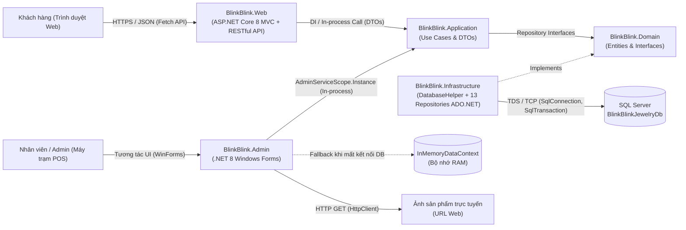
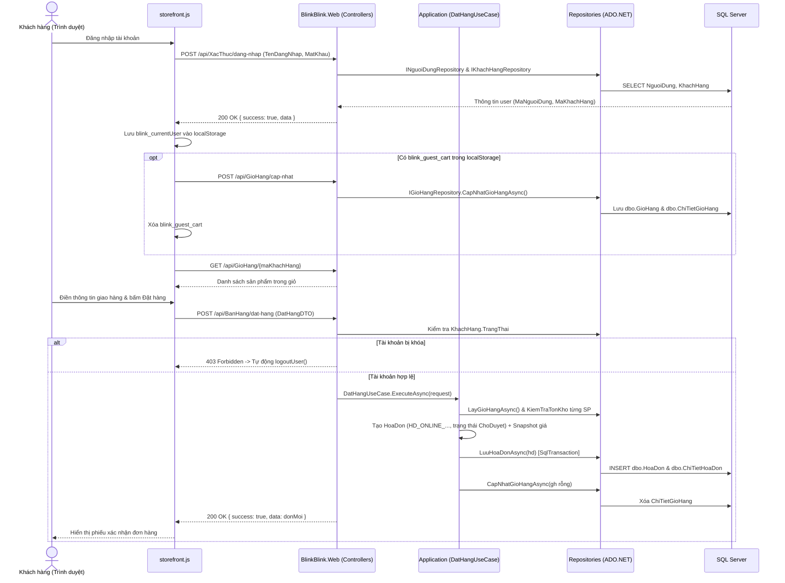
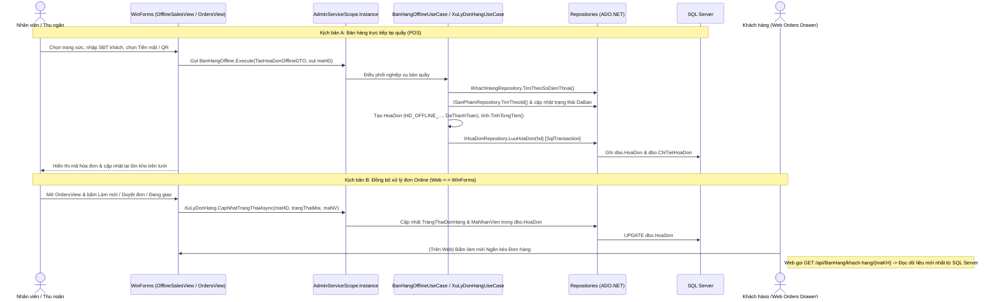

# THIẾT KẾ GIAO TIẾP HỆ THỐNG — BLINK BLINK JEWELRY

Tài liệu này mô tả chi tiết **Thiết kế giao tiếp (Communication Design)** của đồ án **Blink Blink Jewelry** dựa trên kiến trúc **Clean Architecture (.NET 8 LTS)** và hiện trạng mã nguồn thực tế trong solution `BlinkBlinkJewelry.slnx`.

---

## 1. Tổng quan Kiến trúc Giao tiếp Toàn hệ thống

Hệ thống **Blink Blink Jewelry** phục vụ đồng thời hai nhóm tác nhân trên hai nền tảng giao diện khác nhau nhưng dùng chung một lõi nghiệp vụ và một cơ sở dữ liệu tập trung:

1. **Khách hàng mua sắm trực tuyến:** Tương tác thông qua **Web Storefront** (`BlinkBlink.Web`: ASP.NET Core 8 MVC + HTML5/CSS3/Vanilla JS ES6). Giao tiếp với nghiệp vụ qua **RESTful API (HTTP/HTTPS + JSON)**.
2. **Nhân viên, Thu ngân (POS), Thủ kho, Kỹ thuật viên & Quản trị viên:** Tương tác thông qua **Ứng dụng Desktop WinForms** (`BlinkBlink.Admin`: .NET 8 Windows Forms). Giao tiếp trực tiếp trong cùng tiến trình (**In-process**) với tầng `BlinkBlink.Application` thông qua `AdminServiceScope.Instance`.
3. **Kho lưu trữ tập trung:** Cả Web và Desktop đều truy xuất dữ liệu xuống **Microsoft SQL Server (`BlinkBlinkJewelryDb`)** thông qua tầng hạ tầng `BlinkBlink.Infrastructure` sử dụng **ADO.NET thuần (`Microsoft.Data.SqlClient`)**.

### Bảng tổng hợp các kênh giao tiếp chính

| Kênh giao tiếp | Bên gửi (Client/Caller) | Bên nhận (Server/Target) | Giao thức / Cơ chế | Định dạng dữ liệu | Ghi chú triển khai |
| :--- | :--- | :--- | :--- | :--- | :--- |
| **Web Frontend ↔ Web Backend** | `wwwroot/js/storefront.js` (Fetch API) | `BlinkBlink.Web/Controllers/*` (`[ApiController]`) | HTTP / HTTPS (RESTful) | JSON (`application/json`) | Mặc định chạy tại `http://localhost:5095` (hoặc `5000`, `https://localhost:7031`) |
| **Web Controller ↔ Application** | API Controllers (`BanHangController`, `SanPhamController`, ...) | Use Cases (`DatHangUseCase`, `DangNhapUseCase`, ...) | In-process via ASP.NET Core DI (`AddScoped`) | DTOs & Kiểu nguyên thủy | Controller chỉ validate input, kiểm tra quyền/trạng thái rồi ủy quyền cho Use Case |
| **WinForms UI ↔ Application** | Các Form & UserControl (`LoginForm`, `OfflineSalesView`, `OrdersView`, ...) | `AdminServiceScope.Instance` → Use Cases & Repositories | In-process Singleton (`lock` thread-safe) | DTOs & Domain Entities | Không đi qua HTTP API, tối ưu tốc độ thao tác quầy POS |
| **Application / Infra ↔ SQL Server** | `DatabaseHelper` & 13 Repositories | SQL Server (`BlinkBlinkJewelryDb`) | ADO.NET (`Microsoft.Data.SqlClient`) qua TCP/LocalDB/Named Pipes | Câu lệnh T-SQL tham số hóa (`SqlParameter`) | Có cơ chế tự dò instance, tự tạo DB và tự nâng cấp schema |
| **WinForms Offline Fallback** | `AdminServiceScope` | `InMemoryDataContext` | In-memory C# Collections | Domain Entities | Tự kích hoạt nếu không kết nối được SQL Server |
| **Đồng bộ Web ↔ WinForms** | `BlinkBlink.Web` | `BlinkBlink.Admin` | Chia sẻ CSDL tập trung (Shared Database) | Dữ liệu bảng `HoaDon`, `SanPhamTrangSuc`, `PhieuBaoHanh`, ... | Đồng bộ theo mô hình Pull (tải lại/làm mới theo thao tác người dùng) |
| **Tài nguyên ngoại vi / Thanh toán** | `ProductEditDialog.cs`, `OfflineSalesView.cs`, `WarrantyView.cs` | URL ảnh ngoài / File tĩnh nội bộ | `HttpClient` (timeout 5s) / Đọc file `QRChuyenKhoan.jpg` & `/images/products/` | Binary Image Stream | Hiển thị QR chuyển khoản tĩnh; chưa tích hợp webhook ngân hàng |

---

## 2. Giao tiếp Web Client ↔ Backend RESTful API (`BlinkBlink.Web`)

### 2.1. Cấu hình Pipeline & Chính sách Giao tiếp (`src/BlinkBlink.Web/Program.cs`)

- **Địa chỉ lắng nghe (`launchSettings.json` & `chay_he_thong.bat`):**
  - Profile `http`: `http://localhost:5095;http://localhost:5000`
  - Profile `https`: `https://localhost:7031;http://localhost:5095;http://localhost:5000`
  - Script khởi chạy toàn hệ thống (`chay_he_thong.bat`): khởi động `BlinkBlink.Web` tại `http://localhost:5095` và chạy song song `BlinkBlink.Admin`.
- **Middleware Pipeline:**
  1. `UseSwagger()` & `UseSwaggerUI()` (khi `IsDevelopment()`): cung cấp tài liệu tương tác OpenAPI tại `/swagger`.
  2. `UseHttpsRedirection()` và `UseStaticFiles()` (phục vụ CSS, JS, hình ảnh trong `wwwroot/`).
  3. `UseRouting()` → `UseCors("AllowAll")` → `UseAuthorization()`.
  4. `MapControllers()` (ánh xạ các `[ApiController]` theo attribute route `/api/[controller]`) và `MapControllerRoute` mặc định `{controller=Home}/{action=Index}/{id?}` cho Razor Views.
- **Chính sách CORS (`AllowAll`):** Cho phép mọi Origin, Header và Method (`AllowAnyOrigin().AllowAnyHeader().AllowAnyMethod()`), giúp giao diện Web hoặc ứng dụng ngoài có thể gọi API linh hoạt.
- **Đăng ký phụ thuộc (Dependency Injection):**
  - `DatabaseHelper`: `AddSingleton` (dùng chung kết nối/cấu hình trong vòng đời ứng dụng).
  - 13 Repositories (`ISanPhamRepository`, `INhomSanPhamRepository`, `IDanhMucRepository`, `IKhachHangRepository`, `INhanVienRepository`, `INguoiDungRepository`, `IVaiTroRepository`, `IPhieuNhapKhoRepository`, `IPhieuKiemKeRepository`, `IHoaDonRepository`, `IGioHangRepository`, `IBaoHanhRepository`, `IThongKeRepository`): `AddScoped`.
  - 14 Use Cases (`QuanLySanPhamUseCase`, `QuanLyNhomSanPhamUseCase`, `QuanLyKiemKeUseCase`, `DangNhapUseCase`, `DangKyKhachHangUseCase`, `QuanLyNhanVienUseCase`, `QuanLyKhachHangUseCase`, `XacNhanNhapKhoUseCase`, `DatHangUseCase`, `XuLyDonHangUseCase`, `TiepNhanBaoHanhUseCase`, `XuLyBaoHanhUseCase`, `ThongKeDoanhThuUseCase`, `ThongKeKhoHangUseCase`): `AddScoped`.

### 2.2. Đặc tả các RESTful API Endpoints

#### A. Phân hệ Xác thực & Khách hàng

| Controller | Method & Endpoint | Payload / Tham số đầu vào | Phản hồi chính | Chức năng |
| :--- | :--- | :--- | :--- | :--- |
| `XacThucController` | `POST /api/XacThuc/dang-nhap` | Body `DangNhapDTO`: `{ TenDangNhap, MatKhau }` | `200`: `{ success, message, data: { maNguoiDung, hoTen, tenDangNhap, soDienThoai, maVaiTro, maKhachHang } }` `400` / `401` | Xác thực đăng nhập cho khách hàng (và người dùng) |
| `KhachHangController` | `POST /api/KhachHang/dang-ky` | Body `DangKyKhachHangDTO`: `{ HoTen, SoDienThoai, NgaySinh, TenDangNhap, MatKhau }` | `200`: `{ success, message, data: { hoTen, tenDangNhap, soDienThoai } }` `400` (bắt lỗi trùng `SqlException` 2601/2627) | Đăng ký tài khoản khách hàng mới |
| `KhachHangController` | `GET /api/KhachHang/{maKh}` | Route `maKh` (Mã KH hoặc Mã người dùng) | `200`: `{ success, data: { maKhachHang, maNguoiDung, hoTen, soDienThoai, tenDangNhap, ngaySinh, trangThai } }` `400` / `404` | Tra cứu hồ sơ khách hàng |
| `KhachHangController` | `PUT /api/KhachHang/cap-nhat` | Body `CapNhatKhachHangDTO`: `{ MaKhachHang, HoTen, SoDienThoai, NgaySinh }` | `200`: `{ success, message, data }`  `400` / `403` (tài khoản bị khóa) / `404` | Cập nhật thông tin cá nhân khách hàng |

#### B. Phân hệ Sản phẩm & Danh mục

| Controller | Method & Endpoint | Payload / Tham số đầu vào | Phản hồi chính | Chức năng |
| :--- | :--- | :--- | :--- | :--- |
| `SanPhamController` | `GET /api/SanPham` | Không | `200`: `{ success, data: [...] }` (kèm `giaSauGiam`, `tenDanhMuc`, `maNhom`, `tenNhom`, `conHang`) | Lấy toàn bộ danh mục trang sức hiển thị trên Storefront |
| `SanPhamController` | `GET /api/SanPham/{maSanPham}` | Route `maSanPham` | `200`: `{ success, data: { ... } }` `400` / `404` | Lấy chi tiết một mẫu trang sức |
| `SanPhamController` | `GET /api/SanPham/nhom/{maNhom}` | Route `maNhom` | `200`: `{ success, data: [...] }` | Lấy các biến thể sản phẩm cùng nhóm mẫu (khác size) |
| `SanPhamController` | `POST /api/SanPham` | Body `SanPhamDTO` | `200` / `400` | Tạo sản phẩm trang sức mới |
| `SanPhamController` | `PUT /api/SanPham/{maSanPham}/doi-gia` | Route `maSanPham`, Body `DoiGiaDTO` (`{ GiaMoi }`) | `200` / `400` / `404` | Cập nhật giá bán niêm yết sản phẩm |
| `SanPhamController` | `PUT /api/SanPham/cap-nhat-thong-tin` | Body `CapNhatSanPhamDTO` | `200` / `400` / `404` | Cập nhật thông tin chi tiết sản phẩm |

#### C. Phân hệ Giỏ hàng & Bán hàng / Đơn hàng

| Controller | Method & Endpoint | Payload / Tham số đầu vào | Phản hồi chính | Chức năng |
| :--- | :--- | :--- | :--- | :--- |
| `GioHangController` | `GET /api/GioHang/{maKhachHang}` | Route `maKhachHang` | `200`: `{ success, data: { maGioHang, maKhachHang, soLuong, danhSachSanPham } }` `400` / `500` | Nạp giỏ hàng đã lưu trên SQL Server của khách hàng |
| `GioHangController` | `POST /api/GioHang/cap-nhat` | Body `CapNhatGioHangRequest`: `{ MaGioHang, MaKhachHang, DanhSachSanPham: [{ MaSanPham, SoLuong }] }` | `200`: `{ success, message, tongSoLuong }` `400` / `403` (tài khoản bị khóa) / `500` | Đồng bộ toàn bộ giỏ hàng từ trình duyệt xuống CSDL |
| `GioHangController` | `POST /api/GioHang/xoa-sach/{maKhachHang}` | Route `maKhachHang` | `200` / `400` / `500` | Dọn sạch giỏ hàng của khách trên CSDL |
| `BanHangController` | `POST /api/BanHang/dat-hang` | Body `DatHangDTO`: `{ MaKhachHang, DiaChiGiaoHang, SoDienThoaiNhan, PhuongThucThanhToan, GhiChu }` | `200`: `{ success, message, data: donMoi }` `400` / `403` (tài khoản bị khóa) | Tạo đơn đặt hàng trực tuyến (`HD_ONLINE_...`) từ giỏ hàng và dọn giỏ |
| `BanHangController` | `GET /api/BanHang/khach-hang/{maKH}` | Route `maKH` | `200`: `{ success, data: [...] }` `400` | Tra cứu lịch sử đơn hàng của một khách hàng |
| `BanHangController` | `GET /api/BanHang/danh-sach` | Không | `200`: `{ success, data: [...] }` | Lấy toàn bộ đơn hàng trong hệ thống (phục vụ quản trị) |
| `BanHangController` | `PUT /api/BanHang/trang-thai` | Body `CapNhatDonHangDTO`: `{ MaHoaDon, TrangThaiMoi, MaNhanVien }` | `200` / `400` | Cập nhật trạng thái xử lý đơn hàng |
| `BanHangController` | `PUT /api/BanHang/{maHoaDon}/huy` | Route `maHoaDon` | `200` / `400` | Hủy đơn hàng và hoàn lại trạng thái sản phẩm vào kho |

#### D. Phân hệ Bảo hành, Nhập kho & Thống kê

| Controller | Method & Endpoint | Payload / Tham số đầu vào | Phản hồi chính | Chức năng |
| :--- | :--- | :--- | :--- | :--- |
| `BaoHanhController` | `GET /api/BaoHanh/{soPhieu}` | Route `soPhieu` | `200`: `{ success, data: { soPhieu, tenKhachHang, tenSanPham, trangThaiXuLy, chiPhiBaoHanh, ngayTiepNhan, ngayHenTra, ... } }` `400` / `404` | Tra cứu tiến độ phiếu bảo hành điện tử |
| `BaoHanhController` | `GET /api/BaoHanh/khach-hang/{maKH}` | Route `maKH` | `200`: `{ success, data: [...] }` `400` | Lấy danh sách phiếu bảo hành của một khách hàng |
| `BaoHanhController` | `GET /api/BaoHanh/danh-sach` | Không | `200`: `{ success, data: [...] }` | Lấy toàn bộ danh sách phiếu bảo hành |
| `BaoHanhController` | `POST /api/BaoHanh/tiep-nhan` | Body `TaoBaoHanhDTO` | `200` / `400` | Tiếp nhận yêu cầu và lập phiếu bảo hành mới |
| `BaoHanhController` | `PUT /api/BaoHanh/{soPhieu}/trang-thai` | Route `soPhieu`, Body `CapNhatTrangThaiDTO` | `200` / `400` | Cập nhật tiến độ hoặc hoàn tất (`DaHoanTat`) kèm chi phí bảo hành |
| `PhieuNhapKhoController` | `POST /api/PhieuNhapKho/nhap-kho` | Body `NhapKhoDTO` | `200` / `400` | Lập và xác nhận phiếu nhập kho trang sức |
| `ThongKeController` | `GET /api/ThongKe/doanh-thu` | Query `tuNgay?`, `denNgay?` (mặc định 30 ngày gần nhất) | `200`: `{ success, tuNgay, denNgay, data }` | Thống kê doanh thu và lợi nhuận ước tính theo ngày |
| `ThongKeController` | `GET /api/ThongKe/ton-kho` | Không | `200`: `{ success, data }` | Báo cáo tồn kho, giá trị tồn và chênh lệch kiểm kê |
| `ThongKeController` | `GET /api/ThongKe/top-ban-chay` | Query `top` (mặc định `5`) | `200`: `{ success, top, data }` | Top sản phẩm bán chạy nhất |
| `ThongKeController` | `GET /api/ThongKe/doanh-thu-thap` | Query `top` (mặc định `5`) | `200`: `{ success, top, data }` | Top sản phẩm doanh thu thấp / bán chậm |

#### E. Điều hướng Trang Web MVC (`HomeController`)

- `GET /` (`Home/Index`): Trả về Razor View `Views/Home/Index.cshtml` (cửa hàng trang sức chính).
- `GET /tim-kiem` hoặc `GET /TimKiem`: Trả về Razor View `Views/Home/TimKiem.cshtml` (tìm kiếm & lọc nâng cao).
- `GET /Home/Privacy`: Trả về `Views/Home/Privacy.cshtml`.
- `GET /Home/Error`: Trả về `Views/Shared/Error.cshtml` kèm `RequestId`.

### 2.3. Quy ước Bản tin, Xử lý Lỗi & Quản lý Trạng thái Client (`storefront.js`)

1. **Quy ước JSON Payload & Response:**
   - Mọi request ghi dữ liệu (`POST`, `PUT`) gửi từ `storefront.js` đều đính kèm header `Content-Type: application/json` và `Accept: application/json`.
   - Phản hồi chuẩn hóa theo cấu trúc `{ success: boolean, message?: string, data?: any }`. Do `System.Text.Json` mặc định của ASP.NET Core chuyển sang camelCase, phía JS đọc linh hoạt cả hai dạng (ví dụ `data.maKhachHang || data.MaKhachHang`) để phòng ngừa sai khác tên trường.
2. **Xử lý Trạng thái Khóa Tài Khoản (`403 Forbidden`):**
   - Tại `GioHangController.CapNhatGioHang`, `BanHangController.DatHang` và `KhachHangController.CapNhatThongTin`, backend kiểm tra thuộc tính `TrangThai` của `KhachHang`.
   - Nếu tài khoản đã bị Admin khóa từ WinForms (`TrangThai == false`), API trả về mã HTTP `403`. Khi nhận `res.status === 403`, `storefront.js` hiển thị thông báo cảnh báo và tự động gọi `logoutUser()` sau `1200ms` để chấm dứt phiên làm việc trên trình duyệt.
3. **Chiến lược Lưu trữ & Đồng bộ Giỏ hàng Hai Chế Độ:**
   - **Khách vãng lai (chưa đăng nhập):** Giỏ hàng được lưu cục bộ trong `localStorage` dưới khóa `blink_guest_cart`.
   - **Khách đã đăng nhập:** Thông tin phiên được giữ trong `localStorage` (`blink_currentUser`). Ngay sau khi đăng nhập hoặc đăng ký thành công, hàm `syncGuestCartAndReload()` gửi dữ liệu từ `blink_guest_cart` (nếu có) lên `POST /api/GioHang/cap-nhat`, xóa bỏ `blink_guest_cart`, rồi gọi `GET /api/GioHang/{maKhachHang}` để đồng bộ hoàn toàn từ SQL Server. Từ thời điểm này, mọi thao tác thêm/sửa/xóa giỏ hàng chỉ giao tiếp qua API `/api/GioHang/*`.

---

## 3. Giao tiếp Nội bộ & Ứng dụng Desktop WinForms (`BlinkBlink.Admin`)

### 3.1. Mô hình Kết nối In-process qua `AdminServiceScope`

Khác với Web phải đi qua tầng HTTP Controller, ứng dụng **WinForms POS/Admin (`BlinkBlink.Admin`)** tham chiếu trực tiếp đến các project `BlinkBlink.Application`, `BlinkBlink.Domain` và `BlinkBlink.Infrastructure`. Toàn bộ điểm truy cập dịch vụ được tập trung tại lớp Singleton `AdminServiceScope` (`src/BlinkBlink.Admin/Services/AdminServiceScope.cs`):

- **Cơ chế khởi tạo an toàn đa luồng:** Sử dụng mẫu Singleton với khóa `lock (_lock)` thông qua `AdminServiceScope.Instance`.
- **Quản lý phiên nhân sự đăng nhập:** Lưu giữ thông tin người dùng hiện hành trong `CurrentUser` (`NguoiDung`) và `CurrentStaff` (`NhanVien`) để truyền `MaNhanVien` xuống các Use Case (lập hóa đơn POS, duyệt đơn, nhập kho, kiểm kê) và phân quyền hiển thị trên `MainForm`.
- **Giao tiếp giữa các Form khởi động (`Program.cs`):**
  - `Program.Main()` chạy vòng lặp xác thực: hiển thị `LoginForm.ShowDialog()`.
  - Nếu `DialogResult.OK` và `loginForm.AuthenticatedUser != null`, khởi chạy `MainForm(loginForm.AuthenticatedUser)`.
  - Khi người dùng bấm Đăng xuất trong `MainForm`, cờ `mainForm.IsLogoutRequested` được đặt thành `true`, thoát vòng lặp `Application.Run(mainForm)` và mở lại `LoginForm`. Nếu đóng cửa sổ trực tiếp (`X`), ứng dụng thoát hoàn toàn.

### 3.2. Cơ chế Dự phòng Ngoại tuyến (`InMemoryDataContext`)

Khi `AdminServiceScope` khởi tạo, nếu không kết nối hoặc không khởi tạo được SQL Server (`IsDatabaseConnected == false`), hệ thống tự động khởi tạo `InMemoryDataContext` và gọi `SeedInitialLuxuryData()`. Vì `InMemoryDataContext` cài đặt đầy đủ 13 interface Repository của `BlinkBlink.Domain` (`ISanPhamRepository`, `IHoaDonRepository`, `IBaoHanhRepository`, ...), toàn bộ Use Cases và WinForms Views vẫn giao tiếp bình thường qua cùng bộ hợp đồng Interface mà không cần thay đổi bất kỳ dòng code UI nào.

### 3.3. Giao tiếp Tài nguyên & Thiết bị Bên ngoài trên WinForms

- **Tải ảnh sản phẩm từ Internet (`ProductEditDialog.cs`):** Khi quản trị viên dán URL `http://` hoặc `https://`, WinForms sử dụng `HttpClient` với `Timeout = TimeSpan.FromSeconds(5)` để tải mảng byte ảnh bất đồng bộ và hiển thị xem trước trên `PictureBox`.
- **Chia sẻ thư mục ảnh tĩnh với Web (`ProductEditDialog.cs`):** Khi chọn ảnh nội bộ theo đường dẫn `/images/products/...`, WinForms ánh xạ trực tiếp tới thư mục vật lý `src/BlinkBlink.Web/wwwroot/images/products/` để cả WinForms và Web đọc chung một nguồn ảnh.
- **Hiển thị QR Chuyển khoản (`OfflineSalesView.cs` & `WarrantyView.cs`):** Tìm nạp file ảnh tĩnh `QRChuyenKhoan.jpg` theo danh sách đường dẫn ứng viên từ `AppDomain.CurrentDomain.BaseDirectory` lên tới thư mục gốc solution để phục vụ khách quét mã thanh toán tại quầy POS và quầy bảo hành.

---

## 4. Giao tiếp Tầng Hạ tầng ↔ Cơ sở dữ liệu SQL Server (`BlinkBlink.Infrastructure`)

### 4.1. Cơ chế Dò tìm Kết nối & Tự động Khởi tạo CSDL (`DatabaseHelper.cs`)

Cả `BlinkBlink.Web/Program.cs` và `BlinkBlink.Admin/Services/AdminServiceScope.cs` đều áp dụng chung chuỗi ưu tiên dò tìm SQL Server cục bộ:
1. `DefaultConnection` (từ `appsettings.json` nếu có, riêng Web).
2. `Server=.;Database=BlinkBlinkJewelryDb;...`
3. `Server=localhost;Database=BlinkBlinkJewelryDb;...`
4. `Server=.\MSSQL;Database=BlinkBlinkJewelryDb;...`
5. `Server=(localdb)\mssqllocaldb;Database=BlinkBlinkJewelryDb;...`

Tất cả chuỗi kết nối đều bật `Trusted_Connection=True`, `MultipleActiveResultSets=true`, `TrustServerCertificate=True`, `Connect Timeout=3`.

- **Auto-Database Provisioning (`TryProvisionDatabase`):** Nếu kiểm tra `TestConnection()` thất bại trên tất cả ứng viên (CSDL chưa được tạo), `DatabaseHelper` tự động kết nối vào database `master`, tạo database `BlinkBlinkJewelryDb`, đọc kịch bản `BlinkBlinkJewelry.sql` (từ `EmbeddedResource` hoặc file vật lý), tách các batch lệnh theo từ khóa `GO` (`ExecuteScriptBatches`) và thực thi tạo bảng cùng dữ liệu mẫu.
- **Tương thích Lược đồ Ngược (`EnsureSchemaCompatibility`):** Ngay sau khi kết nối thành công, hệ thống tự kiểm tra các cột/bảng bổ sung (`ChiTietHoaDon.PhanTramGiamGia`, các cột mở rộng của `PhieuBaoHanh`, bảng `NhomSanPham`, `SanPhamTrangSuc.TyLeLoiNhuan`, chuẩn hóa `TrangThai` của `PhieuNhapKho` và `PhieuKiemKe`, tài khoản `TECHNICIAN` và khách vãng lai `KH_GUEST_POS`) và tự chạy lệnh `ALTER TABLE` / `INSERT` nếu thiếu.

### 4.2. Toàn vẹn Giao dịch (ACID) & Bảo mật Truy vấn

- **Chống SQL Injection:** Mọi truy vấn T-SQL trong 13 Repositories đều sử dụng câu lệnh tham số hóa tường minh qua `SqlParameter` (kèm kiểu dữ liệu cụ thể như `SqlDbType.VarChar`, `SqlDbType.NVarChar`, `SqlDbType.Decimal`, `SqlDbType.DateTime2`).
- **Giao dịch đồng bộ (`SqlTransaction`):** Các thao tác ghi nhiều bảng liên quan nhau được bọc trong `conn.BeginTransaction()`. Ví dụ điển hình là `HoaDonRepository.LuuHoaDon(HoaDon hd)`:
  - `INSERT`/`UPDATE` bảng cha `dbo.HoaDon` → `DELETE` chi tiết cũ → `INSERT` từng dòng con `dbo.ChiTietHoaDon`.
  - Chỉ `tx.Commit()` khi toàn bộ thành công; nếu có ngoại lệ ở bất kỳ bước nào sẽ `tx.Rollback()` để tránh hóa đơn bị thiếu chi tiết.
- **Chuẩn hóa mã định danh liên bảng (Foreign Key Resolution):** Vì hệ thống cho phép truyền `MaKhachHang` (ví dụ `KH001`) hoặc `MaNguoiDung` (ví dụ `USER_KH001`), cả `GioHangController.ResolveMaNguoiDung()` và câu lệnh T-SQL trong `HoaDonRepository` đều thực hiện đối soát sang `MaNguoiDung` nhằm thỏa mãn chính xác ràng buộc khóa ngoại trong SQL Server.

---

## 5. Luồng Giao tiếp theo Các Kịch bản Nghiệp vụ Điển hình

### 5.1. Luồng 1: Khách hàng Đăng nhập, Đồng bộ Giỏ hàng và Đặt hàng Trực tuyến

### 5.2. Luồng 2: Bán hàng Trực tiếp tại Quầy POS & Đồng bộ Đơn hàng với Web

---

## 6. Đánh giá Hiện trạng Thiết kế Giao tiếp & Hướng Mở rộng

Dựa trên mã nguồn hiện tại, thiết kế giao tiếp của hệ thống đạt được tính tách biệt rõ ràng theo Clean Architecture (tái sử dụng chung 100% tầng `Domain` và `Application` cho cả Web API và WinForms Desktop), đồng thời có một số đặc điểm hiện trạng cần ghi nhận:

1. **Xác thực & Phiên làm việc trên Web:** Hiện tại `BlinkBlink.Web` chưa sử dụng JWT Bearer Token hay Cookie Authentication chuẩn ASP.NET Core; thông tin phiên được giữ tại `localStorage` (`blink_currentUser`) và các endpoint nhận định danh (`MaKhachHang`) trực tiếp trong URL/Body kết hợp kiểm tra trạng thái khóa (`TrangThai`) tại Controller. Khi đưa lên môi trường sản xuất (Production), cần bổ sung JWT/Cookie Auth kèm thuộc tính `[Authorize]` để bảo vệ các endpoint quản trị (`POST/PUT /api/SanPham`, `GET /api/BanHang/danh-sach`, `PUT /api/BanHang/trang-thai`, `/api/ThongKe/*`, `/api/PhieuNhapKho/*`).
2. **Đồng bộ dữ liệu giữa Web và WinForms:** Hiện đồng bộ qua mô hình chia sẻ CSDL SQL Server kết hợp thao tác làm mới (Pull). Nếu cần thông báo đơn hàng Online mới tức thời lên màn hình thu ngân POS, có thể bổ sung **SignalR Hub** trên `BlinkBlink.Web` để đẩy sự kiện real-time tới `BlinkBlink.Admin`.
3. **Tích hợp thanh toán:** Hiện sử dụng mã QR tĩnh (`QRChuyenKhoan.jpg`) và xác nhận thủ công. Kiến trúc RESTful API sẵn có cho phép gắn thêm endpoint nhận Webhook từ cổng thanh toán/VietQR để tự động chuyển trạng thái `HoaDon` sang `DaThanhToan`.
4. **Khả năng chuyển WinForms sang mô hình Client-Server qua mạng WAN:** Các Controller như `SanPhamController`, `BanHangController`, `BaoHanhController`, `PhieuNhapKhoController`, `ThongKeController` đã được thiết kế sẵn trên `BlinkBlink.Web`. Trong tương lai, nếu không muốn máy trạm POS kết nối trực tiếp cổng SQL Server (`1433`), `BlinkBlink.Admin` chỉ cần thay thế lời gọi Repository trong `AdminServiceScope` bằng `HttpClient` gọi các RESTful API này.

